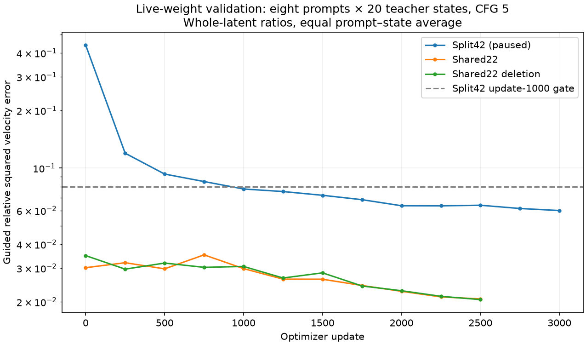
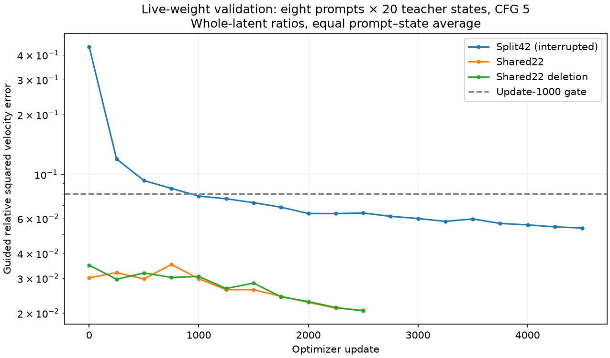
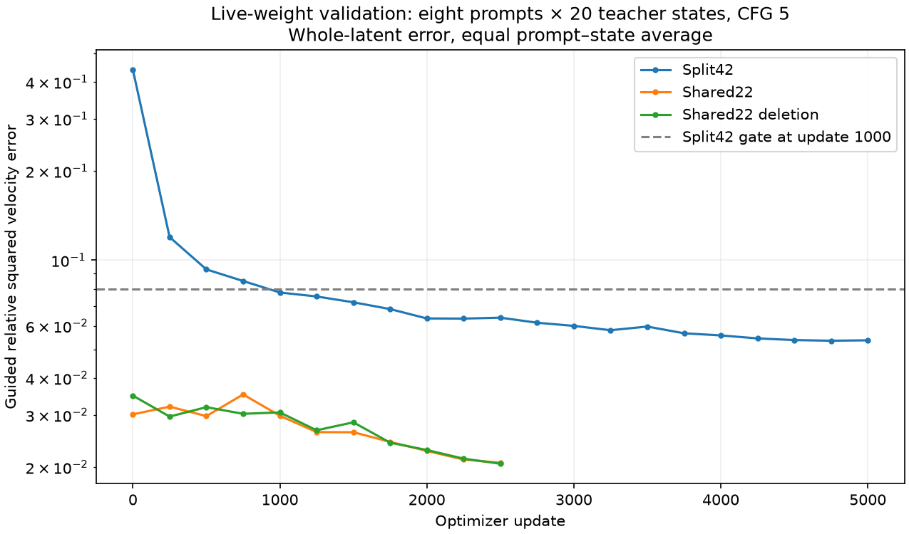
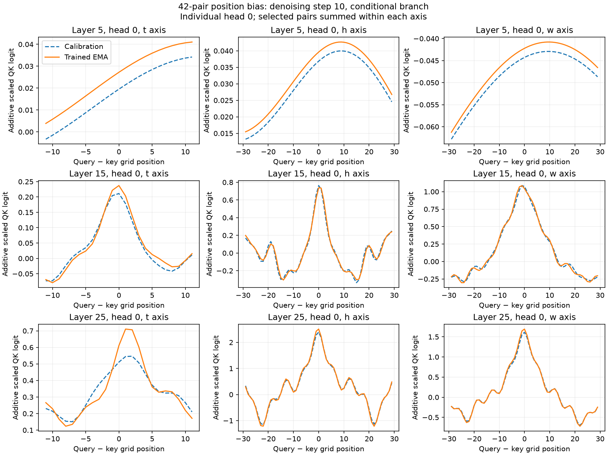
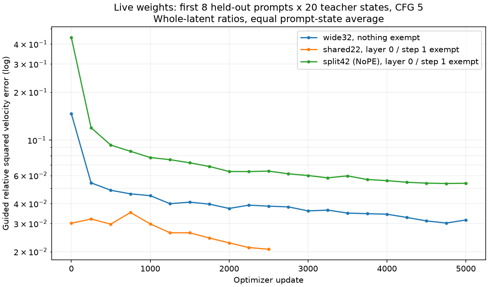
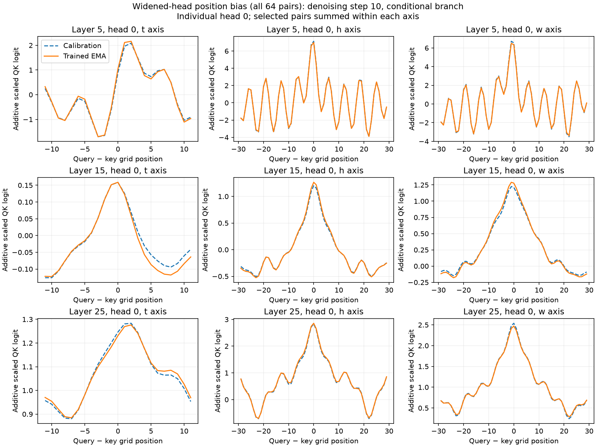
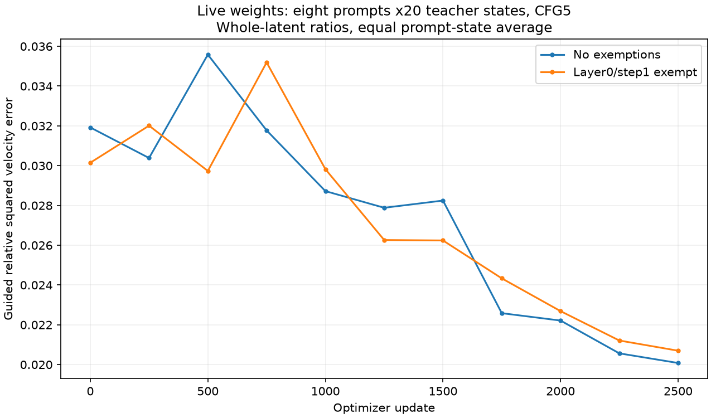
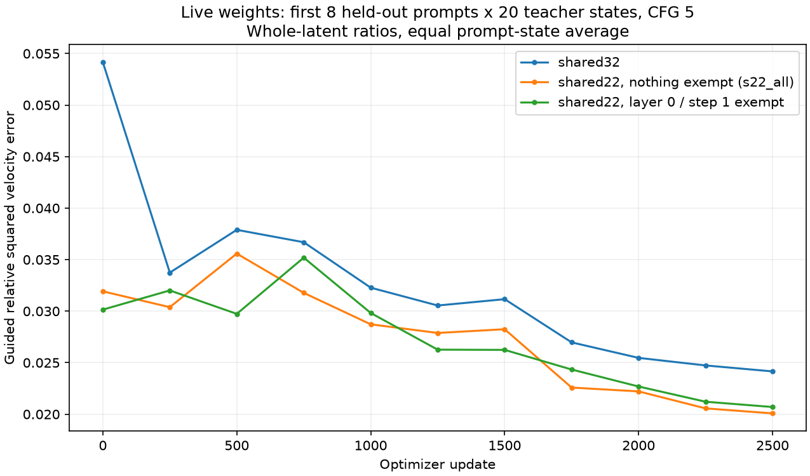
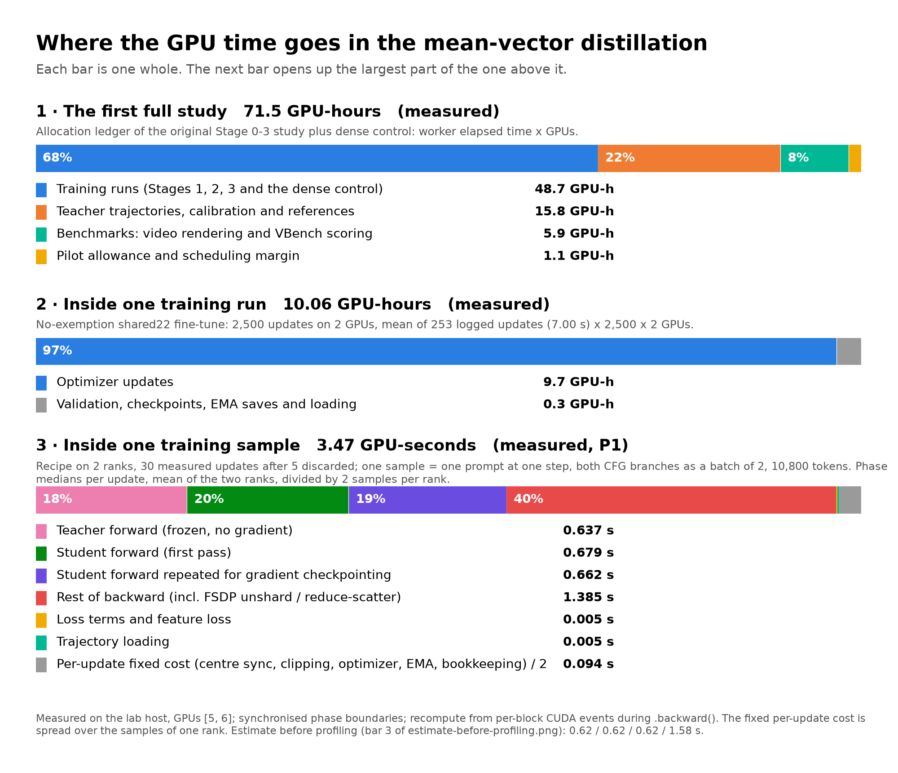

# Wan2.1 mean-vector distillation

Stage 0 captured all 3,641 teacher trajectories. Stages 1, 2 and 3 completed their 2,000, 5,000 and 5,000 updates, respectively. The dense control completed 5,000 off-policy updates. Five arms have audited results for all 100 matched prompts and seven dimensions: the frozen teacher, static means, Stage 1, final Stage 3 and dense control. The run stopped before the deletion control at the resource decision point. The approved limits were four concurrent GPUs, 72 total GPU-hours and 300 GB of incremental disk. During the final student benchmark, the user reduced the active device set to GPUs 1, 3 and 6.

## Headline benchmark — tuned shared22 on 100 matched prompts

The tuned shared22 Stage 2 EMA was evaluated on all 100 original benchmark prompts with one fixed seed per prompt. The first 30 previously audited renders, seven scores per render, and agreement records match the same EMA and generation protocol. The other 70 were generated from the checksum-verified durable EMA at `out/distill-shared22-export/student/`. Reference rows come from the audited teacher, dense, trained fixed-high Stage 3 EMA, and static fixed-high benchmarks on the same prompt and seed manifest.

Each VBench mean averages 100 per-video scores. Aesthetics and imaging use all 45 frames. Text–video consistency uses eight midpoint frames and the prompt. The other dimensions use the sampling described below. Tuned shared22 uses 22 shared normalized pre-RoPE pairs per layer, denoising step, CFG branch and head. Each selected pair has a token-independent value in both Q and K. All 100 generated videos passed the checksum and 45-frame, 480×480, 16 fps audits, with finite latents at all 20 steps and 2,204 replacement calls each. Those calls count both Q and K and both branches over 29 active layers and 19 active steps.

| Dimension | Tuned shared22 | Teacher | Dense | Trained fixed-high | Static fixed-high |
|---|---:|---:|---:|---:|---:|
| subject_consistency | 0.967490 | 0.963999 | 0.964285 | 0.958942 | 0.991220 |
| background_consistency | 0.978377 | 0.976466 | 0.977676 | 0.974867 | 0.991434 |
| motion_smoothness | 0.986384 | 0.984463 | 0.985506 | 0.985119 | 0.991962 |
| dynamic_degree | 0.280000 | 0.330000 | 0.250000 | 0.210000 | 0.000000 |
| aesthetic_quality | 0.583495 | 0.588595 | 0.578063 | 0.517914 | 0.271404 |
| imaging_quality | 0.678854 | 0.660679 | 0.670020 | 0.652749 | 0.486135 |
| overall_consistency | 0.234047 | 0.232555 | 0.234363 | 0.219662 | 0.026384 |

Differences are tuned shared22 minus the reference. The 95% percentile intervals use 10,000 paired resamples of the 100 prompt-and-seed units with NumPy seed 20261109.

| Dimension | vs. teacher | vs. dense | vs. trained fixed-high | vs. static fixed-high |
|---|---:|---:|---:|---:|
| subject_consistency | +0.00349 [-0.00316, +0.01014] | +0.00321 [-0.00105, +0.00765] | +0.00855 [+0.00371, +0.01348] | -0.02373 [-0.03218, -0.01623] |
| background_consistency | +0.00191 [-0.00177, +0.00566] | +0.00070 [-0.00207, +0.00354] | +0.00351 [+0.00116, +0.00580] | -0.01306 [-0.01754, -0.00894] |
| motion_smoothness | +0.00192 [+0.00057, +0.00333] | +0.00088 [-0.00047, +0.00244] | +0.00126 [-0.00006, +0.00277] | -0.00558 [-0.00812, -0.00340] |
| dynamic_degree | -0.05000 [-0.12000, +0.02000] | +0.03000 [-0.03000, +0.09000] | +0.07000 [-0.01000, +0.15025] | +0.28000 [+0.19000, +0.37000] |
| aesthetic_quality | -0.00510 [-0.01689, +0.00685] | +0.00543 [-0.00756, +0.01809] | +0.06558 [+0.04867, +0.08249] | +0.31209 [+0.29338, +0.33010] |
| imaging_quality | +0.01817 [+0.00011, +0.03586] | +0.00883 [-0.00737, +0.02504] | +0.02611 [+0.00732, +0.04508] | +0.19272 [+0.16839, +0.21567] |
| overall_consistency | +0.00149 [-0.00484, +0.00792] | -0.00032 [-0.00576, +0.00503] | +0.01439 [+0.00659, +0.02226] | +0.20766 [+0.19395, +0.22232] |

All seven paired intervals against dense span zero. Against the trained fixed-high student, tuned shared22 had higher aesthetics by 0.06558, imaging quality by 0.02611 and text–video consistency by 0.01439, with paired intervals above zero. Against the teacher, imaging quality and motion smoothness had paired intervals above zero. The paired aesthetic, text–video and motion-incidence intervals versus the teacher span zero.

Same-seed teacher agreement averaged final-latent L2 491.224 and relative L2 0.559077 across 100 pairs. Each L2 uses every final latent coordinate. The relative L2 divides each difference norm by its teacher norm before averaging. Mean decoded-frame PSNR was 14.194 dB over 4,500 aligned RGB frames.

Expansion to 100 prompts used 2,971 GPU-seconds (0.825 GPU-hours) on GPU 2. The report inputs, per-video selection records and agreement are in `distill-results/shared22/full100/`. Lab videos and source records are in `out/learned-center-wan-shared22-full100/` in the selection checkout.

## Question and setup

Can Wan2.1-T2V-1.3B recover video quality after replacing the high-frequency parts of self-attention Q and K with learned, token-independent vectors? Frozen teacher: `Wan-AI/Wan2.1-T2V-1.3B-Diffusers` at `0fad780a534b6463e45facd96134c9f345acfa5b`. Generation uses 45 frames at 480×480, 20 UniPC steps (flow shift 3), CFG 5 with an empty negative prompt, a bf16 transformer and a tiled fp32 VAE. Each step on each CFG branch evaluates 10,800 tokens and full native attention across all 64 rotary pairs.

The student replaces 22 pairs (44 coordinates: t 0–7, h 22–28, w 43–49) of **both** Q and K after QK-RMSNorm and before 3D RoPE. A separate 44-coordinate vector applies to every token at a fixed layer, step, CFG branch and head. The 42 other pairs and V stay content-dependent. Layer 0 and denoising step 1 are exempt. There is no attention kernel or inference speedup claim.

The manifests contain 3,641 distinct text prompts: 1,641 VBench prompts and 2,000 OpenVid captions, divided into 64 calibration, 32 validation and 3,545 additional training prompts. Rechecked normalized text uniqueness and disjointness from benchmark prompts and p00–p03; the six-arm evaluation manifest preserves every original benchmark prompt and seed. All 3,641 trajectory records passed the prompt and seed check and contain 20 entering states of shape `[16,12,60,60]`.

## Real-model pilots

The pinned lab runtime uses NVIDIA GeForce RTX 5090, driver 580.173.02, torch 2.11.0+cu128, Diffusers 0.42.1 and Transformers 5.22.2. A native SDPA probe dispatched `aten::_scaled_dot_product_flash_attention` on a synthetic `[1,12,10800,128]` bf16 dense attention input with no mask. This probe checks the dispatcher's forward kernel for the real sequence and head dimensions.

| Pilot | Measured result |
|---|---|
| Calibration captures, GPU 3 | `d0000` 21.17 s, `d0001` 23.95 s; each includes embedding, the full teacher sampler trajectory and files, without VAE decode. Each retained 20 `[16,12,60,60]` entering latents and separate Q/K `[30,20,2,12,44]` center means. |
| Held-out captures, GPU 6 | `d0064` 21.29 s, `d0065` 24.98 s, same cached-state protocol without center hooks. |
| Stage 1, one GPU, 20 optimizer steps | Median 1.57 s/step (steps 2–20, excluding initialization/checkpoints); 7.39 GiB peak PyTorch allocated, 33.2 s training loop including save. One sampled training prompt and denoise step per optimizer step, both branches; only means train. |
| Stage 2, one GPU | Ran forward/backward and failed in the first Adam state allocation. PyTorch reported 29.18 GiB allocated and 2.81 MiB device free at the failed allocation. The model and loss were kept; switched to FSDP2. |
| Stage 2, GPUs 3 and 6, 20 optimizer steps | Median 3.60 s/step (steps 2–20; excludes validation and export); 19.58/19.57 GiB peak PyTorch allocated by rank. 395.6 s training loop including validation, export and shared-filesystem checkpoint. Per step: one prompt/denoise sample per rank, both branches. |
| Stage 3, GPUs 3 and 6, 20 optimizer steps | Four full rollouts (two refreshes × two ranks), each with 20 entering latents. Peak 19.59/19.59 GiB by rank; 199.6 s elapsed including rollouts, validation and node-local save. |
| Stage 3 resume | Loaded step 20 checkpoint; resumed at optimizer step 21. Forced both rank samples to come from student rollouts for this one smoke-test update; guided relative squared error was 0.2403, the average of those two prompt/step samples, with both branches combined at CFG 5. |
| Export and decode | `WanTransformer3DModel.from_pretrained` loaded the resumed Stage 3 EMA export; `v000` with its frozen seed decoded in 15.96 s (sampler and VAE only). All 20 latents were finite. Verified MP4 hash, 45×480×480 frame shape and 2,204 replacement calls = 29 nonexempt layers × 19 nonexempt steps × 2 branches × Q/K. This is a generation smoke test, not a quality score. |

Validation uses squared velocity error over every latent coordinate, normalized by the corresponding teacher velocity energy. Each number below averages 40 cached teacher states (two held-out prompts × 20 steps); conditional and unconditional are scored separately and guided uses `u + 5(c − u)` before computing the ratio. These checkpoints come from training on only the two calibration prompts, and the validation trajectories are off-policy in both stages.

| Pilot checkpoint | Conditional | Unconditional | Guided |
|---|---:|---:|---:|
| Stage 2 step 10 | 0.09371 | 0.09440 | 0.28456 |
| Stage 2 step 20 | 0.07327 | 0.07407 | 0.21188 |
| Stage 3 step 10 | 0.10204 | 0.10247 | 0.31071 |
| Stage 3 step 20 | 0.10078 | 0.10121 | 0.30655 |

The single GPU means-only pilot predates the fix to use the specified fixed 1e-3 means LR; it used the first 20 points of the original 500-step warmup. It establishes execution and memory, not a Stage 1 gate result. The Stage 3 short run created rollouts; the normal ramp yielded zero sampled rollout states in those 20 updates. The forced resume check verifies the actual buffer-to-loss path. Neither pilot qualifies as a complete training stage or a VBench result.

## Fixes and next evidence

Stage 1 now backpropagates each independent attention loss immediately, preserving the sum without retaining 30 backward graphs. NCCL scalar reductions use CUDA tensors. FSDP leaves fp32 RoPE inputs and schedule timesteps intact, fixing the forward/recompute dtype mismatch. Validation pads distributed work without counting repeated cells, preserving all prompt-step observations. Stage 3 uses EMA for rollouts and final export, including the means. Checkpoint publication is atomic and resume preserves the per-rank data sampler. Frozen prior benchmark source, outputs and model protocol remain intact.

Stage 0 measured precision and current-mean velocity references over the 32 validation prompts, both branches and all 20 denoising steps. Stage 2 cleared its guided-error gate at step 2,500. Each benchmark comparison below uses 10,000 paired prompt resamples with NumPy seed 20261109 and measures same-seed final latent relative L2 and frame PSNR against the teacher.

During capture, two workers and the static video generator exited with status 137. The source of the kill was unconfirmed. Capture retained 236 training prompts plus all 64 calibration and 32 validation prompts. Static generation retained 33 of the planned 100 evaluation videos. Workers resumed from the last completed prompt, clearing only empty claims from exited workers.

Keeping the text encoder on GPU gave bit-for-bit identical conditional and unconditional embeddings, all 20 entering latents, and the final latent for `d0096`, `d0097`, and `d0098` with their original prompt seeds. Capture wall time per prompt, including text encoding and file writes with no video decode, was 19.18–19.34 s with offload and 12.42–12.74 s with the resident encoder. The resumed training capture uses the resident mode. Short worker invocations return to the scheduler at prompt boundaries.

## Long-run results

Calibration pooled 64 prompts. At each layer, denoising step, CFG branch and head, each prompt contributes the coordinate mean across all 10,800 normalized pre-RoPE tokens. Compare its concatenated 2D high-pair coordinates with the pool for that same cell. Medians and tenth percentiles are over prompts, all 30 layers, 20 steps, both branches and 12 heads; group boundaries are t 0–7, h 22–28 and w 43–49. Q and K are separate.

| Side | Pair group | Median cosine | P10 cosine |
|---|---|---:|---:|
| Q | t | 0.970994 | 0.875884 |
| Q | h | 0.992557 | 0.969481 |
| Q | w | 0.992834 | 0.966834 |
| K | t | 0.978754 | 0.895643 |
| K | h | 0.993214 | 0.969184 |
| K | w | 0.993446 | 0.967174 |

Temporal centers are less directionally stable across prompts than spatial centers, especially in the lower tail. This measures the direction of token averages across prompts.

Stage 0 velocity references: 32 held-out prompts × 20 entering teacher states, with one seed per prompt. Relative squared velocity error over all latent elements for one prompt, teacher entering state, denoise step and branch or guided combination. Average each step across prompts and overall equally across all prompt-step cells. High current means replace both normalized pre-RoPE Q/K on 22 high pairs across all 10800 tokens, all heads/layers, each branch/step independently, no exemptions (matches the earlier benchmark). FP32 teacher uses the same cached BF16 inputs upcast to FP32.

| Reference | Conditional | Unconditional | CFG 5 |
|---|---:|---:|---:|
| Teacher bf16 vs. fp32 | 0.000140878 | 0.0001488545 | 0.002731035 |
| Current high-pair means vs. native bf16 | 0.1008203 | 0.1012649 | 0.3499369 |

Complete teacher capture, including prompt encoding, 20 denoising steps with both CFG branches and artifact writes; excludes VAE decode. The sum is across prompt wall times and does not denote elapsed wall time when workers run concurrently.

| Split | Trajectories | Median seconds | Sum of prompt seconds |
|---|---:|---:|---:|
| calib | 64 | 21.09 | 1392.7 |
| val | 32 | 20.85 | 698.7 |
| train | 3545 | 12.48 | 48793.3 |

The completed comparison below pairs the static calibration arm with the frozen teacher. The trained arms and full six-arm evaluation are reported when their outputs are available.

VBench measures the benchmark's single video per seed and prompt. Aesthetic/imaging use all 45 frames (with their official normalizations); subject/background compare first/previous-frame embeddings over 44 transitions; motion smoothness uses AMT over 22 reconstructions; dynamic degree uses RAFT over 22 flow transitions after subsampling to 23 frames; text-video consistency uses ViCLIP on eight midpoint frames and the caption. See `handoff.md` §11 for the pinned evaluator and exact scopes.

Each comparison uses the same 100 prompt/seed units across arms, 10,000 paired prompt resamples and percentile 95% intervals (NumPy 20261109).

| Dimension | baseline | static |
|---|---:|---:|
| subject_consistency | 0.963999 | 0.991220 |
| background_consistency | 0.976466 | 0.991434 |
| motion_smoothness | 0.984463 | 0.991962 |
| dynamic_degree | 0.330000 | 0.000000 |
| aesthetic_quality | 0.588595 | 0.271404 |
| imaging_quality | 0.660679 | 0.486135 |
| overall_consistency | 0.232555 | 0.026384 |

| Dimension | Comparison | Paired mean difference | 95% CI |
|---|---|---:|---|
| subject_consistency | static_minus_baseline | +0.027221 | [+0.018944, +0.036092] |
| background_consistency | static_minus_baseline | +0.014968 | [+0.010736, +0.019253] |
| motion_smoothness | static_minus_baseline | +0.007499 | [+0.004637, +0.010788] |
| dynamic_degree | static_minus_baseline | -0.330000 | [-0.420000, -0.240000] |
| aesthetic_quality | static_minus_baseline | -0.317191 | [-0.334745, -0.299354] |
| imaging_quality | static_minus_baseline | -0.174544 | [-0.199351, -0.148707] |
| overall_consistency | static_minus_baseline | -0.206171 | [-0.220326, -0.192148] |

Same prompt and seed in each arm vs frozen baseline. L2 ratio over all final post-step latent coordinates, then average over prompts. Frame PSNR is 10log10(255^2/RGB MSE) over all channels/pixels of each aligned decoded MP4 frame; average finite dB values over all frames/prompts, count infinite identical frames separately.

| Arm | Prompt pairs | Aligned frames | Latent relative L2 | Mean finite frame PSNR (dB) | Identical frames |
|---|---:|---:|---:|---:|---:|
| static | 100 | 4500 | 1.142688 | 8.869 | 0 |

Calibration, the held-out velocity references, and trajectory capture used 15.8067 GPU-hours from observed worker launch-to-exit times, including setup, retries, and the encoder parity probe. The allocator used up to four idle devices. The workload retains 136.60 GB of trajectory data, measured across the complete capture directory.

### Stage 1 means training

The median layer-local relative squared error fell from 0.280204 to 0.218263, a 22.10% reduction against the runbook’s 20% threshold. Each layer’s error compares its complete attention output over all video tokens and output coordinates, using the same frozen teacher inputs. The comparison averages the conditional and unconditional errors over 32 held-out prompts and 19 nonexempt denoising steps, then takes the median over the 29 nonexempt layers. Layer 0 and the first step are exempt. The perturbation replaces only the selected 22 normalized pre-RoPE pairs in both Q and K.

Stage 1 ran 2,000 updates at a fixed learning rate of 0.001 on GPUs 3 and 1. Each update used two independently sampled prompt-and-step states, one per rank, with both CFG branches. Elapsed time from the worker launch through exit was 5,549 s, equivalent to 3.08 GPU-hours across both ranks. Peak PyTorch allocation was 7.39 GiB on each rank. The initial Stage 2 attempt ended after 29 s when another lab process had allocated 11.49 GiB on one of its GPUs. Stage 2 restarted from the completed Stage 1 means on idle GPUs 3 and 6. Per-layer scores, the training log samples, and the configuration are in `distill-results/stage1/`.

### Stage 2 held-out validation

At optimizer step 2,500, the guided relative squared velocity error was 0.035898, clearing the 0.174968 threshold. Validation averages ratios over 32 held-out prompts and 20 cached entering teacher states per prompt. Each ratio covers all latent velocity coordinates. The guided column combines conditional and unconditional velocities at CFG 5 before computing the ratio. `distill-results/stage2/validation.jsonl` also retains the 20 denoising-step means for each checkpoint.

| Optimizer step | Conditional | Unconditional | Guided |
|---:|---:|---:|---:|
| 250 | 0.014305 | 0.017708 | 0.054301 |
| 500 | 0.012941 | 0.012885 | 0.043466 |
| 750 | 0.014037 | 0.013656 | 0.047797 |
| 1000 | 0.012497 | 0.012011 | 0.045220 |
| 1250 | 0.010652 | 0.010337 | 0.039658 |
| 1500 | 0.010823 | 0.010566 | 0.039968 |
| 1750 | 0.010055 | 0.009906 | 0.039741 |
| 2000 | 0.010034 | 0.010003 | 0.039204 |
| 2250 | 0.009077 | 0.009055 | 0.036135 |
| 2500 | 0.008831 | 0.009028 | 0.035898 |
| 2750 | 0.008438 | 0.008743 | 0.034415 |
| 3000 | 0.007776 | 0.007680 | 0.031819 |
| 3250 | 0.007532 | 0.007311 | 0.032380 |
| 3500 | 0.007674 | 0.007778 | 0.031138 |
| 3750 | 0.006960 | 0.006908 | 0.030547 |
| 4000 | 0.006680 | 0.006483 | 0.029268 |
| 4250 | 0.006494 | 0.006181 | 0.028811 |
| 4500 | 0.006414 | 0.006166 | 0.028006 |
| 4750 | 0.006289 | 0.006056 | 0.027869 |
| 5000 | 0.006186 | 0.005931 | 0.027649 |

The Stage 2 final guided error was 0.027649 over the same 640 held-out prompt-and-step states. Training used two prompt-and-step samples per update, each with both CFG branches. The base transformer learning rate was `1e-5`, and the mean learning rate was `2e-4`. They warmed up over 500 updates and used cosine decay to 10% of their base rates. Across the successful runs before and after the gate, the two ranks used 23,661 elapsed seconds, or 13.15 GPU-hours, including validation, checkpoints and final EMA export. Peak PyTorch allocation was 19.58 GiB per rank.

### Stage 1 paired video benchmark

The means-only student and teacher each generated 100 videos with the same prompt and seed manifest. Each VBench score uses the dimension-specific frame sampling described above. The paired columns use 10,000 prompt resamples with NumPy seed 20261109. Each static and Stage 1 result uses the same frozen transformer and replaces the selected high pre-RoPE pairs in both Q and K.

| Dimension | Teacher | Stage 1 | Stage 1 − teacher [95% CI] | Stage 1 − static [95% CI] |
|---|---:|---:|---:|---:|
| subject_consistency | 0.963999 | 0.987142 | +0.023143 [+0.014815, +0.031980] | -0.004078 [-0.004653, -0.003521] |
| background_consistency | 0.976466 | 0.989032 | +0.012566 [+0.008151, +0.016980] | -0.002401 [-0.003512, -0.001311] |
| motion_smoothness | 0.984463 | 0.989720 | +0.005258 [+0.002434, +0.008548] | -0.002242 [-0.002469, -0.002031] |
| dynamic_degree | 0.330000 | 0.000000 | -0.330000 [-0.420000, -0.240000] | +0.000000 [+0.000000, +0.000000] |
| aesthetic_quality | 0.588595 | 0.271410 | -0.317185 [-0.334832, -0.299144] | +0.000006 [-0.004341, +0.004224] |
| imaging_quality | 0.660679 | 0.484571 | -0.176108 [-0.200114, -0.150651] | -0.001564 [-0.007275, +0.004107] |
| overall_consistency | 0.232555 | 0.023345 | -0.209210 [-0.223406, -0.195191] | -0.003039 [-0.005935, -0.000241] |

The mean final latent relative L2 was 1.171124 against the teacher, taking one full post-step latent ratio per prompt. Mean decoded-frame PSNR was 8.701 dB across all 4,500 matched frames from the 100 prompt-and-seed pairs, with 0 identical frames. All 200 videos passed the 45-frame, 480×480, 16 fps and checksum checks. Each Stage 1 video has 20 finite steps and 2,204 replacements across 29 active layers, 19 active denoising steps, both branches and Q and K.

The Stage 1 improvement in isolated attention output error did not carry over to restored video motion or text alignment. Dynamic degree remained zero in both means-only arms, and Stage 1 text–video consistency fell by 0.00304 versus static means. The interval for the aesthetic change spans zero. The paired scores and agreement records are in `distill-results/s1-paired/`.

### Stage 2 held-out video agreement

Seven of eight scheduled validation prompts completed before the device timeouts. For the seven completed prompt-and-seed pairs, the Stage 2 EMA student had a mean final latent relative L2 of 0.588189 over all final latent coordinates per pair. Mean decoded-frame PSNR was 13.464 dB over all 315 aligned frames. This diagnostic uses the validation split and its teacher renderings. The VBench arms use the separate 100-prompt benchmark.

### Stage 3 on-policy training

Stage 3 completed 5,000 updates on two ranks, using the Stage 2 EMA export as initialization. The loss, base learning rates, warmup and cosine schedule were the same as Stage 2. Each rollout refresh proposed 64 prompt-and-seed trajectories, each with 20 entering latents. Over 401 logged optimizer steps after step 1,000, 48.0% of the two sampled states per logged update came from student rollouts. The target still used the frozen teacher at the sampled state.

After checkpoint 2,000, the rollout split used GPUs 1 and 5 for part of two refreshes while GPUs 3 and 6 continued as training ranks. The replica test matched all 20 entering latents bit for bit on three fixed prompt-and-seed rollouts from the same Stage 2 EMA snapshot. The first split finished in 267.85 s after the export, and the second timed out at 330 s when the spare devices were contested. Both training ranks regenerated that refresh’s remaining jobs using the same prompt and seed lists. The run charged 1,340 GPU-seconds for the two spare-worker allocations.

The two trainer ranks ran roughly 9.77 hours between Stage 3 launch and final checkpoint, including rollouts, validation and restart. This is roughly 19.54 GPU-hours before the separate spare-worker charge. The resumed run used at most 19.58 GiB of PyTorch allocations per rank. The median logged optimizer step took 3.66 s, excluding time before each optimizer step such as rollout refreshes. The mean Euclidean norm of the 44 selected high-pair coordinates, averaged across all layers, denoising steps, CFG branches and heads, changed from 10.72936 to 10.72580 for Q and 11.76144 to 11.75797 for K. These are table vector norms, including exempt slots, with no token averaging at measurement time.

The table uses the same 640 held-out teacher states and CFG-5 relative squared velocity errors as Stage 2.

| Optimizer step | Conditional | Unconditional | Guided |
|---:|---:|---:|---:|
| 250 | 0.006817 | 0.006565 | 0.029448 |
| 500 | 0.010304 | 0.009766 | 0.035846 |
| 750 | 0.008976 | 0.008637 | 0.036808 |
| 1000 | 0.009967 | 0.009901 | 0.037512 |
| 1250 | 0.009617 | 0.009222 | 0.037400 |
| 1500 | 0.009435 | 0.009461 | 0.036514 |
| 1750 | 0.009647 | 0.009608 | 0.037056 |
| 2000 | 0.008668 | 0.008507 | 0.037017 |
| 2250 | 0.009690 | 0.009199 | 0.035845 |
| 2500 | 0.008514 | 0.008356 | 0.037032 |
| 2750 | 0.007459 | 0.007278 | 0.032017 |
| 3000 | 0.007650 | 0.007718 | 0.033970 |
| 3250 | 0.006815 | 0.006648 | 0.030924 |
| 3500 | 0.006885 | 0.006860 | 0.031200 |
| 3750 | 0.006556 | 0.006341 | 0.029898 |
| 4000 | 0.006435 | 0.006190 | 0.029437 |
| 4250 | 0.006202 | 0.006050 | 0.028711 |
| 4500 | 0.006131 | 0.005947 | 0.029119 |
| 4750 | 0.006097 | 0.005917 | 0.028629 |
| 5000 | 0.005997 | 0.005781 | 0.028238 |

### Final Stage 3 paired video benchmark

The teacher and Stage 3 EMA student each contributed 100 videos matched by prompt and seed, using the original 100-prompt manifest. Each score averages 100 per-video values using the metric-specific VBench frame sampling described above. The same 10,000 bootstrap samples of the 100 matched prompts, with NumPy seed 20261109, keep all arms together within each sampled prompt. The static and Stage 1 comparisons use their audited per-prompt results and the same 100 teacher video checksums. All three center-replacement arms intervene on the same 22 high pre-RoPE pairs in Q and K. The final student uses its trained transformer and learned constants.

| Dimension | Teacher | Stage 3 | Stage 3 − teacher [95% CI] | Stage 3 − static [95% CI] | Stage 3 − Stage 1 [95% CI] |
|---|---:|---:|---:|---:|---:|
| subject_consistency | 0.963999 | 0.958942 | -0.005056 [-0.011926, +0.002087] | -0.032278 [-0.041341, -0.023791] | -0.028200 [-0.037269, -0.019814] |
| background_consistency | 0.976466 | 0.974867 | -0.001599 [-0.004941, +0.001841] | -0.016566 [-0.020690, -0.012616] | -0.014165 [-0.018447, -0.010204] |
| motion_smoothness | 0.984463 | 0.985119 | +0.000657 [-0.001284, +0.002433] | -0.006843 [-0.009766, -0.004313] | -0.004601 [-0.007500, -0.002072] |
| dynamic_degree | 0.330000 | 0.210000 | -0.120000 [-0.210000, -0.030000] | +0.210000 [+0.130000, +0.290000] | +0.210000 [+0.130000, +0.290000] |
| aesthetic_quality | 0.588595 | 0.517914 | -0.070681 [-0.086809, -0.053861] | +0.246510 [+0.228104, +0.264980] | +0.246504 [+0.228028, +0.265220] |
| imaging_quality | 0.660679 | 0.652749 | -0.007931 [-0.025771, +0.010023] | +0.166614 [+0.137478, +0.193499] | +0.168177 [+0.139276, +0.195316] |
| overall_consistency | 0.232555 | 0.219662 | -0.012893 [-0.020745, -0.005342] | +0.193278 [+0.178278, +0.208606] | +0.196317 [+0.181334, +0.211642] |

The final student exceeded both static means and Stage 1 on motion incidence, aesthetics, imaging quality and text–video consistency. It scored lower than both on subject and background consistency and motion smoothness. Against the teacher, the paired intervals were below zero for motion incidence, aesthetics and text–video consistency. The four remaining intervals included zero. The contribution of on-policy training to video quality remains unresolved because Stage 2 has only the separate seven-prompt validation video diagnostic.

Across the 100 seed-matched pairs, the mean final latent relative L2 was 0.586365, taking the norm ratio across all coordinates of each final latent and then averaging over prompts. Mean decoded-frame PSNR was 13.773 dB over all 4,500 aligned frames, with zero identical frames. The video audit confirmed 45 frames, 480×480, 16 fps and matching checksums for all 200 videos. Each Stage 3 video had 20 finite denoising states and 2,204 replacement calls across 29 active layers, 19 active steps, both CFG branches and Q and K. Median student render-and-decode time was 15.71 seconds per prompt, excluding text encoding and MP4 export.

The main resumed GPU 1 worker used 4,166 seconds for rendering and VBench. The first attempt on GPU 5 used 271 seconds and saved four completed videos before a shared-host out-of-memory failure. A later GPU 5 worker saved one more video before being stopped at the user's request, after 51 seconds. Total charged accelerator time was 4,488 GPU-seconds, or 1.25 GPU-hours. The CPU finished the video audit and agreement analysis after the scorer released the GPU. Artifacts are in `distill-results/student-paired/`. The lab's prompt-level videos are under `out/learned-center-wan-student/videos/`.

### Dense control training

The dense control started from the Wan2.1 teacher checkpoint and used full Q and K with every rotary pair active, including layer 0 and the first denoising step. It ran the Stage 2 objective for 5,000 off-policy updates, using two prompt-and-step samples per optimizer update, each with both CFG branches. Its transformer learning rate was `1e-5` with 500 warmup updates and cosine decay to 10% of the base rate. The two RTX 5090 ranks ran for 22,637 elapsed seconds including setup, validation, checkpoints and EMA export, or 12.58 GPU-hours. Peak PyTorch allocation was 19.58 GiB per rank.

This curve uses the same 640 held-out teacher states and CFG-5 relative squared velocity errors as Stages 2 and 3. Every 250-update checkpoint, including its 20 per-denoise-step values, is in `distill-results/dense/validation.jsonl`.

| Optimizer step | Conditional | Unconditional | Guided |
|---:|---:|---:|---:|
| 250 | 0.003609 | 0.006080 | 0.027740 |
| 1000 | 0.006606 | 0.006540 | 0.034220 |
| 2000 | 0.004874 | 0.005090 | 0.027256 |
| 2500 | 0.003757 | 0.003967 | 0.023889 |
| 3000 | 0.002944 | 0.003052 | 0.021911 |
| 4000 | 0.002008 | 0.001898 | 0.018360 |
| 5000 | 0.001458 | 0.001334 | 0.015493 |

### Dense control paired video benchmark

Each mean covers one video per prompt on the same 100 prompt-and-seed pairs and the VBench frame sampling specified above. The direct Stage 3 comparison uses the same prompt indices, teacher video checksums and 10,000 paired prompt resamples with NumPy seed 20261109.

| Dimension | Teacher | Dense | Dense − teacher [95% CI] | Stage 3 − dense [95% CI] |
|---|---:|---:|---:|---:|
| subject_consistency | 0.963999 | 0.964285 | +0.000286 [-0.004789, +0.005414] | -0.005342 [-0.010979, +0.000146] |
| background_consistency | 0.976466 | 0.977676 | +0.001210 [-0.001541, +0.004178] | -0.002808 [-0.005425, -0.000076] |
| motion_smoothness | 0.984463 | 0.985506 | +0.001043 [-0.000675, +0.002753] | -0.000386 [-0.001586, +0.000865] |
| dynamic_degree | 0.330000 | 0.250000 | -0.080000 [-0.150000, -0.020000] | -0.040000 [-0.120000, +0.040000] |
| aesthetic_quality | 0.588595 | 0.578063 | -0.010532 [-0.022586, +0.001557] | -0.060149 [-0.075305, -0.044672] |
| imaging_quality | 0.660679 | 0.670020 | +0.009341 [-0.007529, +0.026302] | -0.017272 [-0.034703, -0.000962] |
| overall_consistency | 0.232555 | 0.234363 | +0.001808 [-0.005027, +0.008694] | -0.014701 [-0.023318, -0.006229] |

Stage 3 trailed dense in background consistency, aesthetics, imaging quality and text–video consistency with paired intervals below zero. The other three intervals spanned zero. Dense and Stage 3 both registered less motion than the teacher, with paired intervals below zero for motion incidence. The dense-control and Stage 3 training histories differ in Q/K coverage, initialization and on-policy sampling, so this comparison measures the complete recipes.

Dense mean final latent relative L2 was 0.566338 across the 100 teacher pairs, using all final latent coordinates per pair. It achieved 14.202 dB mean PSNR across all 4,500 temporally aligned decoded frames, with zero identical frames. The audit verified 45 frames at 480×480 and 16 fps plus matching checksums for all 200 videos. Each dense video had 20 finite denoising steps and zero Q/K replacements. Rendering and all seven VBench dimensions used 3,978 GPU-seconds (1.11 GPU-hours) on GPU 3. The summary, direct paired intervals and agreement are in `distill-results/dense-paired/`. The lab videos are under `out/learned-center-wan-dense/videos/`.

### Resource stop and remaining control

The conservative allocation ledger totals 257,395 GPU-seconds (71.50 GPU-hours) through the dense paired benchmark. It charges worker elapsed time per allocated device, including retries, an hour reserved for early pilots and a timing margin. Calibration, references and trajectory capture account for 56,905 GPU-seconds. The total leaves about 0.50 approved GPU-hours. The lab scratch and pilot directories occupied 260.07 GB at the final check. The driver's deletion preflight projected roughly 49 GB of additional checkpoint and export headroom, so it stopped before allocating devices. A 5,000-update deletion run and 100-prompt VBench comparison are estimated to take about 14 GPU-hours based on the dense control's measured allocation. The claim that learned replacement beats deletion remains untested. Full EMA exports, validation curves and the completed paired benchmark outputs were preserved.

| Allocation | GPU-seconds charged |
|---|---:|
| Calibration, references and capture | 56,905 |
| Stage 1 training | 11,098 |
| Stage 2 training and early restart | 47,380 |
| Stage 3 training, restart and spare rollout workers | 71,648 |
| Dense training | 45,274 |
| Static benchmark | 4,787 |
| Stage 1 benchmark | 7,264 |
| Stage 3 benchmark | 4,488 |
| Dense benchmark | 3,978 |
| Stage 2 held-out videos and timeout grace | 721 |
| Stage 3 rollout parity probe | 72 |
| Early pilot allowance and scheduling margin | 3,780 |
| Total | 257,395 |

## Narrow and deletion controls

Narrow uses the dense control’s 5,000-update Stage 2 loss, optimizer and sampling recipe, with teacher initialization and two ranks. It trains on cached teacher states throughout. The Stage 3 student also trained on its own rollouts, so the comparison with narrow includes a training-history difference. The requested shared22 deletion control supersedes the original fixed-high deletion experiment. It uses the tuned shared22 masks and 2,500-update recipe.

Narrow zeroes the 44 coordinates of the selected 22 rotary pairs per head in each token's Q and K projection output before native QK-RMSNorm and RoPE. It applies to all 20 denoising steps in 29 of 30 self-attention layers, with layer 0 exempt. Across the 12 heads, 528 of the 1,536 Q and K outputs are masked in each active layer. The effective removal is 1,623,072 projection weight and bias parameters per active layer, or 47,069,088 across 29 layers, from `2 × 528 × (1,536 + 1)` per layer. The implementation masks the rows' outputs and still stores the dense matrices.

Native Wan RMSNorm takes its mean square across all 1,536 features for one token and projection. Under narrow, only 1,008 live features contribute to the numerator, corresponding to 84 per head, while the denominator remains 1,536. Shared22 deletion zeroes the tuned shared22 pair selection after RMSNorm, so all projected features contribute to the norm statistic. It retains the first-step exemption. Comparing shared22 deletion with narrow would combine changes in the masks, training recipe, norm statistic and first-step coverage.

On CPU, the narrow hooks matched the manual zero-padded RMSNorm calculation on a tiny Wan model. The same test checked exact zero Q/K projection outputs and exact zero gradients in the masked Q/K weight and bias rows, nonzero gradients in kept rows, the layer-0 exemption, and masking with no step or branch context. The existing learned-center tests also passed on the pinned lab runtime.

### Narrow training and continuation

Narrow resumed its update-4,000 optimizer, sampler and EMA checkpoint under code `f51d494`, then completed update 5,000 on two idle RTX 5090s (4 and 2). The continuation took 4,776 wall seconds on two ranks, or 9,552 GPU-seconds (2.653 GPU-hours). Median optimizer-update time was 3.529 s across 101 logged updates in the continuation, averaging the two ranks for each logged update and excluding validation and saving. Peak PyTorch allocation was 19.578 and 19.575 GiB by rank.

Validation measures each branch's squared velocity error normalized by teacher velocity energy over every latent coordinate. Guided error applies CFG 5 to both the teacher and narrow branch predictions before taking the ratio. Each row averages 640 equal-weight cached states (32 held-out prompts × 20 denoising steps) evaluated with the current training weights.

| Update | Conditional | Unconditional | Guided |
|---|---:|---:|---:|
| 4,000 | 0.027696 | 0.026974 | 0.059094 |
| 4,250 | 0.027204 | 0.026351 | 0.058749 |
| 4,500 | 0.026786 | 0.026006 | 0.057795 |
| 4,750 | 0.026692 | 0.025937 | 0.057508 |
| 5,000 | 0.026277 | 0.025496 | 0.057076 |

The untouched validation log in `distill-results/narrow/` records both update-2,750 evaluations around an earlier resume. The final EMA was copied to the lab's durable selection checkout at `out/distill-narrow-export/student/` and matched by SHA-256.

### Narrow benchmark on 100 matched prompts

The update-5,000 EMA completed all 100 original prompts with their fixed seeds. Each narrow video passed the MP4 checksum and 45-frame, 480×480, 16 fps checks, recorded finite latents at all 20 steps, and made 2,320 intervention calls across 29 layers, 20 steps, both branches, and Q and K. The pinned VBench scorer evaluated all seven dimensions over the 100 narrow videos and reused audited teacher rows. The Stage 3 and dense scores also come from their audited runs on the same prompts and seeds. Aesthetics and imaging use all 45 frames per video. Text–video consistency uses eight midpoint frames and the prompt. The general VBench setup above describes the sampling for the other dimensions.

| Dimension | Narrow | Teacher | Trained fixed-high Stage 3 | Dense |
|---|:---:|:---:|:---:|:---:|
| subject_consistency | 0.939386 | 0.963999 | 0.958942 | 0.964285 |
| background_consistency | 0.971719 | 0.976466 | 0.974867 | 0.977676 |
| motion_smoothness | 0.985804 | 0.984463 | 0.985119 | 0.985506 |
| dynamic_degree | 0.060000 | 0.330000 | 0.210000 | 0.250000 |
| aesthetic_quality | 0.309547 | 0.588595 | 0.517914 | 0.578063 |
| imaging_quality | 0.540361 | 0.660679 | 0.652749 | 0.670020 |
| overall_consistency | 0.102609 | 0.232555 | 0.219662 | 0.234363 |

Differences are narrow minus the reference. The 95% percentile intervals use 10,000 paired resamples of the 100 prompt-and-seed units, with NumPy seed 20261109.

| Dimension | vs. teacher | vs. trained fixed-high Stage 3 | vs. dense |
|---|:---:|:---:|:---:|
| subject_consistency | -0.02461 [-0.03256, -0.01610] | -0.01956 [-0.02518, -0.01390] | -0.02490 [-0.03189, -0.01765] |
| background_consistency | -0.00475 [-0.00854, -0.00088] | -0.00315 [-0.00613, -0.00014] | -0.00596 [-0.00907, -0.00280] |
| motion_smoothness | +0.00134 [-0.00071, +0.00341] | +0.00068 [-0.00058, +0.00214] | +0.00030 [-0.00125, +0.00222] |
| dynamic_degree | -0.27000 [-0.37000, -0.18000] | -0.15000 [-0.22000, -0.08000] | -0.19000 [-0.28000, -0.11000] |
| aesthetic_quality | -0.27905 [-0.29621, -0.26161] | -0.20837 [-0.22608, -0.19123] | -0.26852 [-0.28613, -0.25063] |
| imaging_quality | -0.12032 [-0.14399, -0.09547] | -0.11239 [-0.13395, -0.09053] | -0.12966 [-0.15336, -0.10550] |
| overall_consistency | -0.12995 [-0.14258, -0.11756] | -0.11705 [-0.13002, -0.10437] | -0.13175 [-0.14393, -0.11989] |

Narrow scored below the teacher, trained fixed-high Stage 3 and dense on six of seven dimensions. Motion smoothness intervals span zero in all three comparisons. Against trained fixed-high, the gaps on the three quality measures were 0.20837 in aesthetics, 0.11239 in imaging, and 0.11705 in text–video consistency. The large deficit from removing the same fixed-high pairs before RMSNorm supports a benefit from the fixed-high student design. Mean replacement, norm statistics, first-step coverage and the Stage 3 rollout schedule all differ in this comparison. The shared22 deletion arm is the matched test of substituting means versus zeros after RMSNorm.

Same-seed teacher agreement averaged absolute final-latent L2 627.957 and relative L2 0.715557 over 100 pairs, using every coordinate and the teacher norm as the relative denominator per prompt. Mean PSNR was 12.295 dB over all 4,500 aligned decoded RGB frames. The benchmark used 3,572 GPU-seconds (0.992 GPU-hours). It retained 90 renders after the initial 2,553 GPU-seconds, then used 1,019 GPU-seconds on GPU 5 after approval to render the final ten and score all 100. The benchmark and last 1,000 training updates used 13,124 GPU-seconds combined (3.646 GPU-hours). The reported summaries and per-prompt results are in `distill-results/narrow-paired/`. Lab renders and records are in `out/learned-center-wan-narrow-full100/` in the selection checkout.

### Shared22 deletion control

Shared22 deletion initialized from teacher weights and followed the tuned shared22 Stage 2 recipe for 2,500 updates. It used two ranks and two microbatches per rank, sampling four cached teacher prompt-and-step states per optimizer update with the same seed. The Q and K masks matched the tuned EMA and the original shared selection exactly across 14,400 layer–step–branch–head cells. At each of the 13,224 active cells, it zeroes both coordinates of the same 22 rotary pairs in both Q and K for every video token, after full native RMSNorm and before RoPE. Layer 0 and denoising step 1 are exempt.

Each validation row averages relative squared velocity error over all latent coordinates at 20 cached teacher entering states for each of the same eight held-out prompts. Conditional and unconditional use their own teacher velocities. Guided error combines both branches at CFG 5 before computing the ratio. The table evaluates the current weights at each update.

| Update | Deletion conditional | Deletion unconditional | Deletion guided | Learned means guided |
|---|---:|---:|---:|---:|
| 0 | 0.008363 | 0.008205 | 0.034872 | 0.030147 |
| 250 | 0.004563 | 0.004953 | 0.029633 | 0.032010 |
| 500 | 0.005117 | 0.005920 | 0.031879 | 0.029735 |
| 750 | 0.004833 | 0.005077 | 0.030278 | 0.035191 |
| 1,000 | 0.004947 | 0.005638 | 0.030603 | 0.029822 |
| 1,250 | 0.003663 | 0.003494 | 0.026632 | 0.026262 |
| 1,500 | 0.003750 | 0.003973 | 0.028333 | 0.026239 |
| 1,750 | 0.003231 | 0.002826 | 0.024191 | 0.024334 |
| 2,000 | 0.002735 | 0.002417 | 0.022847 | 0.022687 |
| 2,250 | 0.002457 | 0.002216 | 0.021362 | 0.021209 |
| 2,500 | 0.002348 | 0.002138 | 0.020530 | 0.020696 |

Deletion completed in one run on GPUs 2 and 0 with finite logged losses. The median update time was 6.943 s across 251 logged optimizer updates, averaging two rank timings for each update and excluding evaluation and saves. Peak PyTorch allocation was 21.507 and 21.504 GiB by rank. Training used 36,712 GPU-seconds (10.198 GPU-hours). The final EMA and four intermediate 500-update EMA exports are in `out/distill-shared22-delete/` in the durable selection checkout. The training args, histories, mask audit and final EMA SHA-256 manifest are in `distill-results/shared22-delete/`.

### Shared22 deletion benchmark on 100 matched prompts

Each of the 100 deletion videos used the original fixed seed for its prompt, recorded finite latents at all 20 steps and passed the MP4 checksum and 45-frame, 480×480, 16 fps audits. All made 2,204 intervention calls across 29 active layers, 19 active steps, both CFG branches, and Q and K. Audited teacher, tuned shared22 and dense scores use the same prompt and seed manifest and pinned evaluator. Each VBench mean averages 100 per-video scores. Aesthetics and imaging use all 45 frames, and text–video consistency uses eight midpoint frames and the prompt.

| Dimension | Shared22 deletion | Teacher | Tuned shared22 | Dense |
|---|:---:|:---:|:---:|:---:|
| subject_consistency | 0.966353 | 0.963999 | 0.967490 | 0.964285 |
| background_consistency | 0.978334 | 0.976466 | 0.978377 | 0.977676 |
| motion_smoothness | 0.986335 | 0.984463 | 0.986384 | 0.985506 |
| dynamic_degree | 0.270000 | 0.330000 | 0.280000 | 0.250000 |
| aesthetic_quality | 0.577787 | 0.588595 | 0.583495 | 0.578063 |
| imaging_quality | 0.680191 | 0.660679 | 0.678854 | 0.670020 |
| overall_consistency | 0.234605 | 0.232555 | 0.234047 | 0.234363 |

The differences below are deletion minus the reference. Each 95% interval uses 10,000 paired prompt resamples of the 100 prompt-and-seed units, with NumPy seed 20261109.

| Dimension | vs. teacher | vs. tuned shared22 | vs. dense |
|---|:---:|:---:|:---:|
| subject_consistency | +0.00235 [-0.00438, +0.00845] | -0.00114 [-0.00494, +0.00223] | +0.00207 [-0.00262, +0.00670] |
| background_consistency | +0.00187 [-0.00154, +0.00534] | -0.00004 [-0.00243, +0.00236] | +0.00066 [-0.00168, +0.00301] |
| motion_smoothness | +0.00187 [+0.00048, +0.00337] | -0.00005 [-0.00057, +0.00048] | +0.00083 [-0.00050, +0.00246] |
| dynamic_degree | -0.06000 [-0.13000, +0.01000] | -0.01000 [-0.07000, +0.05000] | +0.02000 [-0.04000, +0.08000] |
| aesthetic_quality | -0.01081 [-0.02346, +0.00174] | -0.00571 [-0.01637, +0.00459] | -0.00028 [-0.01189, +0.01145] |
| imaging_quality | +0.01951 [+0.00229, +0.03680] | +0.00134 [-0.00870, +0.01113] | +0.01017 [-0.00286, +0.02310] |
| overall_consistency | +0.00205 [-0.00420, +0.00836] | +0.00056 [-0.00378, +0.00496] | +0.00024 [-0.00464, +0.00521] |

All seven intervals versus tuned shared22 and all seven versus dense span zero. Against tuned shared22, average aesthetics was 0.00571 lower with an interval from −0.01637 to +0.00459. Imaging and text–video means differed by +0.00134 and +0.00056, respectively. The matched experiment finds no detectable gain from learned means over post-RMSNorm zeroing of these shared pairs after fine-tuning. The result applies to the shared mask, exemptions, Stage 2 procedure and benchmark above. Against the teacher, deletion’s imaging quality and motion smoothness intervals were above zero.

Same-seed teacher agreement averaged absolute final-latent L2 502.669 and relative L2 0.571827 over 100 matched pairs, each using every final latent coordinate. Relative L2 divides each difference norm by the teacher norm before averaging. Mean PSNR was 14.006 dB over 4,500 aligned decoded RGB frames. Benchmarking used 3,328 GPU-seconds (0.924 GPU-hours), for 40,040 GPU-seconds (11.122 GPU-hours) including training. This used 440 GPU-seconds of the approved additional benchmark allowance. Per-prompt results, comparisons and agreement are in `distill-results/shared22-delete/full100/`. Videos and generation records are in `out/learned-center-wan-shared22_delete-full100/` in the selection checkout.

## Per-pair selection study

### A. Calibration and selection

The frozen bf16 Wan2.1 teacher replayed all 20 cached entering states for each of 64 calibration prompts, with both CFG branches. For each prompt, layer, denoising step, branch, head, and Q or K side, the collector measured normalized pre-RoPE pair means and energies across all 10,800 video tokens. The masks span all 14,400 layer–step–branch–head cells (30 layers × 20 steps × 2 branches × 12 heads). These statistics include layer 0 and step 1.

For a cell, side, and rotary pair, the pooled static mean `mu_f` is the average of the 64 prompt-level token means. For each prompt, `err_pool_p,f` is the average squared L2 distance of its token pairs to `mu_f`. The damage score is the prompt-average of this error multiplied by the partner side’s prompt-average pair energy. This product is the proxy for expected squared logit perturbation before common scaling. Fixed high selects the original 22 high-frequency pairs on each side. Separate selects the 22 lowest-damage pairs independently on Q and K in every cell. Shared selects the 22 lowest sums of Q and K damage and uses those pairs on both sides.

Cross-prompt stability compares the own-mean selection or damage ranking for one prompt and cell with the pooled selection or ranking in that cell. Jaccard compares the chosen 22-pair sets. Spearman ranks all 64 rotary pairs. The median and 10th percentile each summarize 921,600 prompt–cell comparisons per side.

| Side | Jaccard median | Jaccard p10 | Damage Spearman median | Damage Spearman p10 |
|---|---:|---:|---:|---:|
| Q | 0.760 | 0.571 | 0.927 | 0.823 |
| K | 0.760 | 0.571 | 0.931 | 0.825 |

The 0.76 median Jaccard on both sides is between the brief’s 0.5 input-dependence threshold and its 0.8 strong-stability threshold. Pooled damage captures much of the prompt-level ordering, and selected sets still vary across prompts.

Separate retains 40.76% of fixed-high Q selections and 42.27% of fixed-high K selections, counted across all cells. The composition below is the share of each variant and side’s 22 selections per cell, pooled over all cells. Axis entries show high, middle, and low frequency thirds in that order.

| Selection | Temporal H/M/L | Height H/M/L | Width H/M/L |
|---|---|---|---|
| Separate Q | 18.65% / 10.48% / 7.59% | 10.07% / 10.46% / 7.76% | 12.05% / 15.01% / 7.95% |
| Separate K | 19.37% / 10.24% / 7.34% | 10.45% / 10.37% / 7.61% | 12.45% / 14.72% / 7.45% |
| Shared, each side | 18.94% / 10.50% / 7.49% | 9.86% / 10.65% / 7.62% | 12.11% / 15.15% / 7.67% |

Each total damage sums the score over all selected Q and K pairs and all 14,400 cells, including the cells exempted at inference. For separate Q and K individually, this sum is 0.112% and 6.92% of the corresponding fixed-high sum, respectively.

| Selection | Summed Q + K damage | Fraction of fixed high |
|---|---:|---:|
| fixed_high | 590,506,173 | 100.000% |
| separate | 1,294,064 | 0.219% |
| shared | 1,361,080 | 0.230% |

The RMS concentration is `||mu_f|| / sqrt(mean_p E_p ||x_f||²)` for one pair and cell. Values below average those ratios over all pairs in the indicated subset and all cells, separately per side. Low damage in this study does not require a high concentration because partner energy also enters the score.

| Side | Separate selected | Separate unselected | Fixed high selected |
|---|---:|---:|---:|
| Q | 0.4816 | 0.5648 | 0.7244 |
| K | 0.4886 | 0.5362 | 0.7392 |

Separate Q and K share an average of 17.57 selected pairs per cell out of 22 on each side. The median, 10th percentile, and 90th percentile over all cells are 18, 14, and 20 pairs. A one-sided replacement still requires a dot product. Only the shared pairs are position-only, and no inference speed was measured.

Each layer ratio divides the total fixed-high Q + K damage by the total separate damage for that layer, summed over every denoising step, CFG branch, head, and selected pair. The intersection column averages the number of shared pairs per cell over the same steps, branches, and heads.

| Layer | Fixed high / separate damage | Q–K intersection, mean pairs |
|---|---:|---:|
| 0 | 1,134.973 | 21.07 |
| 1 | 23.638 | 19.01 |
| 2 | 30.711 | 18.40 |
| 3 | 7.757 | 16.62 |
| 4 | 7.308 | 17.00 |
| 5 | 36.647 | 16.97 |
| 6 | 3.208 | 17.70 |
| 7 | 5.745 | 17.31 |
| 8 | 13.769 | 17.06 |
| 9 | 9.562 | 16.14 |
| 10 | 2.281 | 16.95 |
| 11 | 5.299 | 17.56 |
| 12 | 6.416 | 17.44 |
| 13 | 2.872 | 18.37 |
| 14 | 4.289 | 17.89 |
| 15 | 3.252 | 18.99 |
| 16 | 2.742 | 17.16 |
| 17 | 7.771 | 17.15 |
| 18 | 2.376 | 18.01 |
| 19 | 5.783 | 16.95 |
| 20 | 17.170 | 17.71 |
| 21 | 12.088 | 16.49 |
| 22 | 2.376 | 17.36 |
| 23 | 4.421 | 18.06 |
| 24 | 3.456 | 16.62 |
| 25 | 2.618 | 17.43 |
| 26 | 6.124 | 16.12 |
| 27 | 101.188 | 17.21 |
| 28 | 60,783.206 | 18.56 |
| 29 | 9,932.877 | 17.86 |

Collection on one RTX 5090 used 986 GPU-seconds (0.274 GPU-hours), including model loading and all 64 prompt files. CPU selection verified that every Q and K mask picks exactly 22 pairs in every cell and that all 64 statistics records completed. Lab artifacts are under `out/distill-pair-stats/` and `out/distill-selection/` in the selection checkout. The tracked numeric artifact is `distill-results/selection/selection-report.json`.

### B. Training-free velocity screen

Each value is the mean over 32 held-out prompts and all 20 cached teacher entering states per prompt. The error at one state is the squared L2 velocity difference divided by the reference velocity energy, using every latent coordinate. For guided error, conditional and unconditional predictions are combined at CFG 5 before computing the ratio. The frozen bf16 teacher is the reference for the static-mean and deletion arms. The selected 22 pairs per side are replaced in normalized pre-RoPE Q and K for every token. This six-arm screen exempts layer 0 and step 1.

| Selection / mode | Conditional | Unconditional | Guided CFG 5 |
|---|---:|---:|---:|
| fixed_high/mean | 0.099291 | 0.098567 | 0.283408 |
| fixed_high/delete | 0.308276 | 0.307376 | 0.414549 |
| separate/mean | 0.010352 | 0.010486 | 0.036740 |
| separate/delete | 0.015286 | 0.014815 | 0.051309 |
| shared/mean | 0.006686 | 0.006748 | 0.032195 |
| shared/delete | 0.009840 | 0.009837 | 0.037419 |

The gate passes. Separate and shared pooled means reduce guided error by 7.71× and 8.80×, respectively, relative to fixed-high pooled means on the 640 states. Shared has the lowest guided error and is the first comparison arm for Stage C.

With a mask held fixed, mean minus deletion in guided error was −0.01457 for separate (95% CI −0.01858 to −0.01134) and −0.00522 for shared (−0.00649 to −0.00413). Each interval resamples 32 matched prompts 10,000 times with NumPy seed 20261109, retaining all 20 states of each sampled prompt. The pooled means improve velocity matching relative to zeros in this training-free screen. The result measures the frozen model on cached states.

The second replay applies the same hooks in all 30 layers and all 20 steps. The Stage 0 current-mean reference recomputes the 22 fixed-high pair means per prompt, state, layer, branch and head from the tokens in that forward. The precision reference compares the dense native bf16 and fp32 teacher velocities. All rows use the same 640 held-out prompt–state cells.

| All-layer, all-step condition | Conditional | Unconditional | Guided CFG 5 |
|---|---:|---:|---:|
| Native teacher bf16 vs. fp32 | 0.000141 | 0.000149 | 0.002731 |
| Fixed-high current-token means vs. native bf16 | 0.100820 | 0.101265 | 0.349937 |
| Fixed-high pooled means vs. native bf16 | 0.132161 | 0.132640 | 0.398662 |
| Separate pooled means vs. native bf16 | 0.010646 | 0.010964 | 0.040984 |

Stage B used 3,072 GPU-seconds for the six-arm screen and 1,288 GPU-seconds for the all-layer, all-step replay on GPU 4. A+B used 5,346 GPU-seconds (1.485 GPU-hours), including model loads. Both runs finished all required prompts and steps without lingering claims. The complete scores, per-step means, scopes and arm manifests are committed under `distill-results/selection/`.

### Shared 22-pair short training

The single shared-mask run used commit `1550308`, two RTX 5090 ranks on GPUs 4 and 2, and teacher initialization. It completed 500 off-policy updates with learning rate 3e-5, a 50-update warmup, no feature loss, and the shared 22-pair mask on both Q and K. Each update used two sampled teacher prompt–state items, one per rank and both CFG branches per item. The run completed in one launch with finite losses and saved both the final EMA export and a resumable optimizer checkpoint.

From launch through exit, the run took 2,026 seconds across the two GPUs (4,052 GPU-seconds, 1.126 GPU-hours). The median logged optimizer step took 3.566 seconds across the 50 logged steps from updates 10 through 500, excluding held-out validation and checkpoint writes. Peak PyTorch-allocated memory was 19.013 GiB on rank 0 and 19.010 GiB on rank 1.

The table reports guided relative squared velocity error over all latent coordinates at each cached teacher entering state, after combining both CFG branches at guidance 5. Every prompt contributes its 20 entering states. The short-run validation uses the live weights and the first 8 held-out prompts, d0064–d0071. The historical comparisons shown with 32 prompts average over the full validation set.

| Condition | Held-out prompts | Guided error |
|---|---:|---:|
| Shared short training, update 250 | 8 | 0.057455 |
| Shared short training, update 500 | 8 | 0.035533 |
| Shared pooled means, frozen teacher weights, matched subset | 8 | 0.029888 |
| Shared pooled means, frozen teacher weights, full screen | 32 | 0.032195 |
| Fixed-high Stage 2, update 5,000 | 32 | 0.027649 |
| Dense Stage 2, update 5,000 | 32 | 0.015493 |
| Native teacher bf16 vs. fp32 | 32 | 0.002731 |

The guided error fell by 38.2% from update 250 to 500 on the eight-prompt set. At update 500, error was +0.005645 above the training-free result on those same prompts and states. This run has no update-zero validation through the trainer, so the exact source of the gap remains unresolved.

To measure mean-vector drift from initialization to update 500, the calculation takes one Euclidean norm over the 44 selected coordinates per active layer, step, branch and head. It averages over 29 layers × 19 steps × 2 branches × 12 heads for each side, using the final live center checkpoint. The vectors are token-independent.

| Side | Initial selected norm | Update-500 selected norm | Mean change |
|---|---:|---:|---:|
| Q | 3.65641945 | 3.65638529 | -0.00003416 |
| K | 3.32870444 | 3.32869009 | -0.00001435 |

The logged whole-table norms include all 128 coordinates and the exempt cells. From the first logged update to update 500, Q moved from 12.271144 to 12.271112 and K from 12.714284 to 12.714255. The requested arguments, history and validation curves are in `distill-results/fast-shared22/`. The lab EMA and optimizer state are under `out/distill-fast-shared22/` in the selection checkout. The work stopped after reporting the requested short run.

### Training-free shared22 and shared32 video benchmark

Both shared arms used the frozen Wan2.1 teacher transformer and pooled static means, evaluated on the first 30 prompts in the benchmark manifest with one original seed per prompt. For each layer, denoising step, CFG branch, head and side, each pair mean pools all 10,800 video tokens within each of 64 calibration prompts and then averages the prompt means. Shared22 and shared32 rank pairs by summed Q and K damage, select 22 or 32 pairs respectively, and use the same selected pairs on both sides of each cell. The constant replacement is after QK-RMSNorm and before RoPE.

Each of the 60 generated videos passed the checksum, finite-latent and frame audit at 45 frames, 480×480 and 16 fps. Every new video recorded 2,204 interventions, matching 29 active self-attention layers × 19 active denoising steps × two CFG branches × two sides. Each video’s selection block records equal Q, K and Q–K intersection counts of 22 or 32 pairs per cell, averaged over the full mask tables. Layer 0 and denoising step 1 are exempt from replacement. The audited selection blocks are in `distill-results/static-shared30/selection-records.json`.

Each VBench mean uses one video per prompt and that dimension’s frame sampling specified above. Teacher, trained fixed-high (the final 5,000-update Stage 3 EMA), dense Stage 2, and static fixed-high scores are the audited per-prompt values from their existing 100-prompt benchmarks, restricted to the same first 30 prompt-and-seed pairs. Each difference is candidate minus reference and uses 10,000 paired prompt resamples with NumPy seed 20261109. Differences below about 0.02 in aesthetics are not resolvable with this 30-prompt screen.

| Dimension | Teacher | Trained fixed-high | Dense | Static fixed-high | Shared22 | Shared32 |
|---|---:|---:|---:|---:|---:|---:|
| subject_consistency | 0.961865 | 0.947142 | 0.962550 | 0.991295 | 0.952154 | 0.942813 |
| background_consistency | 0.976412 | 0.969787 | 0.976944 | 0.991485 | 0.971805 | 0.969995 |
| motion_smoothness | 0.982059 | 0.981423 | 0.982006 | 0.991790 | 0.985126 | 0.987243 |
| dynamic_degree | 0.333333 | 0.333333 | 0.200000 | 0.000000 | 0.200000 | 0.066667 |
| aesthetic_quality | 0.580512 | 0.517949 | 0.568441 | 0.267319 | 0.539369 | 0.398174 |
| imaging_quality | 0.662574 | 0.639815 | 0.658788 | 0.485986 | 0.615462 | 0.414821 |
| overall_consistency | 0.228075 | 0.225531 | 0.234424 | 0.030281 | 0.227472 | 0.172105 |

**Shared22 paired differences with 95% intervals**

| Dimension | vs. teacher | vs. trained fixed-high | vs. dense | vs. static fixed-high |
|---|---:|---:|---:|---:|
| subject_consistency | -0.00971 [-0.01991, -0.00029] | +0.00501 [-0.01067, +0.02100] | -0.01040 [-0.02455, +0.00182] | -0.03914 [-0.06232, -0.01959] |
| background_consistency | -0.00461 [-0.00998, +0.00014] | +0.00202 [-0.00556, +0.00943] | -0.00514 [-0.01210, +0.00146] | -0.01968 [-0.03003, -0.01083] |
| motion_smoothness | +0.00307 [-0.00110, +0.00824] | +0.00370 [-0.00103, +0.01012] | +0.00312 [-0.00202, +0.00959] | -0.00666 [-0.01046, -0.00334] |
| dynamic_degree | -0.13333 [-0.26667, -0.03333] | -0.13333 [-0.30000, +0.03333] | +0.00000 [-0.13333, +0.13333] | +0.20000 [+0.06667, +0.36667] |
| aesthetic_quality | -0.04114 [-0.07217, -0.01192] | +0.02142 [-0.01437, +0.05811] | -0.02907 [-0.06469, +0.00694] | +0.27205 [+0.24027, +0.30509] |
| imaging_quality | -0.04711 [-0.08084, -0.01284] | -0.02435 [-0.05412, +0.00433] | -0.04333 [-0.07579, -0.01304] | +0.12948 [+0.07235, +0.18142] |
| overall_consistency | -0.00060 [-0.01241, +0.01091] | +0.00194 [-0.01304, +0.01519] | -0.00695 [-0.02030, +0.00476] | +0.19719 [+0.17209, +0.22324] |

**Shared32 paired differences with 95% intervals**

| Dimension | vs. teacher | vs. trained fixed-high | vs. dense | vs. static fixed-high |
|---|---:|---:|---:|---:|
| subject_consistency | -0.01905 [-0.03084, -0.00666] | -0.00433 [-0.01853, +0.01144] | -0.01974 [-0.03218, -0.00751] | -0.04848 [-0.06555, -0.03287] |
| background_consistency | -0.00642 [-0.01217, -0.00068] | +0.00021 [-0.00599, +0.00708] | -0.00695 [-0.01279, -0.00098] | -0.02149 [-0.02857, -0.01503] |
| motion_smoothness | +0.00518 [-0.00117, +0.01310] | +0.00582 [-0.00056, +0.01355] | +0.00524 [-0.00144, +0.01309] | -0.00455 [-0.00749, -0.00192] |
| dynamic_degree | -0.26667 [-0.43333, -0.13333] | -0.26667 [-0.43333, -0.13333] | -0.13333 [-0.26667, -0.03333] | +0.06667 [+0.00000, +0.16667] |
| aesthetic_quality | -0.18234 [-0.21683, -0.14925] | -0.11978 [-0.14911, -0.08986] | -0.17027 [-0.20781, -0.13214] | +0.13085 [+0.09351, +0.17053] |
| imaging_quality | -0.24775 [-0.31082, -0.18428] | -0.22499 [-0.28047, -0.17028] | -0.24397 [-0.30584, -0.18302] | -0.07116 [-0.13585, -0.00303] |
| overall_consistency | -0.05597 [-0.07698, -0.03636] | -0.05343 [-0.07599, -0.03245] | -0.06232 [-0.08340, -0.04269] | +0.14182 [+0.11275, +0.16983] |

Shared22 had lower aesthetics, imaging quality, subject consistency and motion incidence than the teacher on the paired intervals. Its text–video consistency was 0.22747 versus 0.22807 for the teacher, with the difference interval spanning zero. All seven shared22 differences versus the trained fixed-high student had intervals spanning zero. Against dense, shared22 had lower imaging quality by 0.04333 (95% CI −0.07579 to −0.01304). Its point estimates for aesthetics and text–video consistency also trailed dense, with both intervals spanning zero.

Shared22 exceeded the static fixed-high arm on aesthetics, imaging quality, text–video consistency, and motion incidence. Shared32 had lower aesthetics, imaging quality, text–video consistency, and motion incidence than the teacher, the trained fixed-high student, and the dense control, with the paired intervals below zero.

For each candidate, final-latent L2 takes the Euclidean norm of the difference over all coordinates of the final latent for one prompt and seed. Relative L2 divides by the teacher latent norm before averaging over prompts. Mean PSNR averages the decoded-frame RGB PSNR over 1,350 matched frames per arm (30 prompts × 45 frames).

| Arm | Mean final latent L2 | Mean relative L2 | Mean frame PSNR (dB) | Identical frames |
|---|---:|---:|---:|---:|
| Shared22 | 467.270 | 0.525782 | 14.949 | 0 |
| Shared32 | 546.265 | 0.614498 | 13.653 | 0 |

Render workers on GPUs 4 and 2 hit their initial time limit. The run resumed from their 51 completed videos and preserved the interrupted files. The 60 videos charged 1,760 GPU-seconds, counting the partial attempts and their continuations. Scoring all seven dimensions on the 60 new videos with audited teacher scores reused charged 431 GPU-seconds on GPU 4. Total GPU use was 2,191 GPU-seconds (0.609 GPU-hours). The lab videos and full records are in `out/learned-center-wan-static-shared30/` in the selection checkout.

### Shared22 full fine-tuning

Shared22 started from the frozen Wan2.1 teacher checkpoint with the pooled static shared 22-pair means. The teacher supplied cached states and velocity targets, and the student transformer and means were trainable. No earlier student weights were used. The run used two FSDP ranks on RTX 5090 GPUs 4 and 5, with two prompt-and-state samples per rank per optimizer update, for four samples with both CFG branches each. It completed 2,500 off-policy updates at a base transformer learning rate of 1e-5 with 250 warmup updates, feature-loss weight 0.1 and EMA decay 0.999.

Training used 36,204 GPU-seconds (10.057 GPU-hours) over 18,102 elapsed seconds, including data loading, validations and EMA saves. The median was 6.902 seconds over the 250 logged optimizer updates from 10 through 2,500. Peak PyTorch allocations were 21.538 GiB on rank 0 and 21.535 GiB on rank 1. All optimizer updates completed in one invocation with finite losses.

Validation measures relative squared velocity error over all latent coordinates at 20 cached teacher states for each of the first eight held-out prompts, d0064–d0071. These 160 states are the same at every checkpoint. The guided column combines both CFG branches at guidance 5 before computing the error. Step zero uses the same training code path as the later live-weight checkpoints.

| Update | Conditional | Unconditional | Guided CFG 5 |
|---:|---:|---:|---:|
| 0 | 0.005625 | 0.005600 | 0.030147 |
| 250 | 0.004925 | 0.005003 | 0.032010 |
| 500 | 0.005119 | 0.005698 | 0.029735 |
| 750 | 0.005403 | 0.004786 | 0.035191 |
| 1,000 | 0.004765 | 0.005181 | 0.029822 |
| 1,250 | 0.003689 | 0.003504 | 0.026262 |
| 1,500 | 0.003692 | 0.003579 | 0.026239 |
| 1,750 | 0.003041 | 0.002914 | 0.024334 |
| 2,000 | 0.002788 | 0.002541 | 0.022687 |
| 2,250 | 0.002478 | 0.002279 | 0.021209 |
| 2,500 | 0.002378 | 0.002143 | 0.020696 |

Both gates passed. At update 1,000, guided error 0.029822 beat step zero (0.030147). At update 1,500, guided error 0.026239 beat update 500 (0.029735). The final live checkpoint reached 0.020696, a 31.3% reduction versus the comparable step-zero result.

Each validation row was appended and committed separately under `distill-results/shared22/`. Each 500-update save kept its EMA transformer and means to fit the storage budget without deleting checkpoints. These exports contain model parameters and masks. The final EMA was used for generation.

#### Matched 30-prompt video benchmark

The final shared22 EMA generated the first 30 manifest prompts with one original seed per prompt. For each fixed layer, denoising step, CFG branch and head, the model replaces the same 22 normalized pre-RoPE pairs in Q and K for every token. All 30 new videos recorded 2,204 calls (29 active layers × 19 active steps × two CFG branches × Q and K), finite latents at all 20 steps, and 45 frames at 480×480 and 16 fps. Per-video selection blocks and checksums are retained with the benchmark artifacts.

Each VBench score averages 30 per-video measurements. Aesthetics and imaging use all 45 frames and text–video consistency samples eight midpoint frames per video. The other dimensions use the same VBench frame sampling as above. The teacher, training-free shared22, trained fixed-high Stage 3 student and dense scores reuse their audited rows on the same prompts and seeds. Paired 95% percentile intervals resample the 30 matched prompts 10,000 times using NumPy seed 20261109.

| Dimension | Teacher | Static shared22 | Trained fixed-high | Dense | Tuned shared22 |
|---|---:|---:|---:|---:|---:|
| subject_consistency | 0.961865 | 0.952154 | 0.947142 | 0.962550 | 0.961931 |
| background_consistency | 0.976412 | 0.971805 | 0.969787 | 0.976944 | 0.976160 |
| motion_smoothness | 0.982059 | 0.985126 | 0.981423 | 0.982006 | 0.983828 |
| dynamic_degree | 0.333333 | 0.200000 | 0.333333 | 0.200000 | 0.266667 |
| aesthetic_quality | 0.580512 | 0.539369 | 0.517949 | 0.568441 | 0.569469 |
| imaging_quality | 0.662574 | 0.615462 | 0.639815 | 0.658788 | 0.682822 |
| overall_consistency | 0.228075 | 0.227472 | 0.225531 | 0.234424 | 0.230451 |

| Dimension | Shared22 − teacher | Shared22 − static shared22 | Shared22 − trained fixed-high | Shared22 − dense |
|---|---:|---:|---:|---:|
| subject_consistency | +0.00007 [-0.00699, +0.00817] | +0.00978 [-0.00266, +0.02199] | +0.01479 [+0.00424, +0.02570] | -0.00062 [-0.00681, +0.00573] |
| background_consistency | -0.00025 [-0.00507, +0.00413] | +0.00435 [-0.00326, +0.01184] | +0.00637 [+0.00302, +0.00959] | -0.00078 [-0.00384, +0.00228] |
| motion_smoothness | +0.00177 [-0.00039, +0.00429] | -0.00130 [-0.00501, +0.00197] | +0.00241 [-0.00097, +0.00659] | +0.00182 [-0.00153, +0.00622] |
| dynamic_degree | -0.06667 [-0.16667, +0.00000] | +0.06667 [-0.06667, +0.20000] | -0.06667 [-0.26667, +0.13333] | +0.06667 [+0.00000, +0.16667] |
| aesthetic_quality | -0.01104 [-0.03190, +0.00899] | +0.03010 [+0.00048, +0.06158] | +0.05152 [+0.02654, +0.07752] | +0.00103 [-0.02542, +0.02675] |
| imaging_quality | +0.02025 [-0.00823, +0.05365] | +0.06736 [+0.02923, +0.11079] | +0.04301 [+0.00240, +0.08456] | +0.02403 [-0.01071, +0.06153] |
| overall_consistency | +0.00238 [-0.00913, +0.01424] | +0.00298 [-0.00835, +0.01579] | +0.00492 [-0.00458, +0.01418] | -0.00397 [-0.01052, +0.00242] |

Fine-tuning lifted aesthetics by 0.03010 and imaging quality by 0.06736 versus static shared22, with both paired intervals above zero. The corresponding gains over trained fixed-high were 0.05152 and 0.04301. The text–video differences versus static shared22 and trained fixed-high had intervals spanning zero. The 30-prompt screen has limited resolution for aesthetic differences below about 0.02.

The dense-interval condition for requesting a full benchmark was met on both dimensions. These are percentile bootstrap intervals for the dense arm mean across 30 videos, with the same 10,000 resamples. The paired difference intervals versus dense also include zero.

| Dimension | Tuned shared22 mean | Dense mean [95% interval] | Shared22 − dense [paired 95% interval] |
|---|---:|---:|---:|
| aesthetic_quality | 0.569469 | 0.568441 [0.531954, 0.599849] | +0.00103 [-0.02542, +0.02675] |
| imaging_quality | 0.682822 | 0.658788 [0.607711, 0.703016] | +0.02403 [-0.01071, +0.06153] |

Same-seed agreement with the teacher gave mean final-latent L2 495.215 and relative L2 0.559703, computed over all final latent coordinates per pair and averaged across 30 prompts. The relative ratio divides by the teacher norm per pair. Mean decoded RGB PSNR was 14.122 dB over the 1,350 aligned frames, with zero identical frames.

The benchmark used 1,170 GPU-seconds on GPU 4, for 37,374 GPU-seconds (10.382 GPU-hours) including training. Training outputs, final EMA backup and benchmark records occupied about 17.51 GB, including linked teacher files in the benchmark count. All EMA milestones were retained. The lab checkpoint is `out/distill-shared22/student/`, and its checksum-verified durable copy is `out/distill-shared22-export/student/` in the selection checkout. Videos and source records are in `out/learned-center-wan-shared22/`. The curve and benchmark artifacts are under `distill-results/shared22/`.

The 100-prompt benchmark awaits approval. Narrow remains paused at update 4,000, and the deletion control is still pending.

## Pre-norm removal of the selected pairs

Pre-norm removal zeroes both coordinates of each selected rotary pair in the Q and K projection outputs for every token, before native QK RMSNorm and RoPE. Post-norm deletion zeroes the same coordinates after RMSNorm and before RoPE. Pre-norm zeroing removes those coordinates from the sum of squares that sets the scale of the surviving values for each token. Native RMSNorm still divides by the full 1,536-coordinate projection width. Each active head retains 42 of 64 pairs, or 84 live coordinates, on Q and on K.

Shared/narrow uses shared22’s per-layer, step, CFG branch and head masks, with layer 0 and denoising step 1 exempt, matching the post-norm deletion comparison. Pooled/narrow selects one set per layer and head, shared by Q and K and applied to both branches at all 20 steps, with layer 0 exempt. Its fixed output mask is equivalent to dropping the masked projection rows and supplying their implicit zeros to native full-width RMSNorm. This accounts for 47,069,088 Q/K weight and bias entries across the 29 active layers, from two projections × 528 rows × (1,536 inputs + one bias) per layer. The run uses masking on the existing matrices.

### Selection v2 and training-free screen

Selection v2 uses the earlier 64 calibration prompts, with each pair statistic computed across all 10,800 tokens at fixed layer, step, CFG branch, head and Q or K side. Pooled picks the 22 smallest summed Q-plus-K mean-replacement damage scores over all steps and branches for each layer and head. Both shared masks are tensor-equal to the original shared22 selection. Pooled shares 20.00861 of 22 pairs with shared on average (10th percentile 18), over all 14,400 layer–step–branch–head cells, including exempt cells. The energy-times-partner-energy criterion for zero replacement shares 18.86160 of 22 pairs with the original mean-replacement ranking across those same cells. The first is a step-and-branch pooling comparison and the second changes the ranking criterion.

The screen uses the frozen teacher weights. It averages relative squared velocity error over every latent coordinate per observation, with each of the 32 held-out prompts contributing all 20 cached entering teacher states. Conditional and unconditional use their own teacher branches, and guided uses the CFG 5 combination before computing the ratio. Exempt steps still contribute observations. The earlier native bf16 versus fp32 reference was 0.002731 guided on 32 prompts × 20 entering teacher states, with native attention across all layers and steps.

| Arm | Exemptions | Conditional | Unconditional | Guided CFG 5 |
|---|---|---:|---:|---:|
| Earlier shared/mean | Layer 0, step 1 | 0.006686 | 0.006748 | 0.032195 |
| Earlier shared/delete | Layer 0, step 1 | 0.009840 | 0.009837 | 0.037419 |
| Earlier fixed_high/delete | Layer 0, step 1 | 0.308276 | 0.307376 | 0.414549 |
| shared/delete | Layer 0, step 1 | 0.009840 | 0.009837 | 0.037419 |
| shared/narrow | Layer 0, step 1 | 0.032152 | 0.037423 | 0.113148 |
| pooled/delete | Layer 0, step 1 | 0.009846 | 0.009700 | 0.037315 |
| pooled/narrow | Layer 0, step 1 | 0.044226 | 0.048505 | 0.138203 |
| pooled/delete | Layer 0 | 0.010068 | 0.009860 | 0.039605 |
| pooled/narrow | Layer 0 | 0.044922 | 0.049555 | 0.144531 |

Shared/narrow scored 0.113148, above the brief’s 0.05 range for expecting the gentle recipe to work. The direct run order requests C1 after B, so C1 uses the specified 2,500-update recipe with this higher starting error. Shared pre-norm error is 3.024× the fresh matched shared post-norm deletion result. The ratio exceeds 1.2, with higher error when zeroing moves before RMSNorm on these cached states. Pooled/narrow at all 20 steps scored 0.144531, between 0.05 and 0.15. The brief allows C2 at 2,500 updates. That horizon may be too short, and any extension requires approval.

### Training-free videos on 30 matched prompts

All four arms use the first 30 benchmark prompts with one original fixed seed each. The two pre-norm arms use teacher transformer weights. Every new shared/narrow video made 2,204 calls across 29 layers, 19 steps, two CFG branches and Q/K, and every pooled/narrow video made 2,320 across the same layers and branches and all 20 steps. All 60 new renders passed the 45-frame, 480×480, 16 fps and checksum audits and recorded finite latents at all 20 steps. The pinned VBench per-video scores are averaged over 30 videos per arm. Aesthetics and imaging use all 45 frames per video, and text–video consistency uses eight midpoint frames and the prompt.

| Dimension | Teacher | Training-free shared22 means | Training-free shared/narrow | Training-free pooled/narrow |
|---|---:|---:|---:|---:|
| Aesthetics | 0.580512 | 0.539369 | 0.353448 | 0.326598 |
| Imaging | 0.662574 | 0.615462 | 0.616318 | 0.638198 |
| Text–video consistency | 0.228075 | 0.227472 | 0.077379 | 0.036490 |

Differences are the pre-norm arm minus the reference. Each paired 95% interval uses 10,000 resamples of the 30 prompt-and-seed units with NumPy seed 20261109. At 30 prompts, aesthetics differences below about 0.02 are beyond the resolution of this benchmark.

| Arm | Reference | Aesthetics | Imaging | Text–video consistency |
|---|---|---:|---:|---:|
| Training-free shared/narrow | Teacher | -0.22706 [-0.25890, -0.19719] | -0.04626 [-0.08954, -0.00019] | -0.15070 [-0.17374, -0.12740] |
| Training-free shared/narrow | Training-free shared22 means | -0.18592 [-0.21931, -0.15268] | +0.00086 [-0.04533, +0.04988] | -0.15009 [-0.17609, -0.12520] |
| Training-free pooled/narrow | Teacher | -0.25391 [-0.28599, -0.22298] | -0.02438 [-0.06448, +0.01797] | -0.19158 [-0.21989, -0.16329] |
| Training-free pooled/narrow | Training-free shared22 means | -0.21277 [-0.24380, -0.18193] | +0.02274 [-0.01938, +0.06643] | -0.19098 [-0.21898, -0.16332] |

Both pre-norm arms scored lower than the teacher and training-free shared22 means on aesthetics and text–video consistency, with all four intervals for each dimension below zero. The imaging intervals versus training-free shared22 means span zero for both pre-norm arms. These are training-free results.

Stage A ran on CPU. Stage B used 5568.3 GPU-seconds (1.547 GPU-hours) for the two screens, 60 new renders and three pinned VBench dimensions. Report sources are in `distill-results/removal/`. Lab outputs are in `out/distill-selection-v2/` and `out/learned-center-wan-removal-static30/` in the isolated removal checkout.

### C1 interruption before the final EMA

C1 trained from teacher weights on GPUs 0 and 3. At 02:16 Singapore time on 18 November, rank 0 received SIGKILL after the last logged update at 1,700. The launcher terminated its peer. The source of SIGKILL is unconfirmed. Logged losses were finite through update 1,700. The median optimizer-update time was 6.935 s across 171 logged updates, averaging the two rank timings per update and excluding validation and saving. The attempt charged 24,920 GPU-seconds (6.922 GPU-hours).

Each validation row averages full-latent relative squared velocity error over eight held-out prompts × 20 cached teacher entering states. The two branch columns score their own teacher velocities, and guided combines both branches at CFG 5 before computing the ratio. The latest row uses the training weights at update 1,500.

| Update | Shared pre-norm conditional | Shared pre-norm unconditional | Shared pre-norm guided | Shared post-norm guided |
|---|---:|---:|---:|---:|
| 0 | 0.029271 | 0.033403 | 0.097438 | 0.034872 |
| 250 | 0.005078 | 0.005625 | 0.030510 | 0.029633 |
| 500 | 0.004914 | 0.005674 | 0.031907 | 0.031879 |
| 750 | 0.005358 | 0.005081 | 0.031111 | 0.030278 |
| 1,000 | 0.004776 | 0.005105 | 0.028846 | 0.030603 |
| 1,250 | 0.003709 | 0.003679 | 0.026474 | 0.026632 |
| 1,500 | 0.003723 | 0.003954 | 0.027917 | 0.028333 |

The prescribed EMA checkpoints at updates 500, 1,000 and 1,500 remain in `out/distill-narrow-shared22/ema-checkpoints/` on the lab host. The most recent export has exact shared Q/K masks and the matched layer-0 and step-1 exemptions, with its weights and center file checksummed. An exact resume requires the live weights, full optimizer and sampler state. The EMA-only run saved smoothed model exports. The approved recovery is a new exact C1 run from teacher weights, with up to seven additional GPU-hours for the combined study. C1 keeps the original training inputs, seed, optimizer and schedule. Its save mode retains every scheduled EMA export and the latest resumable checkpoint, including live model and optimizer weights, EMA buffers and rank-local random states. The CPU test recovered the same final weights and validation curve as an uninterrupted run. The rerun writes to `out/distill-narrow-shared22-rerun/`. Pooled C2 follows the rerun’s full benchmark. The saved training records and the interruption audit are in `distill-results/removal/narrow-shared22/interrupted/`.

### C1 · Shared22 pre-norm removal after 2,500 updates

Starting from teacher weights, this arm used the matched Stage 2 learning rate, warmup, feature and velocity losses, EMA, seed and optimizer. Two ranks used two microbatches each, for four cached teacher prompt-and-step samples per update. Both Q/K masks and both exemption buffers match shared22 post-norm deletion exactly. This comparison moves the same selected coordinates from after RMSNorm to before it, with layer 0 and step 1 exempt.

The current training weights were validated on the first eight held-out prompts and all 20 entering teacher states. Relative squared velocity error normalizes the squared difference over all latent coordinates by the corresponding teacher velocity energy for each state. Guided combines both branches at CFG 5 before applying that ratio. Each row averages 160 equal-weight teacher states for each column.

| Update | Pre-norm conditional | Pre-norm unconditional | Pre-norm guided | Post-norm shared22 guided |
|---|---:|---:|---:|---:|
| 0 | 0.029271 | 0.033403 | 0.097438 | 0.034872 |
| 250 | 0.004715 | 0.005566 | 0.029992 | 0.029633 |
| 500 | 0.004882 | 0.005696 | 0.033184 | 0.031879 |
| 750 | 0.005117 | 0.004999 | 0.031525 | 0.030278 |
| 1,000 | 0.004848 | 0.005404 | 0.030361 | 0.030603 |
| 1,250 | 0.004044 | 0.003659 | 0.027766 | 0.026632 |
| 1,500 | 0.003755 | 0.003651 | 0.027420 | 0.028333 |
| 1,750 | 0.003174 | 0.002849 | 0.024078 | 0.024191 |
| 2,000 | 0.002908 | 0.002473 | 0.023520 | 0.022847 |
| 2,250 | 0.002622 | 0.002246 | 0.021800 | 0.021362 |
| 2,500 | 0.002472 | 0.002167 | 0.021373 | 0.020530 |

Training used GPUs 3 and 5 and completed 2,500 updates in one run with finite logged losses. Median optimizer-update time was 6.870 s across 251 logged steps, averaging the two rank timings for each recorded update and excluding validation and saving. GPU device usage reached 24,487 and 24,483 MiB in the recorded snapshots on GPUs 3 and 5. The timeout prevented the trainer from emitting its final PyTorch allocator peak, and driver accounting was disabled. All 2,500 updates and the final EMA were saved before the wall-time guard stopped the job while writing the final optimizer checkpoint. The EMA was independently opened, mask-checked, and checksummed before evaluation. The last complete optimizer checkpoint is at 2,000. The four intermediate and final EMA exports are preserved in `out/distill-narrow-shared22-rerun/` in the lab removal checkout.

The full benchmark generated one video per original fixed seed for each of 100 prompts, with seven pinned VBench dimensions. Every video passed the MP4 checksum and 45-frame, 480×480, 16 fps audits and recorded finite latents at all 20 steps. Every video recorded 2,204 intervention calls over 29 active layers, 19 steps, both CFG branches and Q/K. Each dimension averages 100 per-video scores. Aesthetics and imaging use all 45 frames. Text–video consistency uses eight midpoint frames and the prompt.

| Dimension | Shared22 pre-norm removal | Teacher | Dense | Tuned shared22 | Shared22 post-norm deletion |
|---|---:|---:|---:|---:|---:|
| Subject consistency | 0.962257 | 0.963999 | 0.964285 | 0.967490 | 0.966353 |
| Background consistency | 0.974716 | 0.976466 | 0.977676 | 0.978377 | 0.978334 |
| Motion smoothness | 0.985579 | 0.984463 | 0.985506 | 0.986384 | 0.986335 |
| Dynamic degree | 0.300000 | 0.330000 | 0.250000 | 0.280000 | 0.270000 |
| Aesthetics | 0.576878 | 0.588595 | 0.578063 | 0.583495 | 0.577787 |
| Imaging | 0.678851 | 0.660679 | 0.670020 | 0.678854 | 0.680191 |
| Text–video consistency | 0.231167 | 0.232555 | 0.234363 | 0.234047 | 0.234605 |

Differences are this pre-norm removal arm minus the reference, with percentile 95% intervals from 10,000 paired prompt resamples on the 100 matched prompt-and-seed units, NumPy seed 20261109.

| Dimension | vs. Teacher | vs. Dense | vs. Tuned shared22 | vs. Shared22 post-norm deletion |
|---|---:|---:|---:|---:|
| Subject consistency | -0.00174 [-0.00934, +0.00513] | -0.00203 [-0.00693, +0.00219] | -0.00523 [-0.01001, -0.00098] | -0.00410 [-0.00827, -0.00009] |
| Background consistency | -0.00175 [-0.00544, +0.00173] | -0.00296 [-0.00563, -0.00052] | -0.00366 [-0.00637, -0.00113] | -0.00362 [-0.00612, -0.00138] |
| Motion smoothness | +0.00112 [-0.00006, +0.00236] | +0.00007 [-0.00103, +0.00123] | -0.00080 [-0.00160, -0.00011] | -0.00076 [-0.00175, +0.00005] |
| Dynamic degree | -0.03000 [-0.11000, +0.05000] | +0.05000 [-0.01000, +0.11000] | +0.02000 [-0.03000, +0.08000] | +0.03000 [-0.03000, +0.09000] |
| Aesthetics | -0.01172 [-0.02343, -0.00005] | -0.00118 [-0.01227, +0.01010] | -0.00662 [-0.01782, +0.00478] | -0.00091 [-0.01040, +0.00861] |
| Imaging | +0.01817 [+0.00184, +0.03516] | +0.00883 [-0.00305, +0.02102] | -0.00000 [-0.01404, +0.01357] | -0.00134 [-0.01071, +0.00798] |
| Text–video consistency | -0.00139 [-0.00745, +0.00486] | -0.00320 [-0.00917, +0.00269] | -0.00288 [-0.00848, +0.00289] | -0.00344 [-0.00871, +0.00169] |

Shared pre-norm minus matched post-norm deletion on the 100 videos measured aesthetics -0.00091 [-0.01040, +0.00861], imaging -0.00134 [-0.01071, +0.00798], and text–video consistency -0.00344 [-0.00871, +0.00169]. The paired intervals on all three quality measures span zero, as do the intervals for motion smoothness and dynamic degree. Subject and background consistency were lower by 0.00410 and 0.00362, with intervals below zero. Those dimensions compare frame embeddings across 44 transitions per video, averaged over the same 100 videos. This comparison holds the mask, exemptions, teacher initialization and fine-tuning recipe fixed.

Across those same 100 pairs, mean whole-final-latent L2 versus the teacher was 499.304 and relative L2 was 0.567666. Relative L2 divides by the teacher latent norm per matched prompt before averaging. PSNR averaged 14.098 dB over 4,500 aligned decoded frames. Training used 37,956 GPU-seconds and benchmarking used 3,992, for 41,948 GPU-seconds (11.652 GPU-hours) for this arm. Training and benchmark artifacts are in `distill-results/removal/narrow-shared22/`. Lab videos are in `out/learned-center-wan-narrow_shared22-full100/`.

The study charges C1’s interrupted attempt separately. Scoring used 493 seconds beyond the first C1 benchmark allowance, with the extra time charged to the approved combined budget. After A+B, the interrupted attempt and the completed C1 rerun, the C2 allocation is 40,963 GPU-seconds (11.379 GPU-hours). C2 uses the same scheduled EMA saves every 500 updates and writes full resumable optimizer checkpoints at updates 1,000 and 2,000. The CPU restart test passed with this save policy.

### C2 · Pooled pre-norm removal interrupted

The fresh matched C2 run on GPUs 3 and 5 logged update 660 of 2,500. Rank 0 received SIGKILL around 19:52 Singapore time on 18 November, and the launcher terminated the peer. The source of the signal is unconfirmed. Losses were finite through the last log. Its latest durable EMA is at update 500, before the first full optimizer save scheduled at update 1,000. The 100-prompt benchmark remains pending.

At update 500, guided relative squared velocity error was 0.035505, down from 0.121886 at initialization. Each value averages whole-latent errors on 160 states from eight held-out prompts × 20 cached teacher entering states, using both branches at CFG 5. The saved EMA has exactly the intended pooled Q/K masks, shared across steps and branches, with layer 0 exempt and all 20 steps active. The full paired benchmark will require a recovery decision.

C2 charged 9,984 GPU-seconds (2.773 GPU-hours), leaving 30,979 GPU-seconds (8.605 GPU-hours) of the approved 31.5 GPU-hours. This accounts for A+B, both C1 attempts, C1 scoring, and the interrupted C2 run. The lab EMA stays under `out/distill-narrow-pooled/ema-checkpoints/step-000500/`. Checksums, training logs through the last EMA and the interruption audit are in `distill-results/removal/narrow-pooled/interrupted/`.

## Fine-tune, then drop: swapping means and zeros in the trained students

Both frozen EMA exports passed the published SHA-256 checks and have identical shared22 masks and exemptions. Each swap changes both coordinates of 22 selected rotary pairs on each of Q and K, for every video token. It applies the per-layer, step, CFG-branch and head mask after full-width QK RMSNorm and before RoPE. Layer 0 and denoising step 1 are exempt. Each within-EMA comparison holds the transformer and center export fixed.

The stored mean norms are averages of the Euclidean norm over all 128 coordinates in each of 14,400 layer–step–branch–head cells, including exempt cells. Shared22 reports Q 12.270763 and K 12.713887. Deletion stores the calibration means and reports Q 12.271144 and K 12.714284.

### Cached teacher-state screen

Each row averages the relative squared velocity error over the full latent for each of 32 held-out prompts × 20 cached teacher entering states. Conditional and unconditional use their corresponding native bf16 teacher velocities. Guided combines both branches at CFG 5 before computing the error-to-energy ratio. Exempt steps contribute observations.

| Arm | Conditional | Unconditional | Guided CFG 5 | First eight guided CFG 5 |
|---|---:|---:|---:|---:|
| Shared22 with trained means | 0.002411 | 0.002321 | 0.019374 | 0.020765 |
| Shared22 with zeros | 0.003290 | 0.003233 | 0.021122 | 0.022121 |
| Deletion with zeros | 0.002491 | 0.002420 | 0.019923 | 0.020852 |
| Deletion with calibration means | 0.003079 | 0.002968 | 0.021128 | 0.022323 |

On the first eight prompts and 160 states, the as-trained EMA runs measured 0.020765 for shared22 and 0.020852 for deletion. The respective live-weight training references at update 2,500 were 0.020696 and 0.020530.

### Matched 100-prompt video benchmark

Each arm uses one original fixed seed per prompt for 100 prompts. The frozen teacher and both as-trained reference rows were reused. All 200 new videos passed checksums and 45-frame, 480×480, 16 fps checks and recorded finite latents at all 20 steps. Each video logged 2,204 intervention calls, from 29 active layers × 19 active steps × two CFG branches × Q and K. The text encoder stayed resident on its GPU between prompts. On the first prompt, each swapped arm produced bitwise-identical final latents and identical MP4 hashes with both residency settings. The resident render was retained in the benchmark.

Each dimension averages 100 per-video scores. Aesthetics and imaging use all 45 frames. Text–video consistency uses eight midpoint frames and the prompt. Subject and background consistency use 44 frame transitions, motion smoothness uses 22 reconstructions, and dynamic degree uses 22 flow transitions on subsampled frames.

| Dimension | Teacher | Shared22 means | Shared22 zeros | Deletion zeros | Deletion with means |
|---|---:|---:|---:|---:|---:|
| Subject consistency | 0.963999 | 0.967490 | 0.959464 | 0.966353 | 0.968874 |
| Background consistency | 0.976466 | 0.978377 | 0.975030 | 0.978334 | 0.978233 |
| Motion smoothness | 0.984463 | 0.986384 | 0.985098 | 0.986335 | 0.986576 |
| Dynamic degree | 0.330000 | 0.280000 | 0.320000 | 0.270000 | 0.200000 |
| Aesthetics | 0.588595 | 0.583495 | 0.578923 | 0.577787 | 0.563431 |
| Imaging | 0.660679 | 0.678854 | 0.669544 | 0.680191 | 0.665028 |
| Text–video consistency | 0.232555 | 0.234047 | 0.233582 | 0.234605 | 0.227792 |

The 95% percentile intervals use 10,000 paired resamples of the 100 prompt-and-seed units, NumPy seed 20261109.

| Dimension | Shared22 zeros − means | Deletion means − zeros | Shared22 zeros − teacher | Deletion means − teacher |
|---|---:|---:|---:|---:|
| Subject consistency | -0.00803 [-0.01189, -0.00464] | +0.00252 [-0.00067, +0.00636] | -0.00453 [-0.01178, +0.00256] | +0.00488 [-0.00210, +0.01172] |
| Background consistency | -0.00335 [-0.00566, -0.00103] | -0.00010 [-0.00177, +0.00159] | -0.00144 [-0.00496, +0.00204] | +0.00177 [-0.00177, +0.00542] |
| Motion smoothness | -0.00129 [-0.00185, -0.00074] | +0.00024 [-0.00027, +0.00075] | +0.00064 [-0.00081, +0.00218] | +0.00211 [+0.00068, +0.00361] |
| Dynamic degree | +0.04000 [-0.01000, +0.10000] | -0.07000 [-0.14000, -0.01000] | -0.01000 [-0.09000, +0.07000] | -0.13000 [-0.21000, -0.05000] |
| Aesthetics | -0.00457 [-0.01625, +0.00663] | -0.01436 [-0.02683, -0.00150] | -0.00967 [-0.02376, +0.00454] | -0.02516 [-0.03981, -0.01040] |
| Imaging | -0.00931 [-0.02144, +0.00359] | -0.01516 [-0.02625, -0.00499] | +0.00887 [-0.00728, +0.02487] | +0.00435 [-0.01398, +0.02212] |
| Text–video consistency | -0.00047 [-0.00496, +0.00424] | -0.00681 [-0.01271, -0.00184] | +0.00103 [-0.00521, +0.00752] | -0.00476 [-0.01215, +0.00232] |

Removing learned means after fine-tuning reduced subject consistency by 0.00803, background consistency by 0.00335, and motion smoothness by 0.00129. Their paired intervals were below zero. The paired intervals for aesthetics, imaging quality, dynamic degree, and text–video consistency spanned zero. Inserting calibration means into the zero-trained EMA reduced dynamic degree by 0.07000, aesthetics by 0.01436, imaging quality by 0.01516, and text–video consistency by 0.00681, with paired intervals below zero. These are effects of switching the selected values after training. The original matched fine-tunes produced comparable scores with learned means and zeros across all seven dimensions. Together the results support choosing zeros before fine-tuning when the aim is to remove the selected pairs.

Same-seed relative final-latent L2 against the teacher was 0.557865 for shared22 with zeros and 0.597051 for deletion with means. Each ratio uses the L2 norm of the full final-latent difference divided by the teacher latent norm before averaging over the 100 pairs. Mean decoded-frame PSNR over 4,500 aligned RGB frames per arm was 14.268 and 13.690 dB, respectively.

The CPU suite passed. The two screens and video benchmark used 7455.4 GPU-seconds (2.071 GPU-hours), with at most two GPUs in any wave. The audited artifacts are in `distill-results/swap/`. Lab videos and full generation records are in `out/learned-center-wan-swap/` in the swap checkout.

### Fixed-high Stage 3 EMA with its means removed

The preserved Stage 3 EMA passed SHA-256 verification for the legacy 44-coordinate center file, transformer weights, and config. The loaded masks select temporal pairs 0–7, height pairs 22–28, and width pairs 43–49 on both Q and K for every head, using the flattened 64-pair index. The intervention sets both coordinates of those 22 pairs to zero for every video token, after full-width QK RMSNorm and before RoPE. Layer 0 and the first denoising step are exempt. Both arms use the same Stage 3 EMA weights from update 5,000.

The following screen uses the same 32 held-out prompts × 20 cached teacher entering states as A. Each number is the equal mean over 640 full-latent relative squared velocity errors against the native bf16 teacher. The guided column combines both CFG branches at guidance 5 before taking each ratio. All rows include observations at the exempt step. The deletion EMA's mean row uses calibration means. The fixed-high EMA with its trained means scored 0.027988 guided. Its live-weight final training validation on the same states was 0.028238.

| Transformer and mask | Selected values | Conditional | Unconditional | Guided CFG 5 | Guided zeros / means |
|---|---|---:|---:|---:|---:|
| Frozen teacher, fixed high | Means | 0.099291 | 0.098567 | 0.283408 | — |
| Frozen teacher, fixed high | Zeros | 0.308276 | 0.307376 | 0.414549 | 1.463× |
| Frozen teacher, shared22 | Means | 0.006686 | 0.006748 | 0.032195 | — |
| Frozen teacher, shared22 | Zeros | 0.009840 | 0.009837 | 0.037419 | 1.162× |
| Fixed-high Stage 3 EMA | Means | 0.005906 | 0.005730 | 0.027988 | — |
| Fixed-high Stage 3 EMA | Zeros | 0.252905 | 0.251435 | 0.286806 | 10.248× |
| Shared22 EMA | Means | 0.002411 | 0.002321 | 0.019374 | — |
| Shared22 EMA | Zeros | 0.003290 | 0.003233 | 0.021122 | 1.090× |
| Deletion EMA | Means | 0.003079 | 0.002968 | 0.021128 | — |
| Deletion EMA | Zeros | 0.002491 | 0.002420 | 0.019923 | 0.943× |

For context, RMS concentration for a pair is its pooled mean norm divided by its pooled root-mean-square vector norm. The per-cell mean and energy use all tokens for 64 calibration prompts. Averaging those ratios over the 22 selected pairs and all 14,400 layer–step–branch–head cells gives fixed-high Q/K values of 0.7244/0.7392 and shared22 values of 0.4505/0.4553. The previously reported 0.4816/0.4886 values describe the separate Q/K selection.

The 100-prompt test used one original seed per prompt, the frozen teacher videos, and the existing fixed-high Stage 3 means arm. Each new video was 45 frames at 480×480 and 16 fps, with finite latents at all 20 steps. It made 2,204 intervention calls across 29 layers, 19 steps, both branches, and Q and K. The first same-seed prompt produced bitwise-identical final latents and identical MP4 hashes with encoder offload and with GPU residency. The benchmark retained the resident version and used the same setting for the remaining prompts.

Each VBench mean averages 100 videos with the frame sampling described above. The paired 95% percentile intervals use 10,000 resamples of the 100 matched prompt-and-seed units, NumPy seed 20261109.

| Dimension | Teacher | Fixed-high means | Fixed-high zeros | Zeros − fixed-high means | Zeros − teacher |
|---|---:|---:|---:|---:|---:|
| Subject consistency | 0.963999 | 0.958942 | 0.918897 | -0.04005 [-0.04873, -0.03102] | -0.04510 [-0.05385, -0.03579] |
| Background consistency | 0.976466 | 0.974867 | 0.961895 | -0.01297 [-0.01810, -0.00761] | -0.01457 [-0.01989, -0.00926] |
| Motion smoothness | 0.984463 | 0.985119 | 0.985614 | +0.00049 [-0.00321, +0.00436] | +0.00115 [-0.00270, +0.00517] |
| Dynamic degree | 0.330000 | 0.210000 | 0.370000 | +0.16000 [+0.05000, +0.27000] | +0.04000 [-0.08000, +0.16000] |
| Aesthetics | 0.588595 | 0.517914 | 0.354575 | -0.16334 [-0.18242, -0.14489] | -0.23402 [-0.25291, -0.21497] |
| Imaging | 0.660679 | 0.652749 | 0.368282 | -0.28447 [-0.31481, -0.25331] | -0.29240 [-0.32337, -0.26185] |
| Text–video consistency | 0.232555 | 0.219662 | 0.050654 | -0.16901 [-0.18313, -0.15492] | -0.18190 [-0.19489, -0.16857] |

The fixed-high EMA was much more sensitive to an inference-only drop than shared22. On 100 matched videos, replacing the fixed-high means with zeros reduced aesthetics by 0.16334, imaging by 0.28447, and text–video consistency by 0.16901. Subject and background consistency also fell by 0.04005 and 0.01297, respectively. All five paired intervals were below zero. Motion smoothness spanned zero and dynamic degree rose by 0.16000 with an interval above zero, indicating more motion by that metric. The corresponding shared22 quality intervals for aesthetics, imaging, and text–video consistency all spanned zero, and the shared22 subject consistency drop was 0.00803. In the cached-state screen, the fixed-high zeros-to-means guided error ratio grew from 1.463× on frozen teacher weights to 10.248× after Stage 3 fine-tuning, while shared22's ratio was 1.162× on teacher weights and 1.090× after fine-tuning. This measures **fine-tune, then drop**. A fixed-high zeros-then-fine-tune arm would be needed to determine whether fixed-high means are necessary after adapting to zeros.

Same-seed teacher-relative final-latent L2 was 0.823514, averaging the full-latent difference norm divided by the teacher latent norm over 100 pairs. Mean PSNR was 11.336 dB across 4,500 aligned decoded RGB frames. C used 3872.8 GPU-seconds (1.076 GPU-hours). Artifacts are in `distill-results/swap/screen-fh/` and `distill-results/swap/full100/fh_zeros/`. Lab videos and full records are under `out/learned-center-wan-swap/` in the fixed-high checkout.

## Baseline saturation and sampling sensitivity

A same-seed check on 19 November 2026 tested the teacher on v000 (“lemur eating grass leaves”, seed 2026110900) with 20 or 50 denoising steps and empty or official negative conditioning. The original baseline video was reused. Full native Q/K was active throughout. All settings used CFG 5, UniPC flow shift 3 and 45 frames at 480×480. Mean HSV saturation averaged every pixel across all 45 decoded frames. The four means were 0.834686 (20/empty), 0.635064 (20/official), 0.492842 (50/empty), and 0.698105 (50/official). The 50-step empty-negative sample showed the clearest visual improvement. The negative prompt helped at 20 steps, while its use at 50 steps increased saturation and changed the composition. This is one prompt and one seed.

The native implementation uses 50 text-to-video steps and recommends CFG 6 with shift 8 for the 1.3B model, at 832×480 with 81 frames. It fills an empty negative input with its built-in negative text. The official Diffusers example supplies negative conditioning explicitly and uses CFG 5, with a 50-step default and shift 3 for 480P. These are two documented inference recipes. The new comparison keeps the benchmark's other settings, so it measures the requested changes within that configuration.

The original benchmark fixed 20 steps and empty negative conditioning, and later experiments reused its frozen protocol. The initial protocol lacked a sampling-quality comparison. Existing benchmark conclusions have that configuration as their scope. New schedules and conditioning require matching inputs, calibrated means and step-indexed masks across the compared arms.

The measured tables, official-source links, precise protocol, video hashes and frame comparison are in [the saturation findings](distill-results/v000-saturation/README.md). The experiment used 234 GPU-seconds including the model-card download retry.

## Content/position split: means on 42 pairs, NoPE on 22

This study partitions every Q/K head into the 42 pairs with the lowest shared pooled-mean replacement damage and the remaining 22 pairs. The 42 pairs use pooled constants after full-width QK RMSNorm, before RoPE, identically at every video token in each layer–step–branch–head cell. The complementary 22 retain content and use identity rotary factors (NoPE). Layer 0 and the first denoising step remain native. The proposed fine-tune starts from teacher weights; its inference-only zeros ablation will zero the same 42 pairs in the trained EMA.

CPU tests passed in the existing runtime, including NoPE reference/permutation checks, selection masks, the three training stages and exact restart. Selection v3 reproduced the original shared22 Q/K masks tensor-exactly. All 14,400 cells have identical Q/K means sets of 42 pairs, disjoint from the 22 NoPE pairs and covering all 64; the shared22 containment fraction is 1.0. Calibration uses 64 prompts: per-prompt means and pair energies average all 10,800 video tokens after RMSNorm and before RoPE, then pool equally over prompts, retaining separate layer, denoising step, CFG branch and head.

The following fractions count selected pairs over all 14,400 cells, including cells exempt at runtime. Each row partitions its own means or NoPE set across the three frequency thirds of each spatial/temporal axis. They are mask composition fractions, without token or prompt averaging at this reporting stage.

| Set | t high/middle/low | h high/middle/low | w high/middle/low |
|---|---|---|---|
| 42 means pairs | 0.1225 / 0.1240 / 0.1028 | 0.0882 / 0.1259 / 0.1032 | 0.0904 / 0.1404 / 0.1027 |
| 22 NoPE pairs | 0.1299 / 0.0815 / 0.1219 | 0.1499 / 0.0779 / 0.1211 | 0.1456 / 0.0502 / 0.1221 |

Of the original 22 fixed-high pairs, 0.425287 fall in the NoPE set, pooled across all cells. The training-free screen completed; its results follow below.

Artifacts: `distill-results/nope/{selection-report.json,mask-audit.json,cpu-tests.log}`. The lab checkout is `/mnt/data/liuzeyu/tri-video-nope-2979d3e`; earlier outputs are read through separate paths. The study uses a maximum of 25 GPU-hours, at most two training ranks plus two screen/benchmark workers. The pooled C2 recovery and shared22 extension are protected.

### Training-free screen (B)

Each error is the mean of 640 per-state, full-latent relative squared velocity errors: 32 held-out prompts × 20 cached teacher entering states. Conditional and unconditional errors are separate; guided errors combine both velocities at CFG 5 before taking the ratio. Native teacher targets are bf16. All rows include the exempt first step, with layer 0 native at every step; Q/K changes apply at all 10,800 tokens in 29 active layers and 19 steps. Sampling and cached conditioning retain the frozen 20-step, empty-negative benchmark protocol.

| Training-free arm | Conditional | Unconditional | Guided CFG 5 |
|---|---:|---:|---:|
| shared/mean | 0.006686 | 0.006748 | 0.032195 |
| shared/delete | 0.009840 | 0.009837 | 0.037419 |
| split/mean | 0.387592 | 0.385888 | 0.443576 |
| split/delete | 0.415090 | 0.414248 | 0.478554 |

All errors were finite. Shared22 reproduces the audited 0.032195 means / 0.037419 zeros screen. Two idle GPU workers used 2104.288 GPU-seconds (0.584524 GPU-hours), including model loading and shutdown. No training-free videos were generated.

The optional means-only warm start is eligible because split/mean exceeds 0.3; it is omitted to retain more of the 25 GPU-hour budget for the specified full fine-tune and both 100-prompt benchmarks. C starts directly from teacher weights and calibrated split means. Its learning-rate schedule spans all 5,000 updates. The first invocation uses `--stop-after 1000` so the 0.08 guided-error gate can be inspected after a resumable optimizer/sampler/RNG/EMA save; a passing run resumes the same state for updates 1,001–5,000. This changes invocation boundaries, not optimizer updates or the recipe.

### C interim: update 3,000 and budget ASK

C started directly from teacher weights and the calibrated split means, with two ranks, accumulation 2 (four prompt–state samples per update, both CFG branches for each), a 5,000-update schedule, transformer learning rate 1e-5, means learning rate 1e-3, 250-update warmup, guided-loss weight 1, feature-loss weight 0.1, EMA 0.999 and clipping 1. Layer 0 and the first denoising step retain native attention. The optional means-only warm start was omitted.

Live-weight validation compares full output latents with the native bf16 teacher at the same 160 cached entering states: eight held-out prompts × 20 denoising steps. Each row averages the per-state relative squared error equally; the guided column combines both branches at CFG 5 before taking the ratio. These are the same eight prompts at every checkpoint, shared with the shared22 and deletion validation curves.

| Update | Conditional | Unconditional | Guided CFG 5 |
|---:|---:|---:|---:|
| 0 | 0.388294 | 0.386433 | 0.439942 |
| 250 | 0.083288 | 0.085384 | 0.119650 |
| 500 | 0.059953 | 0.062642 | 0.093083 |
| 750 | 0.050674 | 0.052441 | 0.085051 |
| 1000 | 0.044731 | 0.045743 | 0.077772 |
| 1250 | 0.040755 | 0.040938 | 0.075413 |
| 1500 | 0.037468 | 0.038264 | 0.072081 |
| 1750 | 0.036187 | 0.036060 | 0.068370 |
| 2000 | 0.033307 | 0.033249 | 0.063562 |
| 2250 | 0.031734 | 0.031718 | 0.063497 |
| 2500 | 0.030991 | 0.030605 | 0.063942 |
| 2750 | 0.029908 | 0.030355 | 0.061492 |
| 3000 | 0.028661 | 0.028897 | 0.059991 |

The update-1,000 gate passed at 0.077772, below 0.08. Its full optimizer, sampler, Torch CPU/CUDA RNG and EMA state was saved and resumed for updates 1,001–3,000. The final live-weight guided error at this pause is 0.059991. All 302 logged training samples and all 13 validation rows were finite.

The median logged optimizer-update duration was 7.107891 seconds, from 302 logged samples, reducing rank durations to their mean first. It excludes validation, export, full-save and logging time. Mean-norm drift from logged update 1 to 3,000 was Q 12.271144 → 12.309043 (+0.30885%) and K 12.714284 → 12.752518 (+0.30071%). These norms include all 128 stored coordinates in each cell and average all 14,400 layer–step–branch–head cells, including exempt cells and unused coordinates. They measure mean-vector magnitudes, without prompt or token averaging at measurement time.

The completed first 1,000-update invocation reported allocator peaks of 23,391,334,912 bytes on rank 0 (21.785 GiB) and 23,387,980,288 bytes on rank 1 (21.782 GiB). Those are peaks for that invocation. The later invocation was intentionally terminated after its complete update-3,000 save and did not print a final allocator peak.

The update-3,000 full save contains 22,782,015,301 bytes (21.22 GiB), including both distributed state shards, center optimizer and both rank RNG files. Its atomic latest pointer is at update 3,000; the center checkpoint step and 42-means / 22-NoPE masks were independently checked. The interval from the update-3,000 EMA-center file modification to the post-full-save pause was 1331.4 seconds (22.19 minutes), including full-save I/O and pause detection. Both ranks were observed waiting on storage I/O, with host memory available. The local disk had about 36 GiB free, less than the roughly 42.43 GiB required for two such full versions to coexist under the current save procedure. Storage and checkpoint-retention semantics were preserved.

Training was paused for the budget ASK immediately after the full update-3,000 save. The intentional SIGTERM produced the elastic launcher’s exit status 1, recorded with its planned-pause marker. Both GPU allocations were released. The logical target remains 5,000 updates, and all earlier EMA exports are preserved. The pooled C2 recovery and shared22 extension were untouched.

Measured allocation so far is 53756.576 GPU-seconds (14.932382 GPU-hours): 2104.288 for B and 51652.288 for C through the pause. Allocation sums each worker’s elapsed wall time times its GPU count, including loading, validation, saves, I/O waits and shutdown. Scaling C’s measured 3,000-update allocation to 5,000 and adding measured B plus the brief’s 2.3 GPU-hour estimate for D+E projects **26.80 GPU-hours**. This is an estimate of completion cost, not completed computation. The approved cap is 25 GPU-hours. **ASK:** approve up to 2.5 additional GPU-hours (27.5 total) to finish C and both 100-prompt benchmarks, or retain the 25-hour cap and choose a reduced scope. No D/E video generation or scoring has run, and no additional GPU work is authorized by this report.

Interim evidence is under `distill-results/nope/progress-3000/`, including original/resumed arguments, complete logged curves, checkpoint audit, update-3,000 EMA hashes, the planned-pause marker and budget projection. On the lab host, exact resume state is `out/distill-split42/checkpoint/step-003000/`; the preserved EMA is `out/distill-split42/ema-checkpoints/step-003000/`, both in `/mnt/data/liuzeyu/tri-video-nope-2979d3e`.

The user approved the additional 2.5 GPU-hours in the lab chat on 19 November 2026 (Asia/Singapore), raising the total cap to 27.5 GPU-hours. C resumes the verified update-3,000 optimizer, sampler, Torch CPU/CUDA RNG and EMA state with the original 5,000-update schedule and two-rank recipe. The approval changes the allocation cap; no model or loss hyperparameters change. The approval record is `distill-results/nope/budget-approval.json`.

### C interruption after update 4,590: recovery and budget decision

The exact update-3,000 resume ran on idle GPUs 4 and 1, retaining the original 5,000-update horizon, optimizer, sampler, Torch CPU/CUDA RNG and EMA state. Rank 0 then received SIGKILL at 01:47:44 on 20 November 2026 (Asia/Singapore), after the update-4,500 validation. The last stdout optimizer update was 4,590; canonical history and validation files were flushed through 4,500. This was an unexpected interruption, separate from the earlier intentional budget pause. The elastic launcher subsequently terminated rank 1 and exited with status 1. No new GPU work was started after the interruption.

The last complete resumable checkpoint is update **4,000**, not 4,590. Its atomic latest pointer, center optimizer step, distributed shard/metadata files and both rank RNG files were independently checked on CPU. It contains 22,782,015,237 bytes. The latest preserved EMA is update **4,500**; its three export-file SHA-256 values and masks were audited. All 14,400 layer–step–branch–head cells retain 42 shared Q/K means pairs and 22 complementary NoPE pairs, with layer 0 and the first step exempt. The masks apply identically to all 10,800 video tokens at each active cell. Earlier EMA exports remain preserved. Exact continuation must use the 4,000 optimizer checkpoint; starting from the 4,500 EMA with a new optimizer would change the recipe.

The additional live-weight validation rows below use the same first eight held-out prompts × 20 cached teacher entering states. Each error is a whole-latent squared velocity-difference norm divided by the corresponding teacher squared norm, averaged equally over the prompt–state cases. Conditional and unconditional errors are separate; guided predictions combine both branches at CFG 5 before measuring the ratio. These are cached-state validation results, not EMA video scores or per-pair Q/K errors.

| Update | Conditional | Unconditional | Guided |
|---:|---:|---:|---:|
| 3250 | 0.027841 | 0.027500 | 0.058001 |
| 3500 | 0.028563 | 0.027738 | 0.059687 |
| 3750 | 0.026694 | 0.026528 | 0.056629 |
| 4000 | 0.026948 | 0.026529 | 0.055715 |
| 4250 | 0.025963 | 0.025934 | 0.054435 |
| 4500 | 0.025709 | 0.025557 | 0.053698 |

All 453 canonical logged training rows and all 19 validation rows are finite; the final stdout update 4,590 also has finite losses. Mean norms from logged update 1 to saved history update 4,500 changed from Q 12.271144 to 12.317051 (+0.37411%) and K 12.714284 to 12.760779 (+0.36569%). These are Euclidean norms across all 128 stored mean coordinates per cell, equally averaged over all 14,400 layer–step–branch–head cells including exempt cells and unused coordinates, without token or prompt averaging at measurement time. The interrupted invocation's median logged optimizer-update duration was 6.998470 seconds, from rank-mean update timings after 3,000; it excludes validation, exports, full saves and logging. A final allocator peak was not printed by this interrupted invocation.

**The SIGKILL cause is unconfirmed.** There is no Python/CUDA OOM exception. Kernel `dmesg` access was denied; the available journal excludes system messages and returned no entries for the failure interval. The current SSH session exposes no readable cgroup memory counters. These observations do not prove an OOM or identify who sent the signal. No speculative change to the training recipe or checkpoint implementation has been applied.

The interrupted invocation consumed 26,016.297 GPU-seconds. Total B+C allocation is now **79,772.873 GPU-seconds / 22.159132 GPU-hours**, leaving **5.340868 GPU-hours** under the user-approved **27.5** cap. Accounting includes all attempts, model initialization, validation, checkpoint/storage waits and shutdown: elapsed worker wall time multiplied by the allocated GPU count. Scaling the interrupted invocation's allocated cost over its 1,590 updates to the 1,000 updates that must be replayed from checkpoint 4,000 estimates **4.545 GPU-hours** for recovery; adding the brief's **2.3 GPU-hours** for D+E projects **29.004 GPU-hours total**. This estimate includes the observed full-save overhead; it is not completed computation or a performance claim.

**ASK:** approve up to **2.5 additional GPU-hours (30 total)** to resume the exact update-4,000 state through 5,000 and then complete D+E, or approve a reduced scope using the preserved update-4,500 EMA for D+E without further training. The reduced-scope option would retain the 27.5-hour cap but would not satisfy the original 5,000-update recipe. Neither change has been applied. The brief requires ASK before exceeding the budget or changing the recipe. No split42 videos or VBench scores have been produced yet; D and E are pending. Protected pooled C2 recovery and shared22 extension outputs were untouched.

Evidence is under `distill-results/nope/progress-interrupted-4590/`: raw invocation arguments/status, failure tail, canonical history and validation, the complete-checkpoint audit, EMA hashes, measured allocation and projection, and the updated comparison curve. Lab recovery paths are `out/distill-split42/checkpoint/step-004000/` and `out/distill-split42/ema-checkpoints/step-004500/` in `/mnt/data/liuzeyu/tri-video-nope-2979d3e`.

The user replied "ok" to the interruption budget ASK on 20 November 2026 (Asia/Singapore), approving up to 2.5 additional GPU-hours, **30 GPU-hours total**, for exact recovery from full checkpoint 4,000 through the original 5,000-update target, then D and E. Recipe and masks remain unchanged. The previous 4,500 EMA and later history are archived by the existing restart procedure before replay, with no deletion. Approval evidence is `distill-results/nope/budget-approval-30.json`. The restart considers only idle GPUs 1, 0 and 6, selecting two; GPU 4 is excluded because it reported nonzero utilization. Protected studies remain untouched.

### C completed: 5,000 updates with full resumable state

Split42 completed the original Stage 2 recipe from teacher weights, without the optional Stage 1 warm start. The update-1,000 gate passed, and the original 5,000-update learning-rate schedule was retained through optimizer/sampler/Torch CPU+CUDA RNG/EMA restores at updates 1,000, 3,000 and 4,000. The last restore recovered from the rank-0 SIGKILL; its cause remains unconfirmed. All earlier EMA exports and interrupted attempts were preserved. No model, loss, split, calibration or exemption settings changed. Two idle GPU ranks with accumulation 2 give four prompt-state samples per update, each using both CFG branches.

The final live-weight validation guided error is **0.053630**, versus **0.439942** at update zero. Scope: the same eight held-out prompts × 20 cached teacher entering states, whole-latent squared velocity-difference norm divided by teacher squared norm per case, equally averaged over prompt-state cases. Conditional and unconditional branches are separate below; guided predictions combine both branches at guidance 5 before evaluating. The training-free Stage B screen uses 32 prompts, so its 0.443576 value has a different prompt scope. These cached-state measurements use live weights and are not EMA video-quality measurements.

| Update | Conditional | Unconditional | Guided |
|---:|---:|---:|---:|
| 0 | 0.388294 | 0.386433 | 0.439942 |
| 250 | 0.083288 | 0.085384 | 0.119650 |
| 500 | 0.059953 | 0.062642 | 0.093083 |
| 750 | 0.050674 | 0.052441 | 0.085051 |
| 1000 | 0.044731 | 0.045743 | 0.077772 |
| 1250 | 0.040755 | 0.040938 | 0.075413 |
| 1500 | 0.037468 | 0.038264 | 0.072081 |
| 1750 | 0.036187 | 0.036060 | 0.068370 |
| 2000 | 0.033307 | 0.033249 | 0.063562 |
| 2250 | 0.031734 | 0.031718 | 0.063497 |
| 2500 | 0.030991 | 0.030605 | 0.063942 |
| 2750 | 0.029908 | 0.030355 | 0.061492 |
| 3000 | 0.028661 | 0.028897 | 0.059991 |
| 3250 | 0.027841 | 0.027500 | 0.058001 |
| 3500 | 0.028563 | 0.027738 | 0.059687 |
| 3750 | 0.026694 | 0.026528 | 0.056629 |
| 4000 | 0.026948 | 0.026529 | 0.055715 |
| 4250 | 0.025966 | 0.025926 | 0.054420 |
| 4500 | 0.025713 | 0.025566 | 0.053734 |
| 4750 | 0.025564 | 0.025386 | 0.053449 |
| 5000 | 0.025404 | 0.025122 | 0.053630 |

All 504 canonical logged training samples and all 21 validation rows were finite. The full update-5,000 optimizer, sampler, both rank RNG and EMA checkpoint and final EMA export were independently checked. Final export checksums are in `distill-results/nope/training/final-ema.sha256`. The Q/K masks are tensor-equal to selection v3: 42 shared means pairs / 22 complementary NoPE pairs in every cell, disjoint and covering 64, with layer 0 and the first denoising step native. In active cells, each mean is constant across all 10,800 video tokens.

The median logged rank-mean optimizer-update duration was 7.103248 seconds, excluding validation, model export, full-checkpoint I/O and logging. All C attempts together allocated 94184.036 GPU-seconds; including B gives 26.746757 GPU-hours against the user-approved 30-hour cap. Allocated cost sums each worker's elapsed wall time times its GPU count, including startup, validation, checkpoint/storage waits and shutdown. Previously reported peak PyTorch allocations were 21.785 / 21.782 GiB for the completed first invocation. Per-invocation final peaks, where printed, are retained in `training-summary.json`; interrupted invocations did not report a final peak.

Mean-norm drift from logged update 1 to 5000 was Q 12.271144 → 12.318420 (+0.38527%) and K 12.714284 → 12.762206 (+0.37692%). Scope: each cell's Euclidean norm over all 128 stored mean coordinates, equally averaged over all 14,400 layer–step–branch–head cells, including exempt cells and unused coordinates; no prompt/token average at measurement time. The later position-bias diagnostic separately measures movement on the active selected coordinates.

State restoration is exact in what was loaded, but real-GPU replay was not bitwise identical: at common update 4010, guided training loss differed by 0.00006587, with the same recorded learning-rate multiplier and mean norms. This is a single sampled training update, not held-out validation. The CPU exact-restart test passed before the study. No claim of bitwise GPU reproducibility or diagnosis of this small replay discrepancy is made. The interrupted update-4,500 EMA is archived, and the replayed update-4,500 milestone is retained.

Stages D and E below benchmark the final EMA, its inference-only zero-means screen and videos, and its CPU position-bias tables. The frozen teacher videos and audited scores are reused. The pooled C2 recovery and shared22 extension remain untouched.

### D: final split42 EMA, 100-prompt benchmark

Scope: all 100 original benchmark prompts, one original fixed seed per prompt, 45 frames at 480×480 and 16 fps, 20 UniPC denoising steps, shift 3, CFG 5, empty negative conditioning. Final EMA weights; 42 shared Q/K mean pairs and 22 complementary NoPE pairs per cell, layer 0 and the first denoising step native. Means are post-full-width RMSNorm/pre-RoPE and identical across all 10,800 tokens in each active cell. All 100 videos passed finite-latent, 2,204 replacement-call and 1,102 NoPE-call audits; each record reports 42.0 Q/K pairs, 22.0 NoPE pairs and the exemptions. Teacher videos were hard-linked and audited teacher scores reused, never regenerated.

Scores below are decoded-video VBench measurements, not Q/K-pair statistics or cached-state velocity errors. They average each dimension's original within-video aggregation equally over the 100 prompts. Aesthetics and MUSIQ imaging use all 45 frames per video; text–video consistency uses eight midpoint frames per video; remaining dimensions retain the original VBench implementation and its frame handling. Imaging scores are divided by 100 to use the official normalized scale. Paired intervals are percentile 95% intervals from 10,000 paired prompt resamples, NumPy seed 20261109, retaining each prompt's one seed and all compared arms together; they do not estimate variation across new seeds. Exact prompt/seed manifests, teacher hashes and scorer-source revisions were checked for every reused reference.

| Dimension | Teacher | Dense | Tuned shared22 | Trained shared22 deletion | Split42 EMA |
|---|---:|---:|---:|---:|---:|
| Aesthetics | 0.588595 | 0.578063 | 0.583495 | 0.577787 | 0.299507 |
| Imaging | 0.660679 | 0.670020 | 0.678854 | 0.680191 | 0.539214 |
| Text–video | 0.232555 | 0.234363 | 0.234047 | 0.234605 | 0.104073 |
| Subject consistency | 0.963999 | 0.964285 | 0.967490 | 0.966353 | 0.934688 |
| Background consistency | 0.976466 | 0.977676 | 0.978377 | 0.978334 | 0.971790 |
| Motion smoothness | 0.984463 | 0.985506 | 0.986384 | 0.986335 | 0.985618 |
| Dynamic degree | 0.330000 | 0.250000 | 0.280000 | 0.270000 | 0.040000 |

| Dimension | Split42 − teacher | Split42 − dense | Split42 − shared22 | Split42 − shared22 deletion |
|---|---:|---:|---:|---:|
| Aesthetics | -0.28909 [-0.30570, -0.27239] | -0.27856 [-0.29635, -0.26093] | -0.28399 [-0.30260, -0.26533] | -0.27828 [-0.29638, -0.26017] |
| Imaging | -0.12147 [-0.14492, -0.09742] | -0.13081 [-0.15423, -0.10742] | -0.13964 [-0.16449, -0.11451] | -0.14098 [-0.16261, -0.11915] |
| Text–video | -0.12848 [-0.14196, -0.11579] | -0.13029 [-0.14268, -0.11828] | -0.12997 [-0.14289, -0.11762] | -0.13053 [-0.14304, -0.11864] |
| Subject consistency | -0.02931 [-0.03660, -0.02171] | -0.02960 [-0.03617, -0.02303] | -0.03280 [-0.03912, -0.02652] | -0.03167 [-0.03864, -0.02474] |
| Background consistency | -0.00468 [-0.00848, -0.00079] | -0.00589 [-0.00906, -0.00265] | -0.00659 [-0.01019, -0.00280] | -0.00654 [-0.00964, -0.00353] |
| Motion smoothness | +0.00116 [-0.00047, +0.00298] | +0.00011 [-0.00151, +0.00202] | -0.00077 [-0.00201, +0.00053] | -0.00072 [-0.00192, +0.00055] |
| Dynamic degree | -0.29000 [-0.38000, -0.20000] | -0.21000 [-0.29000, -0.13000] | -0.24000 [-0.33000, -0.16000] | -0.23000 [-0.31000, -0.15000] |

Same-seed agreement versus the frozen teacher: mean final-latent relative L2 **0.645951** over 100 prompt pairs, using all latent coordinates after the final (20th) denoising step, without averaging intermediate steps. Mean finite frame PSNR is **13.134 dB** over 4,500 aligned decoded frames; each frame uses every RGB channel/pixel and dB values are averaged equally. Identical frames with infinite PSNR: 0.

Phase D allocated 2530.646 GPU-seconds, summing elapsed wall time on each leased idle GPU across all generation/parity/scorer jobs. Caches/initialization and worker teardown are included; CPU-only diagnostics and agreement use no GPUs. Raw videos and records remain on 5090. Published per-prompt scores, paired intervals, selection records, agreement, allocation ledger and scorer provenance are in `distill-results/nope/full100/split42/`; the committed summary omits its model identifier and records the raw summary SHA-256.

The split42 EMA fails this free-generation benchmark: aesthetics, imaging and text–video consistency are below the teacher, dense control, tuned shared22 and trained shared22 deletion, with every corresponding paired 95% interval below zero over the 100 original prompt/seed pairs. For example, split42 aesthetics is 0.299507 versus teacher 0.588595, imaging is 0.539214 versus 0.660679, and text–video is 0.104073 versus 0.232555. The frame aggregation and prompt-bootstrap scopes are those stated above. Dynamic degree averages 0.040000 versus 0.330000 for the teacher; the slightly higher smoothness score should not be read as better overall quality in this low-motion arm. Passing the cached-teacher-state gate did not establish good free-rollout video quality. E measures the additional effect of zeroing the means against this already poor reference, which limits a clean claim that zeroing alone causes collapse.

### E: zero the trained split42 means

Scope: all 100 original benchmark prompts, one original fixed seed per prompt, 45 frames at 480×480 and 16 fps, 20 UniPC denoising steps, shift 3, CFG 5, empty negative conditioning. Final EMA weights; 42 shared Q/K pairs zeroed and 22 complementary NoPE pairs retaining content per cell, layer 0 and the first denoising step native. The zero replacement is post-full-width RMSNorm/pre-RoPE and identical across all 10,800 tokens in each active cell. All 100 videos passed finite-latent, 2,204 replacement-call and 1,102 NoPE-call audits; each record reports 42.0 Q/K pairs, 22.0 NoPE pairs and the exemptions. Teacher videos were hard-linked and audited teacher scores reused, never regenerated.

Scores below are decoded-video VBench measurements, not Q/K-pair statistics or cached-state velocity errors. They average each dimension's original within-video aggregation equally over the 100 prompts. Aesthetics and MUSIQ imaging use all 45 frames per video; text–video consistency uses eight midpoint frames per video; remaining dimensions retain the original VBench implementation and its frame handling. Imaging scores are divided by 100 to use the official normalized scale. Paired intervals are percentile 95% intervals from 10,000 paired prompt resamples, NumPy seed 20261109, retaining each prompt's one seed and all compared arms together; they do not estimate variation across new seeds. Exact prompt/seed manifests, teacher hashes and scorer-source revisions were checked for every reused reference.

This is inference-only deletion of the 42 trained means pairs. The other 22 content pairs keep NoPE, and all weights and exemptions are unchanged. No new optimization was performed. Direct rotary position terms are removed only from self-attention in the 29 active layers at 19 active denoising steps; native positional attention remains in the exempt layer and step.

The trained-EMA screen uses 32 held-out prompts × 20 cached teacher entering states, versus the native bf16 teacher, whole-latent relative squared velocity errors equally averaged over prompt-state cases. Conditional/unconditional errors are separate; guidance combines both branches at 5 before the guided ratio. These numbers use the same 32-prompt scope as B, whereas C live validation used eight prompts.

| EMA screen arm | Conditional | Unconditional | Guided |
|---|---:|---:|---:|
| student/mean | 0.031498 | 0.031353 | 0.059897 |
| student/delete | 0.066756 | 0.065230 | 0.101854 |

| Dimension | Teacher | Split42 EMA means | Same EMA, means zeroed | Zeros − means, 95% CI | Zeros − teacher, 95% CI |
|---|---:|---:|---:|---:|---:|
| Aesthetics | 0.588595 | 0.299507 | 0.330283 | +0.03078 [+0.01719, +0.04437] | -0.25831 [-0.27798, -0.23880] |
| Imaging | 0.660679 | 0.539214 | 0.418496 | -0.12072 [-0.15017, -0.09168] | -0.24218 [-0.27450, -0.21017] |
| Text–video | 0.232555 | 0.104073 | 0.056721 | -0.04735 [-0.05722, -0.03776] | -0.17583 [-0.18941, -0.16275] |
| Subject consistency | 0.963999 | 0.934688 | 0.934383 | -0.00031 [-0.00853, +0.00768] | -0.02962 [-0.03899, -0.02034] |
| Background consistency | 0.976466 | 0.971790 | 0.969448 | -0.00234 [-0.00616, +0.00125] | -0.00702 [-0.01186, -0.00226] |
| Motion smoothness | 0.984463 | 0.985618 | 0.979540 | -0.00608 [-0.00821, -0.00410] | -0.00492 [-0.00767, -0.00224] |
| Dynamic degree | 0.330000 | 0.040000 | 0.360000 | +0.32000 [+0.23000, +0.41000] | +0.03000 [-0.08000, +0.14000] |

The inference-only swaps use 100 original prompt/seed pairs per model, each with its own trained means versus zeros, without retraining. All intervals below use the paired protocol above.

| Trained student, inference-only zero swap | Δ aesthetics | Δ imaging | Δ text–video |
|---|---:|---:|---:|
| Shared22 | -0.00457 [-0.01625, +0.00663] | -0.00931 [-0.02144, +0.00359] | -0.00047 [-0.00496, +0.00424] |
| Fixed-high | -0.16334 [-0.18242, -0.14489] | -0.28447 [-0.31481, -0.25331] | -0.16901 [-0.18313, -0.15492] |
| Split42 | +0.03078 [+0.01719, +0.04437] | -0.12072 [-0.15017, -0.09168] | -0.04735 [-0.05722, -0.03776] |

CPU position-bias tables are under `distill-results/nope/bias-tables/`: layers 5, 15 and 25 (zero-based), denoising steps 2, 10 and 18 (one-based), both CFG branches and all 12 heads separately. Each t/h/w table sums only the selected constant pairs on that axis, scaled by 1/√128, as an additive QK logit contribution for query-minus-key grid offsets −11…11 (t) or −29…29 (h/w). It does not average tokens, prompts, heads, branches or steps. Summing the three axes yields the full constant-pair bias. Frequencies use native theta 10,000 with 22/21/21 t/h/w pairs and were cross-checked against the runtime rotary module. Initial means pool all-token post-RMSNorm/pre-RoPE vectors equally over 64 calibration prompts; trained means are the final EMA.

The figure shows one head (0), conditional branch, denoising step 10, separately for the three layers and axes; JSON retains every requested head/context. The selected-coordinate parameter relative L2 drift is Q 0.061294 and K 0.065904. This ratio pools the 84 selected coordinates in every active layer–step–branch–head cell and divides the norm of the EMA-minus-calibration parameter vector by the calibration norm. It is not the average full-width per-cell norm change reported in C and has no token/prompt average at measurement time.

Same-seed agreement versus the frozen teacher: mean final-latent relative L2 **0.749479** over 100 prompt pairs, using all latent coordinates after the final (20th) denoising step, without averaging intermediate steps. Mean finite frame PSNR is **12.104 dB** over 4,500 aligned decoded frames; each frame uses every RGB channel/pixel and dB values are averaged equally. Identical frames with infinite PSNR: 0.

Phase E allocated 3930.436 GPU-seconds, summing elapsed wall time on each leased idle GPU across all generation/parity/scorer jobs and the trained-student screen. Caches/initialization and worker teardown are included; CPU-only diagnostics and agreement use no GPUs. Raw videos and records remain on 5090. Published per-prompt scores, paired intervals, selection records, agreement, allocation ledger and scorer provenance are in `distill-results/nope/full100/split42_zeros/`; the committed summary omits its model identifier and records the raw summary SHA-256.

### Outcome and final state

**The trained split42 means arm is not a successful replacement for the teacher or the earlier shared22 models under this recipe.** On the 100 original prompt/seed pairs, its aesthetics, imaging and text–video scores are below the teacher, dense, tuned shared22 and trained shared22 deletion, with every corresponding paired interval below zero. Its passing cached-state gate and final live validation error 0.053630 did not translate into good free-generation video quality.

**Zeroing the means produces mixed, substantial changes rather than a uniform collapse from a good baseline.** Against split42 means over the same 100 prompt/seed pairs, zeroing improves aesthetics by +0.030776 [0.017194, 0.044369], reduces imaging by −0.120718 [−0.150167, −0.091682], text–video consistency by −0.047353 [−0.057224, −0.037764] and motion smoothness by −0.006078 [−0.008207, −0.004102]. Dynamic degree rises by +0.320000 [0.230000, 0.410000], while subject/background consistency intervals span zero. The intervals are pointwise 95% paired prompt-bootstrap intervals under the protocol above; aesthetics/imaging use all 45 frames per video, text–video eight midpoint frames, and motion measures the original VBench video aggregation. Both means and zeros remain far below teacher quality. These results show sensitivity to the constant-pair position-bias channel in imaging, text alignment and smoothness, but the already poor means arm prevents a clean “good model → collapsed model” test of the proposed deduction. Native RoPE remains in the exempt layer and first denoising step, so the experiment does not remove every positional pathway from the entire network.

The final EMA retains the cached-state accuracy seen in C: on the exact first eight held-out prompts × 20 teacher states, its guided whole-latent relative squared velocity error is 0.054257, versus live weights' 0.053630 at update 5,000. Both combine CFG branches at 5. This eight-prompt comparison is separate from E's 32-prompt mean/zero screen (0.059897 / 0.101854); all 32 IDs match B, all per-state errors are finite, and both modes' first exempt state errors are exactly equal in every prompt and all three conditional/unconditional/guided columns. The source audit is `distill-results/nope/screen-trained/ema-first8-audit.json` and `audit.json`. The video failure therefore coexists with verified cached-state accuracy and the expected intervention/exemption behavior; its underlying cause is not isolated by this study.

The bias tables are analytic CPU calculations from saved fp32 means. Frequencies were constructed in fp64 and cross-checked against the native rotary module; `position_bias_tables` casts them to fp32 and evaluates the phase and pair products in complex64. They sum only the constant-pair contribution, rather than measuring a full-token bf16 attention forward. Their 18 contexts retain all heads separately; the figure is the prespecified individual head 0 at step 10. Saved mean-vector directions moved even though average norm magnitudes changed little: the selected-coordinate EMA-minus-calibration relative L2 values are 0.061294 (Q) and 0.065904 (K), pooling 1,110,816 active selected coordinates per side without a token/prompt average. This differs from C's full-width per-cell norm-magnitude drift.

All requested A–E work is complete. Measured NoPE-study allocation is **28.541502 GPU-hours / 30 approved** (102749.406 GPU-seconds), including all failed/replayed C work, loading, validation, checkpoint I/O, parity checks, both 100-video cohorts and all scorers. **1.458498 GPU-hours remain unused.** CPU-only selection/tests, bias diagnostics and frame agreement are excluded. Only idle GPU leases were used, at most two study GPUs concurrently; recovery excluded GPU 4's unexplained utilization. No study training/generation/scoring processes remain active. Protected pooled C2 recovery and shared22 extension were untouched.

The final EMA's three SHA-256 values were rechecked after both benchmarks and match the C manifest. The nine 500-update milestones through 4,500, final update-5,000 `student/` export and interrupted update-4,500 archive are all preserved. The final full optimizer/model/EMA checkpoint at `out/distill-split42/checkpoint/step-005000/` contains 22,782,015,301 bytes; its center optimizer counters are 5,000, distributed metadata contains model/optimizer/EMA groups, and both rank sampler/Torch CPU/CUDA RNG records were checked. Recovery remains available without a fresh optimizer. Full audit: `distill-results/nope/training/full-checkpoint-5000-audit.json`; budget/export closure: `distill-results/nope/study-summary.json`. All bulk models, videos and records stay under `/mnt/data/liuzeyu/tri-video-nope-2979d3e` on 5090.

Open issues are the unresolved cause of the earlier rank-0 SIGKILL and the failure of this split42 recipe on free-generation video quality. Runtime recovery used the complete update-4,000 optimizer/sampler/RNG/EMA state and retained the original schedule through 5,000. No additional training or alternative split was run. The publication-only export-count audit was corrected to recognize that the trainer writes its final EMA to `student/`, with no duplicate `ema-checkpoints/step-005000/`; no model file was missing or changed.

## Widened head: 128 means under RoPE + 32 unrotated content pairs

Brief `DISTILL_WIDE_PROMPT.md`, run 20-21 November 2026 in lab checkout `tri-video-wide-67ed977` (pinned to 1359c17);
full evidence, exact flags and runner sources in `distill-results/wide/` (its `README.md` has every table).

**Architecture.** Per self-attention head, layer, denoising step and CFG branch, Q and K are widened to 192 dims:
`[RoPE(mu) (128, constant over tokens) | the 32 highest-damage pairs' real post-QK-norm values (64, not rotated)]`,
logit scale 1/sqrt(128), V and to_out unchanged. The first block is a content-free per-head relative-position bias
over all 64 frequencies; the second is a pure content channel. Mode `delete` zeroes the position channel
(content-only attention on the same student). **Nothing exempt:** all 30 layers and 20 steps, 2,400 replacement and
1,200 processor calls per video, audited on every video.

**Selection (A).** Selection v4 (`--pairs 22 --content-pairs 32 --include-layer0 --include-step1`, damage pooled over
64 calibration prompts): shared masks tensor-equal to the original; 64 means pairs and exactly 32 content pairs in all
14,400 cells; 49.8% of fixed-high pair slots fall in the content set, and the 22 split42 NoPE pairs are inside the
32 in every cell.

**Screens (B and E1).** Whole-latent relative squared velocity error vs the bf16 teacher, equal mean over 32
held-out prompts x 20 teacher entering states, guided = both branches combined at CFG 5, nothing exempt:

| Arm | Guided | Means |
|---|---:|---|
| shared/mean | 0.034431 | pooled calibration |
| shared/delete | 0.039689 | — |
| wide/mean | 0.151673 | pooled calibration |
| wide/delete (content only) | 0.571677 | — |
| wide32 student/mean | 0.031038 | trained EMA |
| wide32 student/delete | 0.389783 | — |

**Fine-tune (C).** Stage 2 from teacher weights, 5,000 updates, two ranks x accumulation 2, model lr 1e-5, means lr
1e-3, EMA 0.999. Update-1,000 gate passed (guided 0.0449 <= 0.10, live weights, first 8 held-out prompts x 20 states,
CFG 5); resumed from the complete update-1,000 save after the user raised the cap from 28 to 30 GPU-hours. Guided
validation 0.1466 -> 0.0316 (min 0.0302 at 4,750), beside shared22 0.0301 -> 0.0207 and split42 0.440 -> 0.0536
(both with layer 0 / step 1 exempt). Median 8.15 s per update (about 1.15x the shared22 recipe on the same GPUs),
peak allocator 21.86 GiB per rank. Mean norms +0.30% (Q and K; live, all 14,400 cells, 128 coordinates).

**Videos (D and E2).** 100 original prompts, one fixed seed each, frozen protocol (20 UniPC steps, shift 3, CFG 5,
empty negative, 45 frames at 480x480); VBench equal prompt means with VBench's own within-video aggregation
(aesthetics and imaging all 45 frames, text-video eight midpoint frames). Paired mean [pointwise 95%, 10,000 prompt
resamples, seed 20261109]:

| Dimension | Teacher | wide32 | wide32_zeros | wide32 − shared22 | wide32 − split42 | wide32_zeros − wide32 |
|---|---:|---:|---:|---|---|---|
| Aesthetics | 0.5886 | 0.5323 | 0.3394 | -0.0512 [-0.0696, -0.0322] | +0.2328 [+0.2129, +0.2530] | -0.1929 [-0.2130, -0.1733] |
| Imaging (/100) | 0.6607 | 0.6603 | 0.3463 | -0.0185 [-0.0387, +0.0015] | +0.1211 [+0.0998, +0.1424] | -0.3140 [-0.3423, -0.2846] |
| Text-video | 0.2326 | 0.2147 | 0.0426 | -0.0193 [-0.0270, -0.0117] | +0.1106 [+0.0980, +0.1238] | -0.1721 [-0.1859, -0.1583] |
| Subject | 0.9640 | 0.9589 | 0.9189 | -0.0086 [-0.0142, -0.0032] | +0.0242 [+0.0188, +0.0295] | -0.0400 [-0.0486, -0.0306] |
| Background | 0.9765 | 0.9729 | 0.9602 | -0.0055 [-0.0092, -0.0020] | +0.0011 [-0.0024, +0.0046] | -0.0128 [-0.0183, -0.0070] |
| Motion smoothness | 0.9845 | 0.9868 | 0.9832 | +0.0004 [-0.0006, +0.0015] | +0.0012 [+0.0000, +0.0023] | -0.0036 [-0.0065, -0.0006] |
| Dynamic degree | 0.3300 | 0.2000 | 0.5100 | -0.0800 [-0.1500, -0.0100] | +0.1600 [+0.0900, +0.2300] | +0.3100 [+0.2100, +0.4200] |

Final-latent relative L2 vs the teacher (step-20 state, all coordinates, prompt ratios averaged) / frame PSNR over all
4,500 decoded frames: wide32 0.6344 / 13.257 dB, wide32_zeros 0.8613 / 11.181 dB (shared22 0.5591 / 14.194 dB,
split42 0.6460 / 13.134 dB).

**Swap table** (zeros minus each model's own trained-means videos, same prompts, seeds and statistics):

| Swap | Aesthetics | Imaging | Text-video | Subject |
|---|---|---|---|---|
| Shared22 (layer 0 / step 1 exempt) | -0.0046 [-0.0163, +0.0066] | -0.0093 [-0.0214, +0.0036] | -0.0005 [-0.0050, +0.0042] | -0.0080 [-0.0119, -0.0046] |
| Fixed high | -0.1633 [-0.1824, -0.1449] | -0.2845 [-0.3148, -0.2533] | -0.1690 [-0.1831, -0.1549] | -0.0400 [-0.0487, -0.0310] |
| Split42 (layer 0 / step 1 exempt) | +0.0308 [+0.0172, +0.0444] | -0.1207 [-0.1502, -0.0917] | -0.0474 [-0.0572, -0.0378] | -0.0003 [-0.0085, +0.0077] |
| wide32 (nothing exempt) | -0.1929 [-0.2130, -0.1733] | -0.3140 [-0.3423, -0.2846] | -0.1721 [-0.1859, -0.1583] | -0.0400 [-0.0486, -0.0306] |

**Position bias (E3).** Trained vs calibration `position_bias_tables` for layers 5/15/25, steps 2/10/18, both branches,
all heads (`distill-results/wide/bias-tables/`): the trained means drifted 2.40% (Q) / 2.21% (K) in relative L2
(all cells and coordinates pooled), and the trained bias nearly overlays the calibration bias.

**Verdict.** The widened student does not reach shared22 quality: on 100 videos it is 0.051 lower in aesthetics and
0.019 lower in text-video than tuned shared22 (intervals exclude zero), although it is far better than split42 on every
dimension and its imaging is level with the teacher. Zeroing its position channel, so that no layer has any
positional input, is catastrophic and as severe as the fixed-high swap: position-blind attention fails, and the
fine-tune-then-drop test fails for this architecture. The learned position channel stays close to its pooled-mean
initialisation. The study allocated 27.334 GPU-hours of the approved 30 (B 0.611, C 24.855, D 0.725, E 1.143; wall
time x GPUs including loading, validation, saves and scorers). No speed claims; no other content widths or a
zeros-trained wide arm were run.

## Shared22 with nothing exempt

CPU suite passed. A selects22 shared Q/K rotary pairs per all14400 layer-step-branch-head cells using existing64-prompt pooled statistics; constants are post-full-width RMSNorm/pre-RoPE, identical across all10800 video tokens in each cell. No exempt layer or step. No masks or calibration outputs overwritten.

A scope:32 held-out prompts x20 teacher entering states, whole-latent relative squared velocity errors vs native bf16 teacher, equal prompt-state mean; conditional/unconditional separate, both combined at CFG5 for guided.

| Arm | Conditional | Unconditional | Guided |
|---|---:|---:|---:|
| shared/mean | 0.006842 | 0.006987 | 0.034431 |
| shared/delete | 0.010010 | 0.010069 | 0.039689 |

Exempted shared means/delete guided references on the same32-prompt scope are0.03219502645661123/0.03741946758891572 (distill-results/nope/screen/complete.json); earlier no-exempt separate/mean is0.04098448762670159 (distill-results/selection/screen-noexempt/complete.json). These are distinct masks/conditions. Original A uses 0.349797 allocated GPU-hours. Budget cap13GPU-hours, idle GPU leases only, max2 per job. User requested unattended continuation after verified startup to conserve model credits; webhook hand-offs replace periodic model checks.

### No-exemption runner stopped for attention

Command '['python3', '/mnt/data/liuzeyu/tri-video-noexempt-6f273d8/out/distill-noexempt-run/gpu-worker.py', '--root', '/mnt/data/liuzeyu/tri-video-noexempt-6f273d8', '--name', 'train-b01', '--gpus', '2', '--candidates', '1,0,6,2,3,5', '--wall-limit', '18150', '--', '/dev/shm/tri-center-runtime/bin/python', '-m', 'torch.distributed.run', '--standalone', '--nproc_per_node', '2', 'scripts/train_learned_center.py', '--stage', '2', '--out', 'out/distill-s22-all', '--steps', '2500', '--accum', '2', '--lr', '1e-5', '--lr-center', '2e-4', '--warmup', '250', '--lambda-cfg', '1', '--lambda-feat', '0.1', '--ema', '0.999', '--clip', '1', '--val-every', '250', '--val-prompts', '8', '--val-at-start', '--save-every', '500', '--ema-checkpoints', '--resume-state-with-ema', '--resume-state-every', '1000', '--seed', '20261114', '--selection', 'out/distill-selection/selection.pt', '--variant', 'shared', '--calibration', 'out/distill-selection/pair-statistics.pt', '--center-mode', 'mean', '--include-layer0', '--include-step1', '--traj', '/tmp/tri-distill-pilot.EG6asH/traj', '--snapshot', '/dev/shm/tri-wan-snapshot', '--budget-seconds', '17550']' returned non-zero exit status 1.. Allocated GPU-hours 8.078830/13. All outputs preserved; see distill-results/noexempt/interruption.json and out/distill-noexempt-run/ logs. No further GPU work is launched by the runner.

### No-exemption B: 2500-update fine-tune

From teacher weights, original tuned shared22 recipe with --include-layer0 --include-step1, two ranks and accumulation2; seed20261114, model lr1e-5, means lr2e-4, warmup250, feature weight0.1, EMA0.999. All logged losses/validations finite. Full2500 optimizer/sampler/CPU+CUDA RNG/EMA save and final EMA masks audited. Whole-latent relative squared velocity errors average the first eight held-out prompts x20 teacher entering states; both branches combine at CFG5.

| Update | Guided |
|---:|---:|
| 0 | 0.031922 |
| 250 | 0.030385 |
| 500 | 0.035585 |
| 750 | 0.031774 |
| 1000 | 0.028721 |
| 1250 | 0.027883 |
| 1500 | 0.028245 |
| 1750 | 0.022584 |
| 2000 | 0.022213 |
| 2250 | 0.020564 |
| 2500 | 0.020078 |

Median logged rank-mean optimizer seconds/update: 6.911287, excluding validation/saves. Peak allocator bytes per reported invocation/rank and all arguments are in training/summary.json and args.json. Mean-norm drift: {"q": {"first": 12.271143913269043, "last": 12.27061653137207, "percent": -0.004297740297887209}, "k": {"first": 12.71428394317627, "last": 12.713732719421387, "percent": -0.004335468338967363}}; scope: Per-cell Euclidean norm over all128 stored mean coordinates, equal average over all14400 cells including unused coordinates; no token/prompt average at measurement time. Allocated A+B GPU-hours: 15.189086, including startup, validation, saves/I/O and all attempts. All historical outputs retained.

### No-exemption C: s22_all_means, 100 prompts

One original seed per each of100 original prompts;20 UniPC steps, shift3, CFG5, empty negative,45frames480x480 at16fps. Shared22 Q/K means/zeros after full-width RMSNorm before RoPE, all10800 tokens per active cell; all30layers and20steps active, no exemptions, no NoPE. All100 videos audited at2400 replacement calls each. VBench scores are equal prompt averages of original within-video aggregation: aesthetics/MUSIQ all45 frames, text-video eight midpoint frames, other dimensions original VBench handling. Imaging divided by100. Frozen teacher videos/scores reused, not regenerated. Intervals are pointwise95% from10000 paired prompt resamples, NumPy seed20261109, one fixed seed per prompt; no across-seed uncertainty.

| Dimension | Candidate | Candidate minus references, mean [95% CI] |
|---|---:|---|
| subject_consistency | 0.964203 | s22_all_means_minus_baseline: +0.000204 [-0.005767, +0.005880]; s22_all_means_minus_dense_control: -0.000081 [-0.004010, +0.003926]; s22_all_means_minus_shared22: -0.003287 [-0.006891, +0.000131]; s22_all_means_minus_shared22_delete: -0.002150 [-0.005663, +0.001312] |
| background_consistency | 0.977130 | s22_all_means_minus_baseline: +0.000664 [-0.002719, +0.003881]; s22_all_means_minus_dense_control: -0.000546 [-0.003169, +0.001892]; s22_all_means_minus_shared22: -0.001247 [-0.003821, +0.001264]; s22_all_means_minus_shared22_delete: -0.001204 [-0.003233, +0.000692] |
| motion_smoothness | 0.986207 | s22_all_means_minus_baseline: +0.001745 [+0.000299, +0.003322]; s22_all_means_minus_dense_control: +0.000701 [-0.000860, +0.002473]; s22_all_means_minus_shared22: -0.000176 [-0.000862, +0.000493]; s22_all_means_minus_shared22_delete: -0.000127 [-0.000879, +0.000624] |
| dynamic_degree | 0.270000 | s22_all_means_minus_baseline: -0.060000 [-0.140000, +0.020000]; s22_all_means_minus_dense_control: +0.020000 [-0.050000, +0.090000]; s22_all_means_minus_shared22: -0.010000 [-0.060000, +0.040000]; s22_all_means_minus_shared22_delete: +0.000000 [-0.050000, +0.050000] |
| aesthetic_quality | 0.587182 | s22_all_means_minus_baseline: -0.001413 [-0.013543, +0.010953]; s22_all_means_minus_dense_control: +0.009119 [-0.001919, +0.020228]; s22_all_means_minus_shared22: +0.003686 [-0.007249, +0.014825]; s22_all_means_minus_shared22_delete: +0.009394 [+0.000182, +0.018940] |
| imaging_quality | 0.671702 | s22_all_means_minus_baseline: +0.011022 [-0.006866, +0.028433]; s22_all_means_minus_dense_control: +0.001681 [-0.015285, +0.017837]; s22_all_means_minus_shared22: -0.007153 [-0.018713, +0.004116]; s22_all_means_minus_shared22_delete: -0.008489 [-0.019778, +0.002521] |
| overall_consistency | 0.233914 | s22_all_means_minus_baseline: +0.001359 [-0.005146, +0.007986]; s22_all_means_minus_dense_control: -0.000450 [-0.006936, +0.005713]; s22_all_means_minus_shared22: -0.000134 [-0.005125, +0.005050]; s22_all_means_minus_shared22_delete: -0.000692 [-0.006004, +0.004455] |

Paired differences versus exempted shared22 include zero for ['subject_consistency', 'background_consistency', 'motion_smoothness', 'dynamic_degree', 'aesthetic_quality', 'imaging_quality', 'overall_consistency']; exclude zero for []. This is detection on these100 prompt/seed pairs, not proof of equivalence.

Teacher agreement: mean full-coordinate final-latent relative L2 0.563031 over100 final-state pairs (step20, no intermediate-step average); frame PSNR 14.254dB over4500 aligned decoded frames, all RGB pixels/channels per-frame then equal dB average.

### No-exemption C: s22_all_zeros, 100 prompts

One original seed per each of100 original prompts;20 UniPC steps, shift3, CFG5, empty negative,45frames480x480 at16fps. Shared22 Q/K means/zeros after full-width RMSNorm before RoPE, all10800 tokens per active cell; all30layers and20steps active, no exemptions, no NoPE. All100 videos audited at2400 replacement calls each. VBench scores are equal prompt averages of original within-video aggregation: aesthetics/MUSIQ all45 frames, text-video eight midpoint frames, other dimensions original VBench handling. Imaging divided by100. Frozen teacher videos/scores reused, not regenerated. Intervals are pointwise95% from10000 paired prompt resamples, NumPy seed20261109, one fixed seed per prompt; no across-seed uncertainty.

| Dimension | Candidate | Candidate minus references, mean [95% CI] |
|---|---:|---|
| subject_consistency | 0.955522 | s22_all_zeros_minus_baseline: -0.008477 [-0.015773, -0.001639]; s22_all_zeros_minus_s22_all_means: -0.008681 [-0.015403, -0.003157]; s22_all_zeros_minus_s22_zeros: -0.003942 [-0.009757, +0.001392] |
| background_consistency | 0.972344 | s22_all_zeros_minus_baseline: -0.004122 [-0.007377, -0.000982]; s22_all_zeros_minus_s22_all_means: -0.004786 [-0.007857, -0.002052]; s22_all_zeros_minus_s22_zeros: -0.002686 [-0.005185, -0.000378] |
| motion_smoothness | 0.984424 | s22_all_zeros_minus_baseline: -0.000039 [-0.001544, +0.001579]; s22_all_zeros_minus_s22_all_means: -0.001784 [-0.002416, -0.001207]; s22_all_zeros_minus_s22_zeros: -0.000674 [-0.001470, +0.000082] |
| dynamic_degree | 0.390000 | s22_all_zeros_minus_baseline: +0.060000 [-0.020000, +0.140000]; s22_all_zeros_minus_s22_all_means: +0.120000 [+0.060000, +0.190000]; s22_all_zeros_minus_s22_zeros: +0.070000 [+0.000000, +0.140000] |
| aesthetic_quality | 0.578991 | s22_all_zeros_minus_baseline: -0.009604 [-0.023531, +0.004327]; s22_all_zeros_minus_s22_all_means: -0.008191 [-0.018619, +0.002252]; s22_all_zeros_minus_s22_zeros: +0.000068 [-0.011080, +0.011411] |
| imaging_quality | 0.664556 | s22_all_zeros_minus_baseline: +0.003877 [-0.013585, +0.021320]; s22_all_zeros_minus_s22_all_means: -0.007145 [-0.018235, +0.003237]; s22_all_zeros_minus_s22_zeros: -0.004988 [-0.018429, +0.008360] |
| overall_consistency | 0.236756 | s22_all_zeros_minus_baseline: +0.004201 [-0.002246, +0.010553]; s22_all_zeros_minus_s22_all_means: +0.002842 [-0.002622, +0.008456]; s22_all_zeros_minus_s22_zeros: +0.003174 [-0.001242, +0.007615] |

This is an inference-only means-to-zeros swap on identical trained weights; interpret its paired changes dimension by dimension, not as a new zero-trained control.

Teacher agreement: mean full-coordinate final-latent relative L2 0.562306 over100 final-state pairs (step20, no intermediate-step average); frame PSNR 14.284dB over4500 aligned decoded frames, all RGB pixels/channels per-frame then equal dB average.

### No-exemption study complete

All four swaps, each on100 original prompt/seed pairs with10000 paired prompt resamples seed20261109; decoded-video scores with within-video frame scopes stated above:

| Swap | Aesthetics | Imaging | Text-video | Subject |
|---|---:|---:|---:|---:|
| Shared22 exempted | -0.004572 [-0.016253,+0.006629] | -0.009310 [-0.021441,+0.003594] | -0.000466 [-0.004960,+0.004237] | -0.008026 [-0.011886,-0.004642] |
| Fixed high | -0.163339 [-0.182423,-0.144891] | -0.284466 [-0.314808,-0.253312] | -0.169008 [-0.183127,-0.154921] | -0.040046 [-0.048728,-0.031019] |
| Split42 | +0.030776 [+0.017194,+0.044369] | -0.120718 [-0.150167,-0.091682] | -0.047353 [-0.057224,-0.037764] | -0.000305 [-0.008526,+0.007682] |
| Shared22 no exemptions | -0.008191 [-0.018619,+0.002252] | -0.007145 [-0.018235,+0.003237] | +0.002842 [-0.002622,+0.008456] | -0.008681 [-0.015403,-0.003157] |

Trained-student screen (32 prompts x20 teacher states, whole-latent ratios, both CFG branches combined at5): {"student/mean": [0.0023714893834039684, 0.002332464066830653, 0.019325562404992523], "student/delete": [0.003279625959294208, 0.0032788750341296692, 0.02113469421310583]}. Columns conditional/unconditional/guided. Total allocated study GPU-hours 16.853779/18 (cap raised from 13 by the user after the external SIGTERM). Full2500 optimizer/sampler/RNG/EMA state and all prior outputs preserved. Evidence under distill-results/noexempt/. No additional recipe or zeros-trained arm was run.

## Shared32 with nothing exempt: half of the rotary pairs as means

User-assigned 21 November 2026 (18 GPU-hours approved, recipe of the no-exemption shared22 study `s22_all`, trainer
unchanged). Run 21-22 November 2026 by `scripts/center_study.py` from `configs/studies/shared32.json` in lab checkout
`/mnt/data/liuzeyu/tri-video-s32-31ef4d2`; full evidence and the auto-generated report in `distill-results/shared32/`.

**What is replaced.** In every self-attention layer (all 30), denoising step (all 20), CFG branch and head, the same 32
of the 64 rotary pairs on Q and K (64 of 128 dimensions per side) are replaced, after QK-RMSNorm and before RoPE, by a
learned constant that is identical across all 10,800 video tokens. The 32 pairs per cell are the lowest-damage pairs
by pooled damage_q + damage_k over the 64 calibration prompts (selection audit: 32 Q, 32 K and 32 Q-K intersection
pairs in all 14,400 cells); shared22 is a subset in every cell. Mode `delete` (the `s32_zeros` arm) sets those same
pairs to zero at inference on the identical trained weights. Every video recorded 2,400 replacement calls (30 layers x
20 steps x 2 branches x 2 sides) and was audited against the final EMA hash, masks and empty exemption lists.

**Velocity error.** Whole-latent relative squared velocity error vs the bf16 teacher; each number is the equal mean
over the same 32 held-out prompts (d0064-d0095) x 20 teacher entering states (one state per denoising step);
conditional and unconditional branches separately, guided = both combined at CFG 5. Training-free arms use the pooled
calibration means (64 prompts x 10,800 tokens per cell); trained arms use the final EMA weights and means.

| Arm | Pairs | Means | Conditional | Unconditional | Guided |
|---|---:|---|---:|---:|---:|
| shared/mean | 22 | pooled | 0.006842 | 0.006987 | 0.034431 |
| shared/delete | 22 | — | 0.010010 | 0.010069 | 0.039689 |
| shared/mean | 32 | pooled | 0.020686 | 0.020958 | 0.059044 |
| shared/delete | 32 | — | 0.034511 | 0.035247 | 0.075852 |
| s22_all student/mean | 22 | trained EMA | 0.002371 | 0.002332 | 0.019326 |
| s22_all student/delete | 22 | — | 0.003280 | 0.003279 | 0.021135 |
| s32 student/mean | 32 | trained EMA | 0.003545 | 0.003468 | 0.023981 |
| s32 student/delete | 32 | — | 0.006230 | 0.006240 | 0.027866 |

Guided error by denoising step (step k = the k-th teacher entering state, mean over the same 32 prompts):

| Arm | 1 | 2 | 3 | 4 | 5 | 10 | 15 | 20 | Mean of 20 |
|---|---:|---:|---:|---:|---:|---:|---:|---:|---:|
| 22 pooled mean | 0.0428 | 0.0817 | 0.0749 | 0.0540 | 0.0455 | 0.0256 | 0.0193 | 0.0401 | 0.0344 |
| 32 pooled mean | 0.1061 | 0.1453 | 0.1166 | 0.0889 | 0.0716 | 0.0410 | 0.0318 | 0.0721 | 0.0590 |
| 32 delete (free) | 0.1034 | 0.1607 | 0.1333 | 0.1031 | 0.0866 | 0.0546 | 0.0456 | 0.1261 | 0.0759 |
| s22_all mean | 0.0557 | 0.0613 | 0.0449 | 0.0288 | 0.0210 | 0.0109 | 0.0083 | 0.0217 | 0.0193 |
| s32 mean | 0.0751 | 0.0739 | 0.0587 | 0.0350 | 0.0266 | 0.0132 | 0.0101 | 0.0248 | 0.0240 |
| s32 delete | 0.0703 | 0.0797 | 0.0654 | 0.0409 | 0.0307 | 0.0164 | 0.0134 | 0.0342 | 0.0279 |

**Fine-tune.** Stage 2 from teacher weights, 2,500 updates, two ranks x accumulation 2, model lr 1e-5, means lr 2e-4,
warmup 250, feature weight 0.1, EMA 0.999, seed 20261114. Guided validation (live weights, first 8 held-out prompts x
20 states, whole latent, CFG 5) fell 0.0542 -> 0.0242, beside s22_all 0.0319 -> 0.0201 on the same scope. One attempt
(19,050 s on two GPUs), no external kills; median 6.95 s per update (rank-mean optimizer time, excluding validation
and saves); peak CUDA allocation 21.54 GiB per rank. Mean norms changed by -0.001% (Q and K; live per-cell norm over
all 128 stored coordinates, equal average over all cells, first vs last update).

**Videos.** 100 original prompts, one fixed seed each, frozen protocol (20 UniPC steps, shift 3, CFG 5, empty
negative, 45 frames at 480x480); frozen teacher reused. VBench equal prompt means with VBench's within-video aggregation
(aesthetics and imaging all 45 frames, text-video eight midpoint frames, imaging /100; dynamic degree = fraction of the
100 videos judged dynamic). Paired mean [pointwise 95%, 10,000 prompt resamples, NumPy seed 20261109; one seed per
prompt, no across-seed uncertainty]:

| Dimension | Teacher | s32_means | s32_zeros | means − teacher | zeros − teacher | zeros − means | means − s22_all_means | zeros − s22_all_zeros |
|---|---:|---:|---:|---|---|---|---|---|
| Aesthetics | 0.5886 | 0.5692 | 0.5323 | -0.0194 [-0.0330, -0.0058] | -0.0563 [-0.0733, -0.0395] | -0.0369 [-0.0506, -0.0237] | -0.0180 [-0.0290, -0.0071] | -0.0467 [-0.0602, -0.0333] |
| Imaging | 0.6607 | 0.6769 | 0.6354 | +0.0162 [-0.0021, +0.0337] | -0.0253 [-0.0437, -0.0066] | -0.0415 [-0.0545, -0.0288] | +0.0052 [-0.0066, +0.0170] | -0.0292 [-0.0421, -0.0168] |
| Text-video | 0.2326 | 0.2314 | 0.2169 | -0.0012 [-0.0077, +0.0054] | -0.0157 [-0.0234, -0.0083] | -0.0145 [-0.0202, -0.0090] | -0.0025 [-0.0082, +0.0032] | -0.0199 [-0.0263, -0.0137] |
| Subject | 0.9640 | 0.9652 | 0.9470 | +0.0012 [-0.0067, +0.0088] | -0.0170 [-0.0262, -0.0084] | -0.0182 [-0.0238, -0.0129] | +0.0010 [-0.0037, +0.0060] | -0.0085 [-0.0144, -0.0025] |
| Background | 0.9765 | 0.9758 | 0.9683 | -0.0006 [-0.0044, +0.0030] | -0.0082 [-0.0126, -0.0041] | -0.0076 [-0.0111, -0.0043] | -0.0013 [-0.0034, +0.0008] | -0.0041 [-0.0071, -0.0010] |
| Motion smoothness | 0.9845 | 0.9863 | 0.9829 | +0.0019 [+0.0004, +0.0035] | -0.0016 [-0.0034, +0.0004] | -0.0034 [-0.0047, -0.0022] | +0.0001 [-0.0012, +0.0012] | -0.0015 [-0.0030, -0.0002] |
| Dynamic degree | 0.3300 | 0.2100 | 0.2600 | -0.1200 [-0.2000, -0.0400] | -0.0700 [-0.1600, +0.0200] | +0.0500 [-0.0200, +0.1300] | -0.0600 [-0.1200, +0.0000] | -0.1300 [-0.2000, -0.0600] |

Final-latent relative L2 vs the teacher (step-20 state, all coordinates, prompt ratios averaged) / frame PSNR over all
4,500 decoded frames: s32_means 0.5818 / 13.910 dB, s32_zeros 0.5757 / 14.161 dB (s22_all_means 0.5630 / 14.254 dB,
s22_all_zeros 0.5623 / 14.284 dB).

**Swap row** (zeros minus the same model's trained-means videos), to extend the swap table above:

| Swap | Aesthetics | Imaging | Text-video | Subject |
|---|---|---|---|---|
| Shared32 no exemptions | -0.0369 [-0.0506, -0.0237] | -0.0415 [-0.0545, -0.0288] | -0.0145 [-0.0202, -0.0090] | -0.0182 [-0.0238, -0.0129] |

**Verdict.** Fine-tuning recovers most of the training-free damage of replacing half the pairs: the training-free
shared32 screen (0.0590 guided) is 1.7x shared22's, and the earlier 30-prompt training-free shared32 videos (layer 0 /
step 1 exempt, a different cohort) lost 0.18 aesthetics, whereas the trained s32_means is at teacher level on
text-video, imaging, subject and background over 100 videos. It is not free: aesthetics is 0.019 below the teacher and
0.018 below s22_all_means, and fewer videos are dynamic (21 vs 33 of 100). Zeroing the 32 pairs at inference, nearly
free at 22 pairs (no aesthetics, imaging or text-video interval excluded zero), now costs 0.037 aesthetics, 0.042
imaging and 0.015 text-video against the same model's means, a moderate drop far smaller than the fixed-high or wide32
swaps. In all eight screen arms the largest per-step errors fall in steps 1-3 (plus step 20 for training-free
shared32 delete) and the smallest in steps 13-17. 12.798 of 18 approved GPU-hours
(allocated wall time x GPUs of every GPU job, including loading, validation, saves and scorers). No zeros-trained arm,
other pair counts or seeds were run.

## Teacher on the early steps

The user assigned this on 25 November 2026, as Part 2 of `DISTILL_PROFILE_PROMPT.md`. It is inference only: no training and no new capture. It ran on 25-26 November 2026 by `scripts/hybrid_steps.py`. Evidence and full tables are in `distill-results/hybrid-steps/`.

**What changed between arms.**
- One UniPC sampler runs all 20 steps and swaps the denoiser between steps, so the multistep history carries across the hand-over.
- On the named steps (1-based), the frozen bf16 teacher runs with `LearnedCenter` off.
- On the other steps, the shared32 final EMA student runs with its trained means. Its checksums matched the audited hashes before rendering.
- `s32_teacher3`: teacher on steps 1-3, student on steps 4-20. Per video: 6 teacher forwards, 2,040 replacement calls.
- `s32_student3`: student on steps 1-3, teacher on steps 4-20. Per video: 34 teacher forwards, 360 replacement calls.
- All 100 videos per arm passed the audit: finite latents at all 20 steps, 45×480×480 frames, call counts as above.
- Two parity checks passed on prompts v000 and v013 before the 100-prompt runs (`torch.equal` on the final latents, identical MP4 SHA-256):
  - teacher on all 20 steps reproduces the frozen baseline;
  - teacher on no step reproduces `s32_means`.

**Videos and statistics.**
- The 100 original prompts with one fixed seed each, under the frozen protocol: 20 UniPC steps, shift 3, CFG 5, empty negative prompt, 45 frames at 480×480.
- VBench values are equal means over prompts of VBench's within-video aggregation. Dynamic degree is the fraction of the 100 videos judged dynamic.
- Paired differences are the mean [pointwise 95%] over 10,000 paired prompt resamples (NumPy seed 20261109).
- There is one seed per prompt, so there is no uncertainty across seeds.

| Dimension | Teacher | s32_means | s32_teacher3 | s32_student3 | teacher3 − teacher | student3 − teacher | teacher3 − s32_means | student3 − s32_means |
|---|---:|---:|---:|---:|---|---|---|---|
| Aesthetics | 0.5886 | 0.5692 | 0.5751 | 0.5929 | -0.0135 [-0.0227, -0.0042] | +0.0044 [-0.0086, +0.0171] | +0.0059 [-0.0060, +0.0179] | +0.0237 [+0.0125, +0.0348] |
| Imaging | 0.6607 | 0.6769 | 0.6586 | 0.6808 | -0.0021 [-0.0119, +0.0077] | +0.0201 [+0.0027, +0.0369] | -0.0183 [-0.0363, +0.0002] | +0.0039 [-0.0062, +0.0135] |
| Text-video | 0.2326 | 0.2314 | 0.2281 | 0.2355 | -0.0044 [-0.0091, -0.0001] | +0.0029 [-0.0039, +0.0099] | -0.0032 [-0.0089, +0.0022] | +0.0041 [-0.0007, +0.0089] |
| Subject | 0.9640 | 0.9652 | 0.9616 | 0.9688 | -0.0024 [-0.0046, -0.0003] | +0.0048 [-0.0022, +0.0117] | -0.0036 [-0.0114, +0.0043] | +0.0036 [+0.0016, +0.0058] |
| Background | 0.9765 | 0.9758 | 0.9753 | 0.9785 | -0.0012 [-0.0031, +0.0008] | +0.0020 [-0.0017, +0.0057] | -0.0005 [-0.0045, +0.0032] | +0.0027 [+0.0007, +0.0047] |
| Motion smoothness | 0.9845 | 0.9863 | 0.9848 | 0.9861 | +0.0004 [-0.0001, +0.0009] | +0.0016 [+0.0003, +0.0031] | -0.0015 [-0.0029, -0.0001] | -0.0002 [-0.0008, +0.0003] |
| Dynamic degree | 0.3300 | 0.2100 | 0.3000 | 0.2600 | -0.0300 [-0.0800, +0.0100] | -0.0700 [-0.1500, +0.0100] | +0.0900 [+0.0200, +0.1700] | +0.0500 [+0.0000, +0.1000] |

The direct differences s32_teacher3 − s32_student3 are in `distill-results/hybrid-steps/README.md`. For example, aesthetics is -0.0179 [-0.0306, -0.0052].

**Same-seed agreement with the teacher.** Final-latent relative L2 uses the step-20 state over all coordinates, one ratio per prompt, averaged over 100 prompts. Frame PSNR is over all 4,500 decoded frames.

| Arm | Final-latent relative L2 | Frame PSNR (dB) |
|---|---:|---:|
| s32_means | 0.5818 | 13.910 |
| s32_teacher3 | 0.2923 | 19.219 |
| s32_student3 | 0.5895 | 13.824 |

**Verdict: the "In between" row of the outcome table.**

For s32_teacher3:
- Dynamic degree returns inside the teacher's paired interval: 30 against 33 dynamic videos of 100.
- Same-seed agreement is clearly better than s32_means: relative L2 is halved and PSNR is +5.3 dB.
- Aesthetics stays below the teacher, with an interval that excludes zero. Of the -0.0194 aesthetics gap, teacher on steps 1-3 recovers only +0.0059 [-0.0060, +0.0179].

The converse arm splits the effects by step group:
- **Steps 1-3 set the trajectory.** The student's steps 1-3 alone take the video as far from the teacher's same-seed video as the full student does: 0.5895 against 0.5818, even though the teacher runs the other 17 steps.
- **Steps 4-20 set the aesthetics.** With the teacher on steps 4-20, aesthetics is at teacher level, so the deficit comes from the student's steps 4-20.
- **Dynamic degree depends on both.** Of the 12 dynamic videos the student loses, the teacher on steps 1-3 restores 9 and the teacher on steps 4-20 restores 5.

Special-casing steps 1-3 at inference would therefore not close this student's aesthetics gap. A student trained only on steps 4-20 is not shown to be worth trying: this arm already runs the current student on those steps, and its aesthetics there remains below the teacher's. Training such a student, other step splits and other students were not run; they need approval.

**GPU time.** 1.3042 GPU-hours, against a 3.0 guard within the 6 GPU-hour cap. This is allocated wall time × GPUs of every GPU job, including loading:

| Job | GPU-seconds |
|---|---:|
| Parity | 155.656 |
| s32_teacher3 (render and scoring) | 2,294.158 |
| s32_student3 (render and scoring) | 2,245.448 |

## Where one optimizer update goes

The user assigned this on 25 November 2026, as Part 1 of `DISTILL_PROFILE_PROMPT.md`. It ran on 26 November 2026 by `scripts/profile_update.py`, with timers inside the real training loop (`scripts/train_learned_center.py --profile`). Full tables, scopes and raw rows are in `distill-results/profile/README.md`.

**Recipe and how it was timed.**
- The recipe is the no-exemption shared22 Stage 2 recipe from teacher weights: `--steps 2500` (the real schedule), two ranks, accumulation 2.
- Each arm ran 5 warm-up updates, which were discarded, then 30 measured updates.
- One sample is one prompt at one denoising step, with both CFG branches as a batch of 2 and 10,800 tokens.
- Phase boundaries synchronize, so the phases partition each update. The recomputation time comes from per-block CUDA events during `.backward()`.
- Unless stated otherwise, every number is a P1 per-update median over the 30 measured updates, averaged over the 2 ranks. P0, P1 and P4a–d ran on GPUs 5 and 6, which sit on different NUMA nodes, as in the 6.911 s reference run.

**Measured per-sample split next to the estimate.** P1 per-update medians are divided by the 2 samples per rank, giving 3.469 s per sample. The estimate is bar 3 of `estimate-before-profiling.png`.

| Part | Estimate | Measured |
|---|---:|---:|
| Teacher forward | ≤ 0.62 s (18%) | 0.637 s (18.4%) |
| Student forward, first pass | ~0.62 s (18%) | 0.679 s (19.6%) |
| Recomputation for checkpointing | ~0.62 s (18%) | 0.662 s (19.1%) |
| Rest of backward | | 1.385 s (39.9%) |
| Per-update fixed cost (centre sync, clip, optimizer, EMA, bookkeeping), spread over 2 samples | | 0.094 s (2.7%) |
| Backward + optimizer + EMA + FSDP traffic, together | ~1.58 s (46%) | 1.479 s (42.6%) |
| Loss terms and trajectory loading | | 0.011 s (0.3%) |

**Per-update fixed cost.** 0.189 s per update: optimizer 0.147 s, EMA 0.021 s, clip 0.018 s, centre sync and bookkeeping 0.002 s. The intercept of accumulation 1 (P4c, 3.571 s) against accumulation 2 gives 0.204 s, which agrees.

**FSDP communication.**
- **Bytes per update** (P1, rank mean): 11.25 GB of bf16 all-gathers (122 calls; half in the student forward, half re-gathered inside `.backward()`) and 11.35 GB of fp32 reduce-scatters (62 calls). The gradients are reduce-scattered after each micro-batch, not once per update.
- **NCCL kernel time** (P2, rank 0, 3 profiled updates): 1.024 s per update (14.8%). All-gather is 0.237 s in the student forward and 0.234 s in backward; reduce-scatter is 0.550 s in backward.
- **Exposed cost:** most of this overlaps compute. The cost sharding adds to the sample phases is the P1 − P3 gap of 0.264 s (3.8%): student forward +0.081 s, recompute +0.091 s, backward_rest +0.094 s.

**Compute floor (P3).** P3 ran on one GPU with no FSDP. The student was cast to bf16, so its gradients are bf16; it ran no optimizer and no EMA. Its numerics therefore differ from training, and the arm measures time only. Sample phases total 6.483 s per update, against 6.746 s in P1.

**Forward anatomy (P5).** Teacher only, one GPU, 20 forwards on stored training states, summed over the 30 blocks. Instrumented outputs equal uninstrumented ones (`torch.equal`).

| Category | Share of forward |
|---|---:|
| Self-attention kernel (FLASH_ATTENTION) | 34.2% |
| Q/K/V projections and norms | 7.9% |
| RoPE application and reshapes | 6.7% |
| `to_out` | 2.6% |
| Cross-attention | 6.8% |
| FFN | 27.8% |
| Block norms, modulation and residuals | 13.9% |
| Everything outside the blocks | 0.4% |

P5's absolute forward time, 0.884 s, is above P1's teacher forward of 0.637 s, and an uninstrumented forward was slower still. P5 is used for shares only; the difference is unexplained.

**Telemetry.** In every training arm, both cards sat at the 575 W power limit (the driver's SW power cap flag) in 86–91% of the 0.5 s samples, loading included. The median SM clock was 2,750–2,780 MHz against a 3,090 MHz maximum. Peak temperature was 83 °C, with no thermal flag. The cards are power capped, not thermally throttled.

**Checks.**

| Check | Result |
|---|---|
| 1. P0 against the 6.911 s reference | 6.931 s, +0.29% |
| 2. Timer overhead | +0.10% |
| 3. Phases sum to the update wall time | 4.5e-6 relative error at worst |
| 4. P4c intercept against P1's fixed phases | 0.204 against 0.189 s |
| 5a. No feature loss (P4a) | total −0.011 s, as predicted by the 0.010 s loss-phase change |
| 5b. No EMA (P4b) | total −0.011 s, against a 0.021 s EMA phase; the shortfall is within the 0.011 s IQR of the update time |

P4d (no checkpointing) ran out of memory in the first student forward, at 29.65 GiB allocated by PyTorch per rank, with no other process on the card. The recipe does not fit two 32 GB cards without checkpointing.

**What the result decides.** Each bound is the share of one P1 update (6.938 s) the change could remove at most. None of these changes was implemented or timed.

| Candidate change | Upper bound |
|---|---:|
| Store teacher velocities, skip the teacher forward (needs the feature loss dropped) | 18.4% |
| Avoid checkpoint recomputation (does not fit as is, P4d) | 19.1% |
| Avoid sharding | 18.6% as the brief defines it (NCCL 14.8% + gap 3.8%); 3.8% measured as exposed |
| Cheaper per-update work (clip + optimizer + EMA) | 2.7% |
| Faster data path | 0.16% |
| Less quadratic attention work (P5 kernel share × the student phases' 78.6%) | 26.9% |

The time is in GPU compute: the three forward-sized passes and their backward. The cheap per-update items and the data path together bound less than 3%. All timings are descriptive measurements on this host on 26 November 2026.

**GPU time.** Part 1 used 2.290 GPU-hours, allocated wall time × GPUs including loading:

| | GPU-hours |
|---|---:|
| Arms kept | 0.948 |
| Attempts set aside | 1.333 |
| Lease gaps | 0.008 |

**Why attempts were set aside.**
- **Another user's service on GPUs 3 and 4.** It started on the leased cards between and during arms: it slowed P4b, and its 9.7 GiB per card left P4c and P4d out of memory. Those six attempts were set aside.
- **Driver monitor.** The driver now checks the leased cards for compute processes outside the job before each arm and once per second during it, and retries on newly leased idle cards.
- **False alarms.** The first version of that check flagged our own ranks. That set aside three clean P0 attempts (0.442 GPU-hours) before it was fixed.

Together with Part 2 (1.304), the task used 3.594 of the 6 GPU-hour cap.
