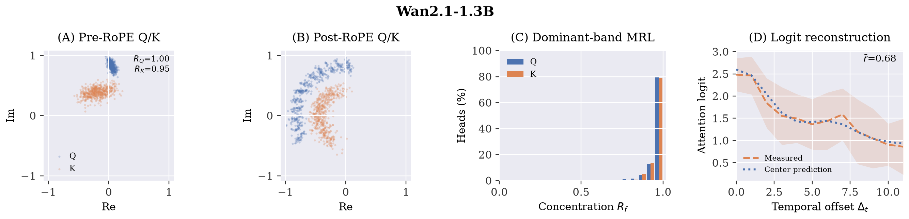
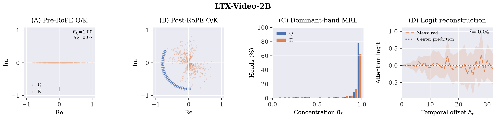
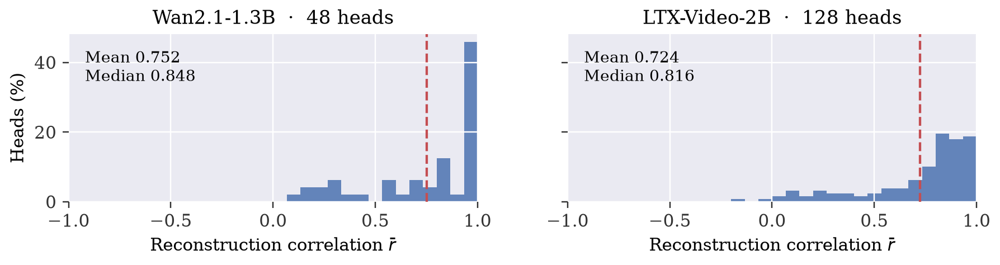
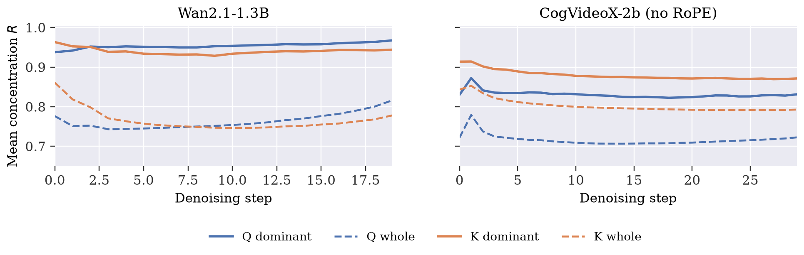

# Pre-RoPE concentration in video diffusion transformers

*A focused reproduction of TriAttention's geometric observations · 1 November 2026*

**Abstract.** Pre-RoPE Q/K concentration transfers to the tested video diffusion transformers. Dominant-band query MRL is 0.972 in Wan and 0.921 in LTX; center-only logit reconstruction reaches mean correlations of 0.752 and 0.724. Wan also retains strong concentration during a real-prompt denoising trajectory. These measurements support the geometric premise of TriAttention; compression quality and efficiency remain untested.

## 1. Setup and measurement

We study Wan2.1-T2V-1.3B (30 layers, 12 heads, 128 dimensions/head) and LTX-Video-2B (28 layers, 32 heads, 64 dimensions/head), both with 3D RoPE. CogVideoX-2b (30 layers, 30 heads, 64 dimensions/head) uses no RoPE in this checkpoint and serves as a comparison. Transformer-only probes use bf16 Gaussian latents, zero text features, and a mid diffusion timestep: 10,800 / 13,728 / 21,600 video tokens, respectively. Hooks capture normalized Q/K immediately before rotation in the RoPE models, or the video portion of the joint stream in Cog. Stored attention-output recomputations report zero error at three checked layers per model; pipeline checks cover the first step only.

For each 2D pair f, R_f = ||E[x_f]|| / E[||x_f||], computed across tokens. We select one dominant pair per head by C_f = E[||q_f||] E[||k_f||] (paper Appendix B.7). Table 1 reports both this selected pair and all-pair means, so selection does not hide weaker bands. Pair estimates use stored 512-token bf16 subsamples; whole-vector statistics use all tokens. Cog's pairs are coordinate pairs, not rotary frequency bands.

## 2. Q/K concentration

Figure 1. Wan Q/K geometry, following the subjects of TriAttention Figure 2. (A-B) Fresh, position-matched samples at layer 0, head 0, band 4; the same 512 tokens and common norm scale are used before/after rotation. One zero-text input, not multiple contexts. (C) Dominant-band MRL across all 360 heads from stored subsamples. (D) Mean measured and center-predicted logits along the t axis, holding other coordinates fixed; 16 deterministic query lines, including self. Shading is +/-1 standard deviation of measured logits across lines; r is the mean per-line Pearson correlation.

**Table 1.** Noise-probe concentration; means over layer × head (and pair for all-pair columns).

| Model | All-pair R (Q / K) | Dominant R (Q / K) | Dominant R > 0.95 (Q / K) |
|---|---|---|---|
| Wan2.1-1.3B | 0.785 / 0.804 | 0.972 / 0.968 | 79.7% / 79.2% |
| LTX-Video-2B | 0.694 / 0.694 | 0.921 / 0.870 | 77.6% / 62.6% |
| CogVideoX-2b | 0.819 / 0.859 | 0.921 / 0.930 | 75.9% / 78.0% |

Both Q and K concentrate strongly in dominant bands, while all-pair averages are lower. This is a band-selective property, not uniform concentration in every 2D subspace. RoPE reduces whole-vector query MRL from 0.857 to 0.631 in Wan and from 0.810 to 0.204 in LTX. Cog also concentrates without RoPE, so these observations do not show that RoPE causes concentration.

Figure 2. LTX uses the same A-D layout. Geometry uses layer 0, head 0, band 31; the histogram covers all 896 heads. The reconstruction example varies the t coordinate only. Layer/head selection is fixed before inspection. These local slices illustrate the mechanism and are separate from the all-key evaluation below. This head is a counterexample: its K pair is dispersed and its temporal-slice correlation is -0.04. Strong average concentration does not imply accurate reconstruction in every head.

## 3. From centers to attention logits

Replacing each token's pre-RoPE Q/K by its head center yields a trigonometric prediction over the spatiotemporal offset. With complex pair centers and model-provided angles, the prediction is:

$$\hat{s}(i,j)=\frac{1}{\sqrt d}\sum_f\Re\!\left[\overline{\mu_{q,f}}\,e^{i(\theta_{j,f}-\theta_{i,f})}\mu_{k,f}\right].$$

Here the overline denotes complex conjugation. The model's angles encode the 3D token positions; a flattened token distance is not sufficient.

The stored evaluation uses 96 sampled queries against all keys in four layers: Wan [0, 5, 15, 29], LTX [0, 5, 14, 27]. Correlations are computed across keys for each query, then averaged within each head. Mean/median correlations are 0.752/0.848 for Wan and 0.724/0.816 for LTX. Centers and evaluation logits come from the same forward pass; this tests within-input reconstruction, not transfer from an independent calibration set. The paper uses logarithmically spaced 1D distances, so these values are not a matched LLM benchmark.

Figure 3. Distribution of per-head reconstruction correlation, matching the subject of TriAttention Figure 3. Four sampled layers contribute 48 Wan heads and 128 LTX heads. Red dashed lines mark means. These are within-input, all-key measurements, not the paper's distance-balanced protocol.

## 4. Real-prompt validation and limits

Existing full-pipeline runs encode a real prompt and follow the scheduler for 20 Wan steps or 30 Cog steps, measuring the positive conditioning branch and returning latents. Wan's dominant-band Q/K MRL averages 0.954/0.940 across steps; query MRL rises from 0.938 at step 0 to 0.968 at step 19. Cog's query value remains near 0.83, below its noise-probe value of 0.921; its key value declines from 0.914 to 0.871. The plots show head means, not uncertainty over prompts.

Figure 4. Real-prompt concentration over denoising. Solid: dominant pair, selected at each head and step; dashed: whole vector. Blue: Q; orange: K. Each point averages all layer/head cells. The two models use different prompts and trajectories, so this is descriptive evidence, not a controlled RoPE ablation.

Concentration within a sequence does not establish a fixed center across contexts. Across two iid noise seeds, mean whole-vector center cosine is about 0.999. Changing zero text features to random features moves centers substantially: Q/K cosine is 0.407/0.469 in Wan and 0.445/0.514 in LTX. Random features are an out-of-distribution perturbation, not a real-prompt benchmark. Each pipeline run covers only one prompt and one seed; LTX has no real-prompt trajectory here. Wan and Cog also differ in architecture, text conditioning, and prompt, so their contrast cannot isolate a causal effect of RoPE.

**Conclusion.** The evidence supports pre-RoPE concentration and useful center-based logit reconstruction in the tested video models. It does not establish fixed centers across diverse prompts, top-key retention, video quality after pruning, or a memory/throughput gain. A compression evaluation needs independent multi-prompt calibration, held-out query/key ranking, and quality-versus-budget measurements. Two existing noise-probe rerun issues (Wan frequency-shape assertion and Cog latent layout) remain documented in README; this report does not alter those experiment scripts.

## Sources and reproduction

Figure subjects and plotting style follow [Mao et al., TriAttention, §3, Figures 2–3 and Appendix B.7](https://arxiv.org/abs/2604.04921). All plotted points and curves are our video-model measurements; no paper results are reused as video results.

Original data: `out/{wan,ltx,cog}.json`, `*-pair-mrl.pt`, `{wan,ltx}-series.json`, `{wan,cog}-pipeline.json`. Fresh geometry captures and source hashes: `out/report/*-visual-capture.json`, `band-data.json`, `report-audit.json`. The prior report is preserved at `out/report/previous-report.md`.

Regenerate the report and vector figures with `python scripts/build_report.py` (numpy, matplotlib, reportlab, pillow). Export/capture on the data host with `HF_HOME=/mnt/data/liuzeyu/hf-cache HF_HUB_OFFLINE=1 CUDA_VISIBLE_DEVICES=0 /dev/shm/trivenv/bin/python scripts/export_report_data.py --capture wan ltx`. Existing data need not be rerun to rebuild the report.
