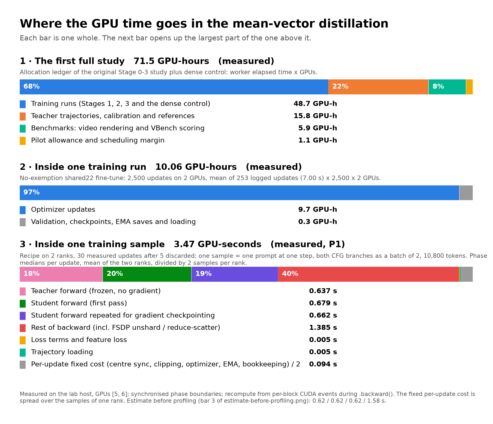

# Where one optimizer update goes: measured profile of the no-exemption shared22 Stage 2 recipe

Part 1 of `DISTILL_PROFILE_PROMPT.md`, run on 26 November 2026 in lab checkout `/mnt/data/liuzeyu/tri-video-profile-8b2502c`. Raw outputs are under `out/distill-profile/` there.

- Code: `scripts/train_learned_center.py --profile` (timers in the real training loop), `scripts/update_profile.py` (timers, block hooks, collective counters, `torch.profiler`), `scripts/profile_forward_anatomy.py` (P5), `scripts/profile_update.py` (driver), `scripts/summarize_update_profile.py` (this directory's statistics and figure).
- CPU test: `scripts/test_update_profile.py`. `scripts/test_learned_center.py` passes before and after the change.
- A profile run saves nothing, runs no validation, and writes only to a new `out/distill-profile/<arm>/`.

**Recipe.** The no-exemption shared22 Stage 2 recipe (`distill-results/noexempt/training/args.json`), from teacher weights:
- `--steps 2500`, so the learning-rate schedule is the real one;
- two ranks, accumulation 2;
- the run is stopped by the profile flag after 5 warm-up updates (discarded) and 30 measured updates.

With the fixed seed, every two-rank arm draws the same prompt-and-step sequence. One sample is one prompt at one denoising step, with both CFG branches as a batch of 2 and 10,800 video tokens.

**Timers.** Every phase boundary calls `torch.cuda.synchronize` and then reads `perf_counter`, so the phases of one update partition its wall time.
- `recompute` is the sum of the student block forwards that run inside `.backward()`, timed with CUDA events.
- `backward_rest` is the wall time of `.backward()` minus `recompute`.

**Statistics.**
1. Per update and rank, per-sample phases are summed over the samples of that update.
2. The two ranks are averaged.
3. Each table gives the median [IQR] over the 30 measured updates, and the mean.
4. Shares are the phase median divided by the sum of the phase medians. Mean-based shares are in `*/summary.json`.

Raw rows (one per arm, rank, update and phase) are in `*/phase-times.jsonl`.

## Host (`host.json`)

| | |
|---|---|
| GPUs | 7× RTX 5090, 32 GiB each, driver 580.173.02, power limit 575 W, no NVLink. All on PCIe gen 5 x16, except GPU 3, which reported a x8 link. |
| CPU, NUMA, RAM | 2× Xeon Gold 6530, 128 threads, 4 NUMA nodes, 251 GiB RAM |
| Topology | GPUs 0, 1, 2 on NUMA 0; 3 and 4 on NUMA 1; 5 on NUMA 2; 6 on NUMA 3 |
| Software | torch 2.11.0+cu128, CUDA 12.8, NCCL 2.28.9, cuDNN 9.19, Diffusers 0.42.1, Transformers 5.22.2 |
| Attention backend | FLASH_ATTENTION, `pytorch_flash::flash_fwd_kernel`, dispatched on a `[2, 12, 10800, 128]` bf16 input (P5) |
| Trajectories | ext4 on the root LVM volume, 99% full (9.8 GB free at the time of the run) |

| Arm | GPUs | Link between the pair |
|---|---|---|
| P0, P1, P4a–d | 5 and 6 | across NUMA nodes 2 and 3 (SYS), like the 6.911 s reference run on GPUs 1 and 6 |
| P2 | 3 and 4 | same NUMA node (NODE) |
| P3, P5 | 6 | one GPU |

## Arms

| Arm | Setup | GPUs | Allocated s | Median update s [IQR] | Mean | Peak CUDA allocated per rank |
|---|---|---|---:|---|---:|---|
| P0 | recipe, no timers | 5, 6 | 265.9 | 6.931 [6.916, 6.955] | 6.954 | 21.54 GiB |
| P1 | recipe, phase and block timers | 5, 6 | 262.3 | 6.938 [6.934, 6.945] | 6.964 | 21.54 GiB |
| P2 | recipe, phase timers, `torch.profiler` on rank 0 for 3 updates | 3, 4 | 332.0 | 6.939 [6.925, 7.002] | 8.151 | 21.54 GiB |
| P3 | one GPU, no FSDP, student in bf16 (bf16 gradients), no optimizer step, no EMA | 6 | 258.0 | 6.497 [6.489, 6.505] | 6.524 | 13.22 GiB |
| P4a | P1 with `--lambda-feat 0` | 5, 6 | 264.2 | 6.927 [6.921, 6.971] | 6.975 | 20.92 GiB |
| P4b | P1 with `--ema 0` | 5, 6 | 264.0 | 6.927 [6.918, 6.946] | 6.974 | 18.88 GiB |
| P4c | P1 with `--accum 1` | 5, 6 | 144.2 | 3.571 [3.567, 3.576] | 3.590 | 19.63 GiB |
| P4d | P1 with `--no-checkpointing`, tried once | 5, 6 | 17.4 | out of memory in the first student forward | — | 29.65 GiB at failure |
| P5 | teacher only, no gradient, 20 forwards on stored training states | 6 | 56.0 | see the forward anatomy below | | |

Notes:
- **P2's mean** includes the three profiled updates; the slowest, 69 s, includes the trace export. P2 is used only for the profiler.
- **P3's numerics differ from training.** The student is cast to bf16, so its gradients are bf16; there is no optimizer, no EMA and no FSDP. The arm measures time only.
- **P4d.** Both ranks reached 29.65 GiB allocated by PyTorch, with no other process on the card. The recipe does not fit two 32 GB cards without checkpointing.

## Per-update phases, P1

Scope: arm P1, 2 ranks, 30 measured updates after 5 discarded, 2 samples per rank per update. Times are per update, rank mean, median [IQR] and mean over the updates.

| Phase | Median s [IQR] | Mean s | Share | Same phase in P3 (one GPU, no sharding), median s |
|---|---|---:|---:|---:|
| data | 0.0108 [0.0090, 0.0112] | 0.0108 | 0.16% | 0.0111 |
| teacher_forward | 1.2737 [1.2721, 1.2744] | 1.2737 | 18.37% | 1.2755 |
| student_forward | 1.3570 [1.3556, 1.3600] | 1.3834 | 19.57% | 1.2762 |
| loss | 0.0108 [0.0107, 0.0108] | 0.0108 | 0.16% | 0.0106 |
| recompute | 1.3248 [1.3242, 1.3257] | 1.3252 | 19.10% | 1.2341 |
| backward_rest | 2.7693 [2.7669, 2.7711] | 2.7690 | 39.93% | 2.6750 |
| center_sync | 0.0008 [0.0008, 0.0008] | 0.0008 | 0.01% | 0.0000 |
| clip | 0.0184 [0.0182, 0.0187] | 0.0188 | 0.27% | not run |
| optimizer | 0.1469 [0.1461, 0.1478] | 0.1491 | 2.12% | not run |
| ema | 0.0211 [0.0210, 0.0212] | 0.0213 | 0.30% | not run |
| bookkeeping | 0.0014 [0.0013, 0.0014] | 0.0014 | 0.02% | 0.0017 |
| **sum of medians** | **6.935** | | 100% | sample phases 6.483 |

The fixed cost per update (`center_sync + clip + optimizer + ema + bookkeeping`) is 0.189 s.

Per block and sample (median over the 60 rank-samples of the measured updates, then summed over the 30 blocks):
- First-pass block forwards: 0.671 s per sample. Blocks range from 0.022 to 0.025 s.
- Recomputation: 0.662 s per sample.
- In P3: 0.633 s first pass and 0.617 s recomputation.

## Per sample, next to the estimate

Scope: P1 per-update medians divided by the 2 samples per rank, rank mean. The fixed per-update cost is spread over those 2 samples. Total: 3.469 s per sample (6.938 s median update / 2). The estimate is bar 3 of `estimate-before-profiling.png` (3.46 s).

| Part | Estimate | Measured |
|---|---:|---:|
| Teacher forward | ≤ 0.62 s (18%) | 0.637 s (18.4%) |
| Student forward, first pass | about 0.62 s (18%) | 0.679 s (19.6%) |
| Student forward repeated for checkpointing | about 0.62 s (18%) | 0.662 s (19.1%) |
| Backward, optimizer, EMA, FSDP traffic | about 1.58 s (46%) | 1.479 s (42.6%): backward_rest 1.385, fixed per-update cost 0.094 |
| Loss and data | — | 0.011 s (0.3%) |

## FSDP communication

**Bytes per update** (P1, rank mean, counted by wrapping `torch.distributed.all_gather_into_tensor` and `reduce_scatter_tensor`, the functions FSDP2's `_fsdp_collectives.py` calls in torch 2.11):

| Collective | Total per update | Where |
|---|---|---|
| bf16 all-gather | 11.25 GB, 122 calls | 5.68 GB in `student_forward`; 5.57 GB inside `.backward()` |
| fp32 reduce-scatter | 11.35 GB, 62 calls | all inside `.backward()` |

- **Backward all-gathers.** These are the re-gathers of parameters for recomputation and gradients. FSDP issues them from its own pre-backward hook, before the block's forward hook, so they are counted under `backward_rest` rather than `recompute`.
- **Reduce-scatter per micro-batch.** The gradients are reduce-scattered after each of the 2 micro-batches, not once per update. That is 5.68 GB per sample, the size of the fp32 gradients.

**Seconds** (P2, rank 0, `torch.profiler` over 3 measured updates; NCCL kernel time per update, attributed to the phase in which the kernel ran):

| Phase | All-gather s | Reduce-scatter s |
|---|---:|---:|
| student_forward | 0.237 | — |
| inside `.backward()` (recompute and backward_rest together) | 0.234 | 0.550 |
| center_sync and clip (small all-reduces) | 0.002 | |
| **total** | **1.024 s per update (14.8% of the 6.94 s update)** | |

This kernel time overlaps compute. The cost that sharding actually adds to the sample phases is the P1 − P3 gap: 6.746 − 6.483 = 0.264 s per update (3.8% of P1).
- Student forward +0.081 s, recompute +0.091 s, backward_rest +0.094 s.
- Teacher forward, data and loss within ±0.003 s.

P3 runs on one card with a bf16 student, so this gap also contains any difference between bf16 and fp32 weights and gradients.

`torch.profiler` names the FSDP ranges as expected: `FSDP::pre_forward`, `FSDP::all_gather`, `FSDP::post_backward_reduce`, and so on (CPU time in `P2/profiler-top-ops.json`).

## Top CUDA kernels (P2, rank 0, 3 measured updates)

Seconds per update are self device time divided by 3. The profiler's "share" column in `profiler-top-ops.json` counts both an aten operator and the kernel it launches, so it double counts; the kernel rows below do not.

| Kernel | s per update | Calls per update |
|---|---:|---:|
| `pytorch_flash::flash_fwd_kernel` (self- and cross-attention; teacher, student, recompute) | 1.324 | 360 |
| `flash_bwd_dq_dk_dv_loop_seqk_parallel_kernel` | 1.067 | 120 |
| cutlass bf16 GEMM 256×128 (linear layers) | 0.978 | 1,260 |
| `ncclDevKernel_ReduceScatter_Sum_f32` | 0.550 | 62 |
| cutlass bf16 GEMM 128×128 | 0.486 | 480 |

## Forward anatomy (P5)

Scope:
- Teacher in bf16, frozen, on one GPU (6), with no gradient.
- 20 forwards after 2 discarded warm-ups. Each forward is one stored training state from the trainer's rank-0 sample stream, both CFG branches as a batch of 2, 10,800 tokens.
- Per-forward times are summed over the 30 blocks, with a synchronize at every hook. Values are medians over the forwards.
- The instrumented outputs equal the uninstrumented ones (`torch.equal`), and the categories sum to the forward total with error 0.

| Category | Median s | Share of forward |
|---|---:|---:|
| self-attention kernel (`attn1` scaled-dot-product) | 0.302 | 34.2% |
| self-attention Q/K/V projections and norms | 0.070 | 7.9% |
| self-attention RoPE, reshapes, casts | 0.059 | 6.7% |
| self-attention `to_out` | 0.023 | 2.6% |
| cross-attention (`attn2`) | 0.060 | 6.8% |
| FFN | 0.246 | 27.8% |
| block norms, modulation, residuals | 0.123 | 13.9% |
| patch embedding, condition embedder, RoPE tables, output | 0.003 | 0.4% |
| **forward total** | **0.884** | 100% |

The absolute P5 time is higher than P1's teacher forward of 0.637 s per sample. The uninstrumented P5 forward was also slower (0.918 s median), so the synchronize calls do not explain the difference. GPU 6 ran at a median SM clock of 2,002 MHz during P5, against about 2,770 MHz in the training arms; P5 is short and that median includes loading, so the clock does not settle it either. Use P5 for shares, not for absolute seconds. This is an open issue.

## Telemetry

Per leased card, over all 0.5 s samples of the arm, loading included:

| Arm | Card | Mean utilization | Mean / max power (W) | Max temperature | Median SM clock (max 3,090) | Samples with SW power cap active |
|---|---|---:|---|---:|---:|---:|
| P0 | 5 / 6 | 88% / 90% | 515 / 582, 521 / 585 | 82 / 75 °C | 2,767 / 2,775 MHz | 86% / 88% |
| P1 | 5 / 6 | 89% / 90% | 527 / 581, 529 / 585 | 83 / 76 °C | 2,760 / 2,767 MHz | 88% / 90% |
| P3 | 6 | 91% | 504 / 584 | 76 °C | 2,752 MHz | 91% |

P4a–c match P0 and P1 within these ranges. No thermal slowdown flag appeared in any arm. The cards spend most of every training arm at their 575 W power limit, and their SM clocks run about 10% below maximum. All GPUs' telemetry is in `*/gpu-telemetry.csv`, and the host snapshots before and after are in `*/smi-*.txt`.

## Checks (`checks.json`)

| Check | Result | Pass |
|---|---|---|
| 1. P0 against 6.911 s | 6.931 s, +0.29% | yes (within 10%) |
| 2. Timer overhead, P1 against P0 | 6.938 against 6.931 s, +0.10% | yes (under 3%) |
| 3. Phases sum to the update wall time | worst update and rank: 4.5e-6 relative | yes (within 1%) |
| 4. Fixed cost from the P4c intercept (2 × 3.571 − 6.938) against P1's fixed phases | 0.204 against 0.189 s, difference 0.016 s | yes (within 0.2 s) |
| 5a. P4a (no feature loss) | total −0.011 s; P1's `loss` phase is 0.011 s and P4a's 0.001 s, so the loss phase moves by 0.010 s, plus taps in teacher_forward 0.001 s | agrees |
| 5b. P4b (no EMA) | total −0.011 s; P1's `ema` phase is 0.021 s. The 0.010 s shortfall is within the spread of the update time (P1 IQR 0.011 s); P4b's `data` phase was 0.017 s slower | about half of the prediction |

## What the result decides

Each bound is the share of one P1 update that the change could remove at most (6.938 s median, 2 ranks, rank mean). None of these changes was implemented or timed.

| Candidate change | Upper bound | From |
|---|---:|---|
| Store teacher velocities at capture and skip the teacher forward off-policy (valid only with the feature loss dropped; the loss phase is a further 0.16%) | 18.4% | `teacher_forward` |
| Avoid checkpoint recomputation | 19.1% | `recompute`; without checkpointing the recipe does not fit (P4d) |
| Avoid sharding | 18.6% as the brief defines it: NCCL kernel time 14.8% plus the P1 − P3 gap 3.8% | the measured cost sharding adds to the sample phases is 3.8%, because most NCCL time overlaps compute |
| Cheaper per-update work (clip, optimizer, EMA) | 2.7% | `clip + optimizer + ema` |
| Faster data path | 0.16% | `data` |
| Less quadratic attention work | 26.9% | P5 kernel share 34.2% × (`student_forward + recompute + backward_rest`) 78.6% of the update |

**Answers to the brief's questions**
1. **Split of one update:** teacher forward 18%, student first pass 20%, recomputation 19%, rest of backward 40%.
2. **FSDP communication:** 1.02 s of NCCL kernel time per update, 23% in the forward and 77% inside `.backward()`. It adds 0.26 s (3.8%) to the sample phases.
3. **Fixed cost per update:** 0.19 s (2.7%), confirmed by the accumulation intercept.
4. **Non-GPU work:** data loading is 0.16% of the update; timer and hook overhead is 0.1%.
5. **Throttling:** the cards are power capped, not thermally limited.
6. **Inside one forward:** the self-attention kernel is 34%, the rest of self-attention 17%, cross-attention 7%, and the FFN 28%.

## GPU time (`ledger.tsv`, `set-aside/`)

Allocated wall time × GPUs of every job, including loading. Part 1 used 8,243.4 GPU-seconds (2.290 GPU-hours):

| | GPU-seconds |
|---|---:|
| Arms kept | 3,414.2 |
| Attempts set aside | 4,799.6 |
| Lease gaps | 29.6 |

**Why attempts were set aside** (`set-aside/index.json`, with each attempt's telemetry and snapshots):
- **First pass, GPUs 3 and 4.** Another user's service started on the leased cards between and during arms. It was present in parts of P0, P1 and P4a, and throughout P4b, which took 442 s instead of about 265 s. Its 9.7 GiB per card left P4c and P4d out of memory. These six attempts were found after the run, from telemetry and snapshots, and set aside.
- **The driver now monitors the leased cards.** It looks for compute processes outside the job before each arm and once per second during it, and an attempt that sees one is set aside and retried on newly leased idle cards.
- **False alarms.** The first version of that monitor wrongly flagged our own ranks, because `torch.distributed.run` starts workers in sessions of their own. That set aside three clean P0 attempts (`P0-contended-2..4`, 1,590.7 GPU-seconds), and was fixed with a parent-chain test.
- **A real catch.** The corrected monitor caught another user's process on GPU 4 during the next P0 attempt (`P0-contended-5`) and moved to GPUs 5 and 6.
- **P2** is the one arm kept from GPUs 3 and 4: no foreign memory appeared during it.
