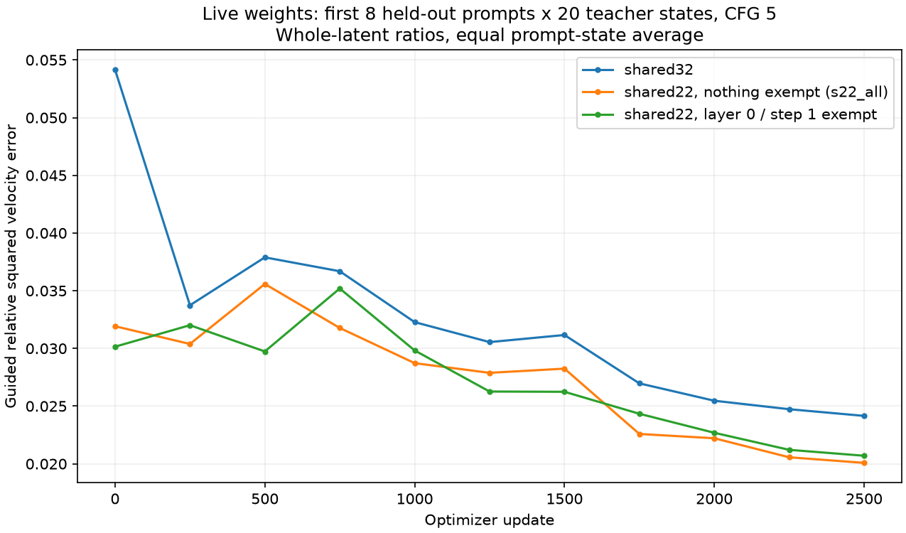

# Study shared32: shared, 32 means pairs per head, nothing exempt (all 30 layers, all 20 steps)

Shared Q/K selection with half of the 64 rotary pairs per head (the 32 lowest-damage pairs by pooled damage_q + damage_k, the same set on Q and K; a superset of shared22) replaced by learned means after QK-RMSNorm and before RoPE; nothing exempt. Same recipe as the no-exemption shared22 study (s22_all) so the two are directly comparable. Arms: trained means, and the same 32 pairs zeroed at inference (zeros swap). User-assigned 21 November 2026, 18 GPU-hours approved, trainer unchanged.

Generated by `scripts/center_study.py` from `configs/studies/shared32.json`. Budget: 12.798 of 18.0 approved GPU-hours (allocated wall time x GPUs).

## Training-free screen

Whole-latent relative squared velocity error vs the bf16 teacher, equal mean over 32 held-out prompts x 20 teacher entering states; guided = both CFG branches combined at 5; nothing exempt (all 30 layers, all 20 steps); pooled calibration means.

| Arm | Conditional | Unconditional | Guided |
|---|---:|---:|---:|
| shared/mean | 0.020686 | 0.020958 | 0.059044 |
| shared/delete | 0.034511 | 0.035247 | 0.075852 |

## Fine-tune

Recipe: {"steps": 2500, "accum": 2, "lr": 1e-05, "lr_center": 0.0002, "warmup": 250, "lambda_cfg": 1.0, "lambda_feat": 0.1, "ema": 0.999, "clip": 1.0, "val_every": 250, "val_prompts": 8, "save_every": 500, "resume_state_every": 1000, "seed": 20261114, "ranks": 2, "max_retries": 3, "gate": null}. Validation: live weights, first 8 held-out prompts x 20 teacher states, whole latent, CFG 5.

| Update | Guided |
|---:|---:|
| 0 | 0.054164 |
| 250 | 0.033738 |
| 500 | 0.037891 |
| 750 | 0.036688 |
| 1000 | 0.032277 |
| 1250 | 0.030546 |
| 1500 | 0.031162 |
| 1750 | 0.026969 |
| 2000 | 0.025464 |
| 2250 | 0.024731 |
| 2500 | 0.024152 |

## Trained-student screen

Whole-latent relative squared velocity error vs the bf16 teacher, equal mean over 32 held-out prompts x 20 teacher entering states; guided = both CFG branches combined at 5; nothing exempt (all 30 layers, all 20 steps); trained EMA means (the screen's generic scope string says pooled).

| Arm | Conditional | Unconditional | Guided |
|---|---:|---:|---:|
| student/mean | 0.003545 | 0.003468 | 0.023981 |
| student/delete | 0.006230 | 0.006240 | 0.027866 |

## 100-prompt benchmark: `s32_means` (trained means)

Frozen protocol: one original seed for each of 100 original prompts, 20 UniPC steps, shift 3, CFG 5, empty negative, 45 frames at 480x480; frozen teacher reused. VBench equal prompt means of VBench's within-video aggregation (aesthetics/imaging all 45 frames, text-video eight midpoint frames; imaging /100). Paired mean [pointwise 95%%] from 10,000 paired prompt resamples, NumPy seed 20261109; one fixed seed per prompt. Every record audited against the trained center (calls, masks, exemptions, hash).

| Dimension | Teacher | s32_means | − baseline | − dense_control | − shared22 | − s22_all_means |
|---|---:|---:|---|---|---|---|
| overall_consistency | 0.2326 | 0.2314 | -0.0012 [-0.0077, +0.0054] | -0.0030 [-0.0093, +0.0034] | -0.0027 [-0.0084, +0.0030] | -0.0025 [-0.0082, +0.0032] |
| aesthetic_quality | 0.5886 | 0.5692 | -0.0194 [-0.0330, -0.0058] | -0.0089 [-0.0214, +0.0037] | -0.0143 [-0.0281, -0.0009] | -0.0180 [-0.0290, -0.0071] |
| imaging_quality | 0.6607 | 0.6769 | +0.0162 [-0.0021, +0.0337] | +0.0069 [-0.0077, +0.0210] | -0.0020 [-0.0142, +0.0101] | +0.0052 [-0.0066, +0.0170] |
| dynamic_degree | 0.3300 | 0.2100 | -0.1200 [-0.2000, -0.0400] | -0.0400 [-0.1100, +0.0300] | -0.0700 [-0.1300, -0.0100] | -0.0600 [-0.1200, +0.0000] |
| subject_consistency | 0.9640 | 0.9652 | +0.0012 [-0.0067, +0.0088] | +0.0009 [-0.0051, +0.0070] | -0.0023 [-0.0067, +0.0020] | +0.0010 [-0.0037, +0.0060] |
| background_consistency | 0.9765 | 0.9758 | -0.0006 [-0.0044, +0.0030] | -0.0018 [-0.0049, +0.0012] | -0.0025 [-0.0054, +0.0003] | -0.0013 [-0.0034, +0.0008] |
| motion_smoothness | 0.9845 | 0.9863 | +0.0019 [+0.0004, +0.0035] | +0.0008 [-0.0005, +0.0022] | -0.0001 [-0.0012, +0.0009] | +0.0001 [-0.0012, +0.0012] |

Teacher agreement: final-latent relative L2 0.5818 (step-20 state, all coordinates, prompt ratios averaged); frame PSNR 13.910 dB over all aligned decoded frames.

## 100-prompt benchmark: `s32_zeros` (same pairs zeroed at inference)

Frozen protocol: one original seed for each of 100 original prompts, 20 UniPC steps, shift 3, CFG 5, empty negative, 45 frames at 480x480; frozen teacher reused. VBench equal prompt means of VBench's within-video aggregation (aesthetics/imaging all 45 frames, text-video eight midpoint frames; imaging /100). Paired mean [pointwise 95%%] from 10,000 paired prompt resamples, NumPy seed 20261109; one fixed seed per prompt. Every record audited against the trained center (calls, masks, exemptions, hash).

| Dimension | Teacher | s32_zeros | − baseline | − s32_means | − s22_all_zeros | − s22_zeros |
|---|---:|---:|---|---|---|---|
| overall_consistency | 0.2326 | 0.2169 | -0.0157 [-0.0234, -0.0083] | -0.0145 [-0.0202, -0.0090] | -0.0199 [-0.0263, -0.0137] | -0.0167 [-0.0235, -0.0104] |
| aesthetic_quality | 0.5886 | 0.5323 | -0.0563 [-0.0733, -0.0395] | -0.0369 [-0.0506, -0.0237] | -0.0467 [-0.0602, -0.0333] | -0.0466 [-0.0620, -0.0318] |
| imaging_quality | 0.6607 | 0.6354 | -0.0253 [-0.0437, -0.0066] | -0.0415 [-0.0545, -0.0288] | -0.0292 [-0.0421, -0.0168] | -0.0342 [-0.0500, -0.0186] |
| dynamic_degree | 0.3300 | 0.2600 | -0.0700 [-0.1600, +0.0200] | +0.0500 [-0.0200, +0.1300] | -0.1300 [-0.2000, -0.0600] | -0.0600 [-0.1300, +0.0100] |
| subject_consistency | 0.9640 | 0.9470 | -0.0170 [-0.0262, -0.0084] | -0.0182 [-0.0238, -0.0129] | -0.0085 [-0.0144, -0.0025] | -0.0125 [-0.0186, -0.0069] |
| background_consistency | 0.9765 | 0.9683 | -0.0082 [-0.0126, -0.0041] | -0.0076 [-0.0111, -0.0043] | -0.0041 [-0.0071, -0.0010] | -0.0068 [-0.0101, -0.0035] |
| motion_smoothness | 0.9845 | 0.9829 | -0.0016 [-0.0034, +0.0004] | -0.0034 [-0.0047, -0.0022] | -0.0015 [-0.0030, -0.0002] | -0.0022 [-0.0036, -0.0010] |

Teacher agreement: final-latent relative L2 0.5757 (step-20 state, all coordinates, prompt ratios averaged); frame PSNR 14.161 dB over all aligned decoded frames.

