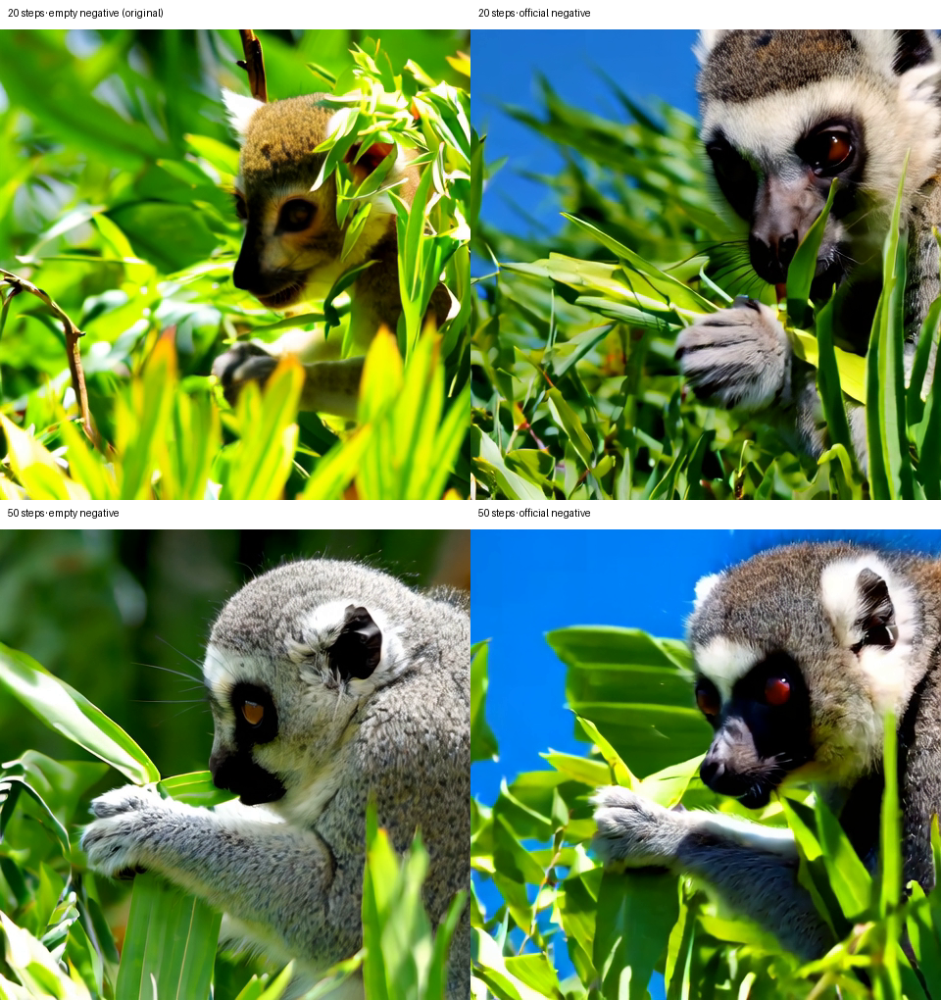

# v000 saturation and sampling settings

On 19 November 2026, the same prompt and seed were compared across 20 and 50 denoising steps with empty and official negative conditioning. The original 20-step empty-negative baseline was reused and its video hash verified. Three new videos were generated using the frozen teacher with native full Q/K.

For “lemur eating grass leaves”, seed 2026110900, 50 steps with empty negative conditioning gave the least saturated result of these four settings. Visual inspection of decoded frames 0, 22 and 44 found more natural colors in that arm. The official negative prompt reduced saturation at 20 steps. At 50 steps it produced a more saturated composition with a bright blue sky.

| Setting | Mean HSV saturation | Pixels with saturation > 0.8 |
|---|---:|---:|
| 20 steps, empty negative, original baseline | 0.834686 | 74.942% |
| 20 steps, official negative | 0.635064 | 47.869% |
| 50 steps, empty negative | 0.492842 | 29.878% |
| 50 steps, official negative | 0.698105 | 58.813% |

Each value aggregates all 10,368,000 RGB pixel positions across all 45 decoded 480×480 frames for a single prompt and seed. HSV saturation is (max RGB − min RGB) / max RGB, with zero assigned to black pixels. These measurements describe output pixels across frames. The model evaluates full Q/K at every step, with zero replaced pairs. The measurements are independent of pair statistics and denoising-step averages.

All runs used CFG 5, UniPC with flow shift 3, 45 frames at 480×480 and 16 fps, bf16 transformer and text encoder, and the fp32 tiled VAE. Each new run reset the CUDA generator to the same seed. Its 20 or 50 denoising states passed finite-latent checks. The exact official negative text was extracted from the pinned model card and is retained in protocol.json with its source URL. The generator used native attention and the standard Diffusers RGB-to-H.264 export.

The pre-encoding mean HSV saturation was 0.650367 for official/20, 0.504213 for empty/50 and 0.712448 for official/50. The ordering therefore exists in the generated RGB frames before video encoding. Changing the step count and negative conditioning also changes the composition. Whole-image saturation is affected by the proportions of foliage, fur and sky, so this single-seed comparison supports a sampling sensitivity finding and an improvement for this sample. Broader quality conclusions require multiple prompts and seeds.

## Official settings checked on 19 November 2026

For the native Wan implementation, the T2V path defaults to 50 steps, UniPC and 81 frames. The 1.3B-specific README recommendation uses CFG 6 and sampling shift 8, with 8–12 suggested for tuning. Its example uses 832×480. The native CLI's generic defaults are CFG 5 and shift 5, so the model-specific example supplies overrides. [Generation defaults](https://github.com/Wan-Video/Wan2.1/blob/main/generate.py), [1.3B recommendations](https://github.com/Wan-Video/Wan2.1#run-text-to-video-generation)

The native text-to-video generator substitutes its built-in negative prompt when its negative input is empty. That default is the Chinese negative prompt in the shared config, including suppression of vivid colors and overexposure. The Diffusers example explicitly supplies its English negative prompt. [Native negative conditioning](https://github.com/Wan-Video/Wan2.1/blob/main/wan/text2video.py), [shared configuration](https://github.com/Wan-Video/Wan2.1/blob/main/wan/configs/shared_config.py)

The official Diffusers example uses CFG 5 and an explicit negative prompt, and WanPipeline defaults to 50 steps. The official repository's Diffusers example specifies UniPC flow shift 3 for 480P. The pinned model card uses 832×480 and 81 frames with fp32 VAE and bf16 transformer. [Diffusers defaults](https://huggingface.co/docs/diffusers/api/pipelines/wan#diffusers.WanPipeline), [Diffusers example](https://github.com/Wan-Video/Wan2.1#3-running-with-diffusers). The pinned model-card URL is in protocol.json.

The official native settings above were verified from source. This experiment measured CFG 5, shift 3, 45 frames and a square image. The native 1.3B recipe at CFG 6, shift 8, 81 frames and 832×480 requires its own measurement.

## Benchmark interpretation and artifacts

The original benchmark plan fixed 20 steps, empty negative conditioning and the square 45-frame protocol before the 100-prompt study. Later distillation instructions required matching that protocol and reusing its audited teacher videos. An initial comparison of sampler quality was missing. The existing paired results describe the original configuration. Evaluating another configuration requires consistent inputs across compared arms, and matching step-indexed means and masks to the new schedule and CFG conditioning.

Results and the exact protocol are in results.json and protocol.json. provenance.json records the video hashes and measured GPU allocation. The four videos remain on the lab host under the recorded lab output directory, named empty20.mp4, official20.mp4, empty50.mp4 and official50.mp4. The local review bundle is under output/v000-saturation-comparison/. The completed GPU run took 147 seconds. An earlier model-card download timeout charged 87 seconds and was resolved by transferring the pinned model card. Total allocation was 234 GPU-seconds (0.065 GPU-hours).
