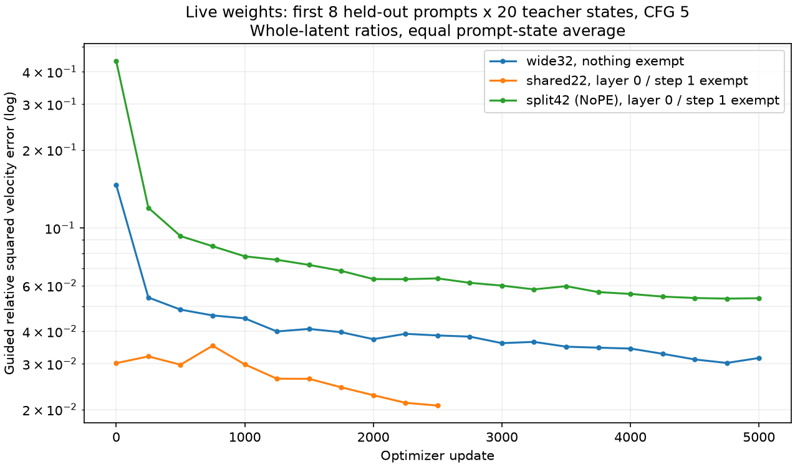

# Widened head (DISTILL_WIDE_PROMPT.md): 128 means under RoPE + 32 unrotated content pairs

Interim evidence for this study. The `DISTILL_REPORT.md` section and the `handoff.md` §16 paragraph are written
after the concurrent no-exemption shared22 study (its own supervisor appends to both files) has published its final
stage, to avoid making its automatic merge conflict.

Lab checkout `/mnt/data/liuzeyu/tri-video-wide-67ed977`, pinned to `1359c17` (branch tip 67ed977 plus the
`generate_learned_center.py` SyntaxError fix). Nothing exempt anywhere: all 30 layers and all 20 denoising steps.

## CPU tests

`cpu-tests.log`: `scripts/test_learned_center.py`, GPU runtime with CUDA hidden, at 67ed977: ALL TESTS OK
(including `test_wide`). The fix in 1359c17 touches only `generate_learned_center.py`, which the suite does not
import; that change was instead checked by loading the shared22 and split42 student checkpoints through the old
(construct + `load_state_dict`) and new (`LearnedCenter.from_checkpoint`) paths, mean and delete modes:
every parameter and buffer identical, same mode / wide / NoPE flags.

## A. Selection v4 (CPU, 52 s)

`select_pairs.py --stats out/distill-pair-stats --out out/distill-selection-v4 --pairs 22 --content-pairs 32
--include-layer0 --include-step1`. Statistics: the existing per-prompt files, pooled over the 64 calibration prompts.

Audit (`selection-audit.json`; per layer-step-branch-head cell, 30 x 20 x 2 x 12 = 14,400 cells, pair-level masks
over the 64 rotary pairs of each head):

- `shared` Q and K masks tensor-equal to the original `out/distill-selection/selection.pt`.
- `wide`: `wide: True`; means mask covers all 64 pairs in every cell, Q = K; exactly 32 content pairs in every cell
  (min = max = 32); in every cell the content pairs are the top 32 by pooled damage_q + damage_k.
- `static-wide/learned_center.pt` loads with `is_wide`, `content_pairs == 32`, `content_index` [30,20,2,12,64]
  consistent with the content mask, and all 30 layers / 20 steps active.

`selection-report.json` → `wide` (pooled over all 14,400 cells; fractions of all selected content pairs):

| Axis | high third | mid third | low third |
|---|---:|---:|---:|
| t | 0.1046 | 0.1002 | 0.1307 |
| h | 0.1227 | 0.0976 | 0.1298 |
| w | 0.1153 | 0.0691 | 0.1301 |

`fixed_high_in_content_fraction` = 0.4982: of the fixed-high pair slots (44 coordinates = 22 pairs per cell, summed over
all cells) 49.8% fall in the content set. The 22 split42 NoPE pairs are contained in the 32 content pairs in
every cell (intersection mean 22.0).

## B. Training-free screen (one GPU, 2,200.9 allocated GPU-seconds = 0.611 GPU-hours incl. loading)

`screen_selections.py --val-prompts 32 --no-exempt --selection out/distill-selection-v4/selection.pt --statistics
out/distill-selection-v4/pair-statistics.pt --variants shared wide --modes mean delete`.

Scope: relative squared velocity error of the whole latent vs the native bf16 teacher at the same teacher entering
state; equal mean over 32 held-out prompts (d0064-d0095) x 20 teacher entering states; conditional and
unconditional branches separately, and combined at CFG w = 5 for guided. Means are the static pooled calibration
means (64 prompts), not trained. No exempt layers or steps. Each Q/K replacement applies to all 10,800 video tokens
of the cell; the wide content channel uses the real post-QK-norm values of the 32 content pairs, unrotated.

| Arm | Conditional | Unconditional | Guided (w=5) |
|---|---:|---:|---:|
| shared/mean | 0.006842 | 0.006987 | 0.034431 |
| shared/delete | 0.010010 | 0.010069 | 0.039689 |
| wide/mean | 0.055053 | 0.052194 | 0.151673 |
| wide/delete | 0.449584 | 0.447210 | 0.571677 |

The shared rows are bit-identical to the no-exemption study's A screen (`distill-results/noexempt/screen`), a
reproducibility check of the same masks, means, prompts and states. All rows finite, so C proceeds. Training-free,
the widened head with pooled means is about 4.4x the shared22 guided error. Zeroing its position channel (content-only
attention on 32 unrotated pairs) is far worse at 0.572, above split42's training-free start of 0.44 (different
architecture and scope).

`runner/` holds the exact lab runner sources for B-E (supervisor.py, supervisor-c2.py, de-runner.py, benchmark.py) (training leased idle GPUs 2 and 3 only; D/E benchmarks lease idle GPUs in order 2, 3, 1, 6, 0, 5;
GPUs 1/6 belong to the running no-exemption study, GPU 4 is excluded).

## C. Fine-tune: 5,000 updates, two ranks x accumulation 2

Exact brief recipe (`training/args.json`, `train-c0*-request.json`): Stage 2 from teacher weights, `--variant wide`,
pooled calibration means as initialisation, model lr 1e-5, means lr 1e-3, warmup 250, lambda_cfg 1.0, lambda_feat 0.1,
EMA 0.999, clip 1.0, seed 20261114, `--include-layer0 --include-step1`, full resumable saves every 1,000 updates,
EMA exports every 500. Two invocations of the same recipe:

- `train-c01`: teacher weights to update 1,000 with `--stop-after 1000` (keeps the full-run LR schedule) so the
  brief's gate could be applied before more GPU time was spent. Gate (`gate-1000.json`): guided validation
  0.044856 <= 0.10, **passed**. Projected study total at the 28 GPU-hour cap was 28.54, so the runner stopped
  there (ASK); the user raised the cap to 30 GPU-hours (`budget-approval.json`).
- `train-c02`: `--resume` from the complete update-1,000 optimizer/model/EMA/sampler/RNG save to update 5,000.
  No interruptions, no failures.

All logged losses and validations finite. History steps unique and ordered.

Validation (`validation.jsonl`): live student weights; whole-latent relative squared velocity error vs the bf16
teacher, equal mean over the first 8 held-out prompts x 20 teacher entering states; conditional, unconditional
and guided (both branches combined at CFG 5); nothing exempt.

| Update | Conditional | Unconditional | Guided |
|---:|---:|---:|---:|
| 0 | 0.050563 | 0.048541 | 0.146573 |
| 250 | 0.015470 | 0.015812 | 0.053977 |
| 500 | 0.013743 | 0.013364 | 0.048481 |
| 750 | 0.013129 | 0.012565 | 0.046039 |
| 1000 | 0.011984 | 0.011770 | 0.044856 |
| 1250 | 0.010328 | 0.010135 | 0.039935 |
| 1500 | 0.009670 | 0.009874 | 0.040851 |
| 1750 | 0.009880 | 0.010043 | 0.039678 |
| 2000 | 0.009178 | 0.008966 | 0.037290 |
| 2250 | 0.009426 | 0.009374 | 0.039115 |
| 2500 | 0.008446 | 0.008065 | 0.038545 |
| 2750 | 0.008595 | 0.008635 | 0.038153 |
| 3000 | 0.007617 | 0.007874 | 0.036000 |
| 3250 | 0.007347 | 0.007300 | 0.036409 |
| 3500 | 0.007582 | 0.007634 | 0.034893 |
| 3750 | 0.006893 | 0.006615 | 0.034582 |
| 4000 | 0.006948 | 0.006305 | 0.034319 |
| 4250 | 0.006566 | 0.006279 | 0.032763 |
| 4500 | 0.006459 | 0.006081 | 0.031158 |
| 4750 | 0.006228 | 0.005876 | 0.030207 |
| 5000 | 0.006318 | 0.005887 | 0.031561 |

Reference curves on the same 8-prompt scope (layer 0 / step 1 exempt in both): tuned shared22 0.0301 -> 0.0207 at
2,500; split42 (NoPE) 0.440 -> 0.0536 at 5,000. The no-exemption shared22 run (interrupted, see below) reached
0.0225 at update 1,750 from 0.0319. wide32 ends at 0.0316 (minimum 0.0302 at 4,750): it starts 3x lower than split42
and ends 1.7x lower, but stays above both shared22 curves on this cached-state scope.

- Median rank-mean optimizer seconds per update: 8.1521 (logged
  updates, excluding validation and checkpoint I/O; the no-exemption shared22 recipe logs about 6.9-7.2 s on the
  same GPUs, so about 1.15x).
- Peak allocator memory: 21.86 GiB on each rank in both invocations (`torch.cuda.max_memory_allocated`; nvidia-smi
  showed about 28.2 GB in use on each GPU during c02, including allocator cache).
- Mean-norm drift (`mu_norm_q/k`: live per-cell Euclidean norm over all 128 coordinates, equal average over all
  14,400 cells, update 10 -> 5,000): Q 12.2711 -> 12.3083 (+0.30%), K 12.7143 -> 12.7520 (+0.30%). Despite lr
  1e-3 the average norm barely moved; direction changes are measured by the E bias tables (relative L2 drift).
- Mask/width audit of the saved final EMA (`mask-width-audit.json`): `wide` True, 64 means pairs and 32 content
  pairs in every one of the 14,400 cells, masks tensor-equal to selection v4, no exempt layers or steps; complete
  resume state at update 5,000. Final EMA SHA-256 in `final-ema.sha256`.
- Allocated GPU-seconds (wall x 2 GPUs, including loading, validation and saves): c01 17949,
  c02 71527; A-C total 25.466 GPU-hours of 30.

## Concurrent no-exemption study: interruption and resume

At 00:47:51 on 21 Nov the no-exemption shared22 training (`train-b01`, GPUs 1/6) received an external SIGTERM on
rank 0 at about update 1,880, below its wall limit; its supervisor stopped and handed off `interrupted`
(aa686f5). Likely sender: the host's earlyoom daemon (SIGTERM when available memory < 10% with swap already
full), unconfirmed because the system journal is not readable. The kill came 30 s into wide32's update-1,000
full optimizer-state save (EMA export written at 1795193240, kill at 1795193271 epoch seconds), so that save's host-memory
use is a plausible contributor; the wide ranks reached about 34 GB RSS during later saves. A passive memory log of this study (`runner/memlog.sh`, 10 s samples over about 10 hours)
afterwards recorded a minimum of 29.6 GB available (never below the 10% trigger), the dips driven by other users'
processes of up to about 54 GB RSS. On the user's approval the no-exemption study was resumed from its complete
update-1,000 save as `train-b02` (exact recipe + `--resume`) under a cap raised from 13 to 18 GPU-hours, with a
continuation runner derived from its original supervisor by asserted substitutions
(`../noexempt/runner-resume/`).

## D. Benchmark: wide32 (final EMA, position channel active), 100 prompts

Frozen benchmark protocol: one original seed for each of the 100 original prompts; 20 UniPC steps, shift 3, CFG 5,
empty negative conditioning, 45 frames at 480x480, 16 fps, bf16 transformer, fp32 tiled VAE. Widened head in all
30 layers and 20 steps, nothing exempt. All 100 videos audited (`selection-records.json`): 2,400 replacement
calls and 1,200 widened-head processor calls each, 64 means pairs and 32 content pairs per cell, `wide_head` true,
center SHA-256 equal to the final EMA. Text encoder: resident and offloaded encoders gave identical final latents
and MP4 on prompt v000 (`encoder-parity.json`). Frozen teacher videos and scores reused, not regenerated.

VBench scores (`summary.json`): equal averages over the 100 prompts of each video's own VBench aggregate.
Aesthetics and imaging (MUSIQ, /100) use all 45 frames; text-video (`overall_consistency`) eight midpoint frames;
the other dimensions VBench's own handling; `dynamic_degree` is the fraction of videos judged dynamic. Reference
columns are the audited summaries of the same prompts/seeds/teacher checksums/scorer revision; the tuned shared22,
shared22 deletion and split42 arms had layer 0 / step 1 exempt.

| Dimension | Teacher | Dense control | shared22 | shared22 deletion | split42 | **wide32** |
|---|---:|---:|---:|---:|---:|---:|
| aesthetic_quality | 0.588595 | 0.578063 | 0.583495 | 0.577787 | 0.299507 | **0.532274** |
| imaging_quality | 0.660679 | 0.670020 | 0.678854 | 0.680191 | 0.539214 | **0.660333** |
| overall_consistency | 0.232555 | 0.234363 | 0.234047 | 0.234605 | 0.104073 | **0.214718** |
| subject_consistency | 0.963999 | 0.964285 | 0.967490 | 0.966353 | 0.934688 | **0.958884** |
| background_consistency | 0.976466 | 0.977676 | 0.978377 | 0.978334 | 0.971790 | **0.972926** |
| motion_smoothness | 0.984463 | 0.985506 | 0.986384 | 0.986335 | 0.985618 | **0.986772** |
| dynamic_degree | 0.330000 | 0.250000 | 0.280000 | 0.270000 | 0.040000 | **0.200000** |

Paired differences (`paired-comparisons.json`): wide32 minus reference, mean over the 100 prompt pairs with pointwise
95% intervals from 10,000 paired prompt resamples (NumPy seed 20261109); one fixed seed per prompt, so no
across-seed uncertainty.

| Dimension | − teacher | − dense | − shared22 | − shared22 deletion | − split42 |
|---|---|---|---|---|---|
| aesthetic_quality | -0.0563 [-0.0736, -0.0391] | -0.0458 [-0.0608, -0.0307] | -0.0512 [-0.0696, -0.0322] | -0.0455 [-0.0633, -0.0275] | +0.2328 [+0.2129, +0.2530] |
| imaging_quality | -0.0003 [-0.0189, +0.0177] | -0.0097 [-0.0270, +0.0063] | -0.0185 [-0.0387, +0.0015] | -0.0199 [-0.0373, -0.0034] | +0.1211 [+0.0998, +0.1424] |
| overall_consistency | -0.0178 [-0.0260, -0.0096] | -0.0196 [-0.0279, -0.0114] | -0.0193 [-0.0270, -0.0117] | -0.0199 [-0.0272, -0.0126] | +0.1106 [+0.0980, +0.1238] |
| subject_consistency | -0.0051 [-0.0118, +0.0018] | -0.0054 [-0.0104, -0.0004] | -0.0086 [-0.0142, -0.0032] | -0.0075 [-0.0136, -0.0011] | +0.0242 [+0.0188, +0.0295] |
| background_consistency | -0.0035 [-0.0068, -0.0002] | -0.0048 [-0.0074, -0.0022] | -0.0055 [-0.0092, -0.0020] | -0.0054 [-0.0085, -0.0025] | +0.0011 [-0.0024, +0.0046] |
| motion_smoothness | +0.0023 [+0.0006, +0.0042] | +0.0013 [-0.0004, +0.0033] | +0.0004 [-0.0006, +0.0015] | +0.0004 [-0.0006, +0.0015] | +0.0012 [+0.0000, +0.0023] |
| dynamic_degree | -0.1300 [-0.2200, -0.0400] | -0.0500 [-0.1300, +0.0200] | -0.0800 [-0.1500, -0.0100] | -0.0700 [-0.1400, +0.0000] | +0.1600 [+0.0900, +0.2300] |

Teacher agreement (`agreement/`): mean final-latent relative L2 0.6344 (all
coordinates of the step-20 final latent per prompt, ratio averaged over 100 prompts; not an intermediate-step
average); mean frame PSNR 13.257 dB over 4,500 aligned decoded frames (per-frame dB,
all RGB pixels, equal average). For reference shared22 0.5591 / 14.194 dB, shared22 deletion 0.5718 / 14.006 dB.

Reading: the widened student is far better than split42 on every dimension (aesthetics +0.233, imaging +0.121,
text-video +0.111), so a full-width position channel plus a 32-pair content channel trains much better than the
42/22 split. It does **not** reach shared22 quality: aesthetics is 0.051 below tuned shared22 and 0.056 below the
teacher, text-video 0.019 below shared22, and subject/background consistency and dynamic degree are lower; all of
these intervals exclude zero. Imaging is level with the teacher (interval includes zero) and motion smoothness is
slightly higher. These are detections on these 100 prompt/seed pairs, not proofs of equivalence.

D allocated 2610.5 GPU-seconds (parity, rendering, seven scorers); study total after D
26.191 GPU-hours of 30.
