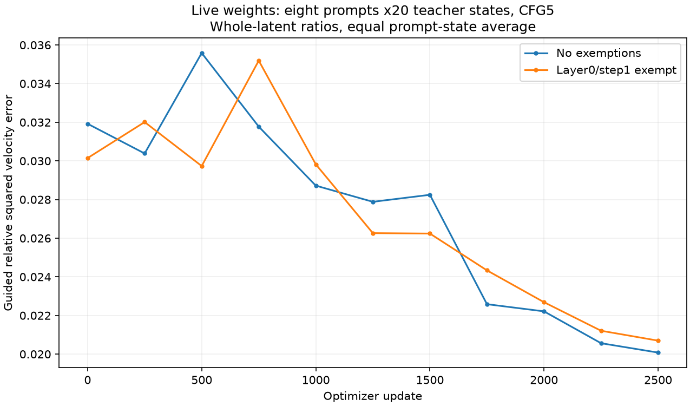

# TriAttention video research handoff

Updated 9 November 2026, Asia/Singapore. Sections 11-14 cover the completed generation benchmarks and latest interpretation. Sections 4-7 define the geometry and correlation experiments.

## 1. Current position

The project investigates pre-RoPE Q/K concentration in video diffusion, its frequency/layer/head/denoising-step structure, and its usefulness for attention approximation and pruning.

- Full conditional Wan sweep, paper-style A/B/C/D figures, all-condition heatmaps and correlation analyses are complete.
- A 100-prompt paired Q/K mean-replacement study is complete, with 300 videos and seven VBench dimensions. It strongly degrades quality. See section 11.
- A separate 100-prompt paired TriAttention-style original-K/V pruning study is complete at 50% and 75% per-bank retention. See section 13.
- Performance profiling was started, then stopped at the user's request. No speed optimization was implemented or validated. See section 14.

## 2. Measurement requirements

For each result, identify tokens, 2D pairs versus full Q/K vectors, prompts, denoising steps, layers, heads, CFG branches and pre/post-RoPE stage. State the averaging order and correlation sample population. MRL pattern similarity, Q/K center directions, logit reconstruction and generation quality are distinct measurements. See `AGENTS.md`.

## 3. Project layout and reproduction

All paths below are relative to the repository root unless marked as external runtime locations.

| Location | Purpose |
|---|---|
| `REPORT.md` | Full conditional Wan geometry report |
| `configs/full_sweep_wan.json` | Four prompts and full geometry-sweep settings |
| `configs/center_benchmark_wan.json` | 100-prompt direct mean-replacement study |
| `configs/triattention_pruning_wan_queryblocks.json` | Authoritative 100-prompt pruning study |
| `out/full-sweep-wan-20261101/` | Geometry captures, metrics and atlas on the data host |
| `out/center-benchmark-wan-20261109/` | Replacement outputs on the data host |
| `out/triattention-pruning-wan-queryblocks-20261109/` | Authoritative pruning outputs on the data host |
| `output/` | Local review mirrors and generated PDFs, excluded from this commit |
| `scripts/` | Generation, measurement, validation, report and site tools |

Generated result archives are external to the source checkout. Configure model caches through `HF_HOME`, evaluator caches through `VBENCH_CACHE_DIR`, and cached Wan weights through `WAN_SNAPSHOT`. Server addresses and SSH connection details are deployment configuration.

To recover an SSH-forwarded atlas, supply the deployment's host and checkout explicitly.

```sh
python3 scripts/open_full_sweep_atlas.py --host "$TRI_REMOTE_HOST" --repo "$TRI_REMOTE_REPO"
```

To start a protected atlas on its data host, supply the desired interface explicitly.

```sh
python3 scripts/start_private_atlas.py --bind "$TRI_ATLAS_BIND"
```

Access credentials, shared URLs, runtime viewer metadata and machine-specific connection settings are excluded from version control.

## 4. The experiment and exact measurements

### Complete sweep

- Model is `Wan-AI/Wan2.1-T2V-1.3B-Diffusers`.
- Four real prompts, 20 denoising steps each, 30 layers, 12 heads, 128 dimensions per head.
- Video configuration is 45 output frames, 480 x 480, CFG 5.0, seed 0 shared across prompts.
- Latent token grid is 12 temporal x 30 height x 30 width = **10,800 video tokens**.
- Prompt IDs are p00, Tokyo woman; p01, waterfall; p02, dancing panda; p03, red toy car. Literal texts are in `config.json`.
- Sequential denoising indices are 1-20. Layer/head/pair indices are zero-based. Latent temporal coordinates are separate from denoising-step indices.
- Captures are normalized Q/K immediately before RoPE on the conditional branch. Every actual text embedding input was checked against its supplied conditional or unconditional embedding. Wan runs the two CFG branches sequentially.

The capture run used GPUs 2 and 5 and parallel CPU rendering. Later work encountered a shared-filesystem bottleneck, and late trajectories used RAM staging before verified persistence. Capture/metrics code hashes are retained in `coverage.json` and checked by the summarizer. Report-only work belongs in the reporting/analysis scripts.

### Pair MRL and dominant pairs

For one prompt, denoising step, layer, head and 2D pair `f`, compute separately for Q and K:

```text
R_f = ||mean_over_all_10800_tokens(x_f)|| / mean_over_all_10800_tokens(||x_f||)
```

Source Q/K are native bf16 and statistics use fp32. Post-RoPE MRL uses the captured vectors rotated with the saved angles and rounded to native bf16.

Original scatter plots choose the axis-dominant pair by:

```text
C_f = mean_tokens(||q_f||) * mean_tokens(||k_f||)
dominant_pair = argmax C_f within the requested axis
```

Selection is repeated per prompt/step/layer/head/axis. The 2D scatter contains every token's Q and K in that pair. The selected pair and plot scale match before/after RoPE.

### Frequency thirds used by heatmaps

The heatmap groups use actual angular frequency. Sort descending separately within each axis, then split into nearly equal-count thirds.

| Axis | All pair IDs | High | Middle | Low |
|---|---|---|---|---|
| t | 0-21 | 0-7 | 8-14 | 15-21 |
| h | 22-42 | 22-28 | 29-35 | 36-42 |
| w | 43-63 | 43-49 | 50-56 | 57-63 |

Within an axis, larger pair index means lower angular frequency. Temporal groups contain 8/7/7 pairs. Spatial groups each contain seven pairs.

Actual frequencies were recovered from `rope.pt` using `atan2(sin,cos)` at a unit coordinate increment. Flattened unit positions are 900, 30 and 1 for t/h/w. Frequencies decrease strictly from 1 rad/token to approximately 0.000152-0.000155 rad/token.

A band heatmap cell is the arithmetic mean of its individual pair MRL values. Each cell retains one prompt, step, layer, head, side and stage. The individual-pair view uses one saved `R_f` directly. All maps share a 0-1 color scale.

### Full-head attention-logit reconstruction

This metric uses all 128 dimensions, summing all 64 pairs. Q/K centers are fp32 means of the full normalized pre-RoPE vectors over all 10,800 tokens, within the same prompt/step/layer/head.

- Measured logits use native bf16 rotated token Q/K with fp32 dots, divided by `sqrt(128)`.
- Predicted logits rotate the fp32 centers at the actual positions.
- Every token is a query. Keys span its complete axis line, fixing the other two coordinates. Both signed directions and self are included.
- Per head/condition, this gives 129,600 temporal logits or 324,000 logits for each spatial axis.
- `per_query_r_mean` first computes Pearson across a query's same-axis keys, then averages the valid query correlations.
- `curve_r` correlates the two offset-mean curves and is retained separately.
- Curve points average all query/key logits at each signed offset. Shading is population standard deviation of measured logits.

## 5. Keep the correlation analyses distinct

### Paper reconstruction correlation

Primary reference is https://arxiv.org/html/2604.04921v1, section 3.3 and Appendix B.6.

TriAttention computes Pearson between actual and center-predicted full-head logits for each query over logarithmically spaced distances `1,2,4,8,...`, then averages over queries within a head. It derives centers from calibration data.

Our video reconstruction follows the same mathematical principle with same-input centers and exhaustive signed t/h/w axis-line distances. Our MRL-pattern correlations below are additional analyses introduced for the video experiment. They answer concentration-pattern stability questions. Explain their data and aggregation explicitly when relating them to the paper.

### Analysis A, denoising changes across the layer/head map

For one axis/band/QK side and one step:

1. Compute each pair MRL from all tokens.
2. Average its band's pair MRLs within each prompt/layer/head.
3. Average four prompts at each layer/head.
4. Flatten the resulting 30 x 12 map into 360 matching layer/head cells.
5. Pearson compares those 360 MRL values between two steps.

Neighbor summary uses the median of 19 adjacent-step correlations. Its 0.996-0.998 range spans 18 pre-RoPE axis/band/QK views, including high/middle/low bands.

Low-Q endpoint results are:

| Axis | Mean at step 1 | Mean at step 10 | Mean at step 20 | Map r, step 1 vs 20 |
|---|---|---|---|---|
| t | 0.6117 | 0.5530 | 0.6066 | 0.15757 |
| h | 0.6111 | 0.5575 | 0.6131 | 0.13470 |
| w | 0.6115 | 0.5523 | 0.6051 | 0.23124 |

The scalar means average four prompts x 30 layers x 12 heads at each stated step. A recovered scalar mean can accompany a changed pattern across layer/head cells.

### Analysis B, denoising changes inside one fixed layer/head

Hold one prompt, numerical layer/head, axis, band and Q/K side fixed. At each step, form a vector of the 7-8 **individual pair MRL values**. Pearson is computed across frequency-pair entries.

```text
Input per axis/band/side       [4 prompts, 30 layers, 12 heads, 20 steps, F pairs]
Neighbor correlations         [4, 30, 12, 19]
Median over 19 transitions     [4, 30, 12]
Median over 1440 trajectories  one scalar
```

Prompts and pairs remain separate before correlation. Each input MRL already aggregates all 10,800 token vectors within one 2D pair. These vectors are frequency profiles of MRL scalars.

The following pre-RoPE results are medians over 1,440 trajectories per view:

| Axis | Band | Q r, step 1 vs 20 | K r, step 1 vs 20 | Q neighboring summary | K neighboring summary |
|---|---|---|---|---|---|
| t | High | 0.598 | 0.551 | 0.998163 | 0.998390 |
| t | Low | 0.240 | 0.187 | 0.995860 | 0.994669 |
| h | High | 0.398 | 0.346 | 0.998220 | 0.998235 |
| h | Low | 0.271 | 0.161 | 0.996046 | 0.994368 |
| w | High | 0.326 | 0.364 | 0.997703 | 0.997918 |
| w | Low | 0.277 | 0.175 | 0.996063 | 0.994496 |

The 0.994-0.998 range spans these 12 summaries, with only high/low bands. All 27,360 adjacent-step correlations per view were defined in the checked data.

**First-transition correction.** The earlier headline that neighboring steps remain highly similar was too broad. The medians describe typical transitions and hide a larger initial change. For height low-Q, the median across 1,440 trajectories is 0.6963 for steps 1->2, 0.9981 for 10->11 and 0.9801 for 19->20. Across axes, low-Q first-transition medians are approximately 0.694-0.726, and low-K medians are 0.734-0.742.

Late-stage frequency profiles retain more similarity. Step 10->20 median correlations span approximately 0.805-0.892 for high bands and 0.619-0.754 for low bands across the Q/K and axis views.

A separate ordering test averages pairs within each high/low band at each step, then checks high mean > low mean throughout all 20 steps. Percentages of trajectories satisfying this condition are:

| Axis | Q | K |
|---|---|---|
| t | 61.7% | 67.2% |
| h | 88.8% | 73.1% |
| w | 81.4% | 68.5% |

Fixed illustration uses p03, layer 15, head 0, pre-RoPE. Individual-pair endpoints include height K pair 39, 0.5982->0.0258, height K pair 41, 0.1731->0.3262, width Q pair 60, 0.5477->0.9096, and width Q pair 58, 0.8126->0.4986. These retain one prompt/layer/head/pair and compare steps 1 and 20.

### Analysis C, changes across layers

Hold one prompt, one denoising step, one numerical head index, axis, band and Q/K side fixed. Compare individual-pair MRL profiles between layers using Pearson across the 7-8 pair entries.

```text
Input per view                 [4 prompts, 20 steps, 12 heads, 30 layers, F pairs]
Adjacent-layer correlations    [4, 20, 12, 29]
Median over 29 transitions     [4, 20, 12]
Median over 960 trajectories   one scalar
```

The same head index is matched between different learned attention blocks. This is a numerical head-index comparison.

| Axis | High-Q neighbor r | High-K neighbor r | Low-Q neighbor r | Low-K neighbor r |
|---|---|---|---|---|
| t | 0.553 | 0.536 | 0.015 | 0.008 |
| h | 0.230 | 0.231 | -0.035 | 0.007 |
| w | 0.035 | 0.076 | 0.019 | -0.023 |

These are two-stage medians, over 29 adjacent-layer correlations and then over 960 prompt/step/head trajectories. Low-frequency profiles have almost zero neighboring-layer correlation. High-frequency similarity varies strongly by axis. Neighboring-layer similarity is much weaker than typical neighboring-denoising-step similarity.

Endpoint and layer-1-to-29 distributions are retained in the Analysis C JSON. Layer distance alone is insufficient to describe the observed profile similarity.

## 6. Other established findings

### Frequency and RoPE means

Each entry below pools 28,800 band-mean cells, separately for the stated axis/stage/side. The cell averages only its frequency pairs, with each pair using all tokens.

| Axis | Pre high Q/K | Pre middle Q/K | Pre low Q/K | Post high Q/K |
|---|---|---|---|---|
| t | 0.7187/0.7476 | 0.5448/0.5361 | 0.5684/0.5436 | 0.3910/0.4061 |
| h | 0.8587/0.8587 | 0.5417/0.5342 | 0.5725/0.5478 | 0.2251/0.2194 |
| w | 0.8513/0.8474 | 0.5145/0.5193 | 0.5678/0.5443 | 0.2459/0.2432 |

High bands rank first after layer/head averaging in all 80 conditions for both sides and all axes. Low-band mean absolute pre/post changes are below 0.00043. Their maximum phase span across the grid is about 0.0206 radians for t or 0.0625 for h/w. High frequencies experience much larger position-dependent rotation.

### Depth and Q/K asymmetry

These pre-RoPE block means average four prompts, 20 steps, all 12 heads and the stated layers, with pair averaging within each band.

| Axis | Low-Q L1-9 | Low-Q L10-19 | Low-Q L20-29 |
|---|---|---|---|
| t | 0.5264 | 0.5589 | 0.6216 |
| h | 0.5278 | 0.5685 | 0.6243 |
| w | 0.5227 | 0.5637 | 0.6189 |

Height high-Q block means are 0.8467, 0.8290 and 0.8867 for the same blocks. Layer 0 behaves differently over denoising. Its low-K means increase from 0.46-0.52 at step 1 to 0.68-0.70 at step 20 across axes, averaging four prompts and 12 heads at that one layer/step.

After averaging 80 conditions at each layer/head, mean within-layer head ranges span roughly 0.19-0.33 across the pre-RoPE axis/band/QK views. Head-index means additionally averaged across layers span roughly 0.03-0.06. At layer 0/head 3, width high-Q/K means over 80 conditions are 0.9597/0.3072.

Middle/low K means decline from step 1 to 20 for each of the four prompts on all axes after averaging layers/heads. Q middle/low pooled curves dip around steps 8-9 and recover. Spatial high Q/K groups strengthen late, while temporal high-K means fall from roughly 0.822 to 0.750.

### Original selected-pair and reconstruction results

Across all 28,800 cells per axis, mean pre-RoPE dominant-pair Q/K MRL is t 0.8950/0.8495, h 0.9271/0.9070, w 0.9114/0.8915. Mean full-head per-query reconstruction r is t 0.5689, h 0.7284, w 0.6117. Frequency-third means and dominant-pair means have different pair populations.

Best full-head reconstruction examples, selected after inspecting all 28,800 cells per axis, requiring all 10,800 valid queries:

| Axis | Prompt | Step | Layer | Head | Displayed dominant pair | Mean query r |
|---|---|---|---|---|---|---|
| t | p01 | 17 | 0 | 5 | 0 | 0.9986695 |
| h | p01 | 12 | 29 | 9 | 24 | 0.9993596 |
| w | p03 | 2 | 29 | 9 | 47 | 0.9999729 |

Best concentrated selected pairs maximize `min(R_Q,R_K)` over the same axis-specific selected-pair population. Winners are t p01/s20/L0/H5/pair0, h p01/s4/L29/H9/pair24, and w p03/s3/L28/H11/pair48. These rankings are separate from full-head reconstruction performance. Exact values, rules and source hashes are in `report-figures/selection.json`.

## 7. Research and implementation file map

### Core experiment and report scripts

| Files under `scripts/` | Role |
|---|---|
| `full_sweep.py`, `full_sweep_metrics.py` | Conditional capture and exact token/pair/head measurements |
| `launch_full_sweep.py`, `render_full_sweep.py` | Capture/render orchestration |
| `summarize_full_sweep.py` | Coverage, CSV, summaries, Markdown and HTML index |
| `make_paper_figures.py` | Nine A/B/C/D composites and best-case selection |
| `export_mrl_heatmaps.py` | Standard-library export of all 2400 hash-verified layer records |
| `build_mrl_heatmaps.py` | Saved-angle grouping, data packaging, six example figures and 160-page appendix |
| `mrl-heatmaps.js`, `full_sweep_atlas.html` | Interactive heatmaps and main atlas template |
| `mrl_pattern_summary.py` | Shared scope-labelled Analysis A prose for HTML, Markdown and PDF |
| `build_full_sweep_pdf.py` | Main nine-page PDF |
| `finalize_full_sweep_delivery.py` | Source/artifact verification and delivery manifest, preserving private-sharing metadata |
| `serve_full_sweep.py`, `start_private_atlas.py`, `open_full_sweep_atlas.py` | Authenticated serving and recovery |
| `test_atlas_access.py`, `test_full_sweep.py`, `verify_full_sweep_samples.py` | Access, math and real-tensor checks |

### Latest local analysis files

These are real files under the local repository. The `tmp/` directory persists through conversation compaction but is gitignored.

| Path | Contents |
|---|---|
| `tmp/analyze-mrl-patterns.py` | Computes Analysis A profiles, prompt/layer/head/step summaries and targeted checks |
| `tmp/mrl-pattern-analysis.json` | Analysis A numerical output before the published source-manifest hash was attached |
| `output/full-sweep-wan-20261101/mrl-heatmaps/pattern-analysis.json` | Published Analysis A source, with `source_heatmap_manifest_sha256` |
| `tmp/analyze-fixed-head-frequency.py` | Computes Analysis B for pre/post, ordering tests and fixed-head illustration |
| `tmp/fixed-head-frequency-analysis.json` | Full Analysis B outputs, example pair values, ordering proportions and scopes |
| `tmp/across-layer-frequency-analysis.json` | Analysis C outputs, scopes, endpoint distributions and per-transition medians |
| `output/full-sweep-wan-20261101/mrl-heatmaps/figures/fixed-head-p03-L15-H00-pre.png` | Local Analysis B illustration, each pair x step displayed individually |
| `tmp/check-mrl-ui.cjs` | DOM integration check for the deployed HTML and interactive heatmaps |
| `tmp/heatmap-check/node_modules/jsdom` | Temporary DOM test dependency |

The Analysis B illustration and Analysis B/C JSON files currently have local/chat publication state. The last published delivery manifest describes the earlier HTML/PDF bundle and Analysis A. A future request to publish B/C should update the site/report, source links and delivery gate accordingly.

To reproduce Analysis C, use the loading and `correlation` helpers in `tmp/analyze-fixed-head-frequency.py`. `raw` has shape `[stage,side,prompt,step,layer,head,pair]`. For pre-RoPE:

```python
profiles = np.moveaxis(np.take(raw[0, side_index], pair_ids, axis=-1), 2, -2)
# Shape [4 prompts,20 steps,12 heads,30 layers,F pairs]
r = correlation(profiles[..., :-1, :], profiles[..., 1:, :])
per_trajectory = np.nanmedian(r, axis=-1)
summary = np.nanmedian(per_trajectory)
```

For Analysis B, move axis 1 to -2 instead, giving `[4,30,12,20,F]` before adjacent-step comparisons. Correlation centers both input profiles over their final pair dimension, then divides the centered dot product by the product of centered norms. The helper treats negligible/zero-variance cases as undefined. All Analysis B pre-RoPE adjacent correlations were defined when checked.

## 8. Runtime, regeneration and verification

### Environments

- Local `.report-venv/bin/python` is Python 3.14. It contains numpy, matplotlib, reportlab, Pillow, pypdf and torch 2.15.0.
- Remote system `python3` is Python 3.12.3. It has the standard library needed for serving and JSON export.
- The original `/dev/shm/trivenv/bin/python` environment disappeared before 8 November. Remote torch/numpy/matplotlib/reportlab were absent when checked then.
- Routine analysis and report work uses the saved data and local environment. Fresh model inference needs the appropriate remote model environment rebuilt first.

For local matplotlib, use a writable cache directory:

```sh
MPLCONFIGDIR=tmp/matplotlib-mrl \
  .report-venv/bin/python tmp/analyze-fixed-head-frequency.py
```

### Regeneration

The saved per-condition heatmap arrays provide all pairs and layers for later statistics. Reading full raw Q/K is necessary only for analyses beyond those retained statistics.

```sh
# Main PDF, local
.report-venv/bin/python scripts/build_full_sweep_pdf.py

# Full heatmap/appendix regeneration, local
.report-venv/bin/python scripts/build_mrl_heatmaps.py

# Analysis B, local
MPLCONFIGDIR=tmp/matplotlib-mrl \
  .report-venv/bin/python tmp/analyze-fixed-head-frequency.py
```

The export generator reads remote `pXX/step-NNN/layer-NNN.json`, checks source hashes against coverage, then creates inputs under `mrl-heatmaps/inputs/` and a transfer bundle under remote `tmp/`. The local heatmap builder expects those inputs and `rope.pt` in the review bundle.

`mrl_pattern_summary.load_summary(root)` loads the published Analysis A source, validates its source-manifest hash, matches its group definitions and verifies all 36 pre/post axis/band/QK means against the heatmap manifest. `summarize_full_sweep.write_index(root,config)` inserts the shared analysis into the HTML and copies the heatmap JS asset.

### Verification already completed

- Coverage is 2400 layer captures, 86400 head figures, 7200 all-head sheets and 7200 concentration distributions.
- Full raw bf16 Q/K total 159,257,560,800 bytes.
- All 144 native attention-output recomputation checks are bit-exact.
- Independent CPU real-tensor spot checks and explicit axis-line math checks passed.
- Ten RAM-staged late-step folders were persisted and SHA256-verified, totaling 21,720,321,189 bytes. The stage tree was removed after persistence.
- All 2400 source layer JSON hashes were verified for heatmap export.
- All 80 exported condition arrays were hash-verified. All 2880 band heatmaps passed shape/range and independently indexed sample checks.
- All 160 appendix pages cover the exact 80-condition x two-stage product, with 18 maps per page.
- Main PDF pages were rendered with `pdftoppm` and visually inspected. Analysis A fits on one page in section 5.4.
- Live HTML/DOM checks verified selectors, exact pair/color indexing, hover, cell selection, individual-pair views, stage changes, prompt/step changes and all seven published analysis scope notes.
- Private HTTP checks verified authorized HTML/images/JSON/PDF/tensor routes and anonymous 403 responses. Published PDFs matched local SHA256 hashes.
- Access-control integration tests passed for anonymous requests, valid URL/cookie sessions, invalid/expired sessions, secret/log handling and outside-root paths.

CUA/browser automation repeatedly timed out, including inventory and DOM access attempts. The latest report work used rendered PDF review and live HTTP plus jsdom tests. A live browser screenshot of the newest analysis section has no successful verification record. Check current tool availability before attempting fresh browser QA.

Current important hashes from `delivery.json`:

```text
report.pdf
9c8a146d49720897e41ba30ac342cdca736f087d25af4fc19b0bd0a0755ce886

coverage.json
a02b87628853fb94156aabd0deb27b3323982101be1c929b542861ee379089a8

per-head-results.csv
6b9d07f2708a1018ca250e1fe364ab25bce1d1cd0586b00f2849df121d8b61b7
```

Main PDF currently has nine pages and 2,978,969 bytes. The appendix has 160 pages and 8,146,170 bytes. Re-read the manifest after future edits.

To update a published report, stage the reviewed PDF and data, atomically copy files into the result root and remote `output/pdf/`, regenerate HTML after its dependencies exist, and run:

```sh
python3 scripts/finalize_full_sweep_delivery.py --pdf-sha256 THE_NEW_PDF_SHA256
```

Then retrieve the new `index.html` and `delivery.json` into the local bundle. The finalizer records the new hashes and preserves `private_sharing` from the prior manifest.

For future PDF edits, read the available PDF skill and follow its authoring marker and render/verify workflow. Scientific plots use numpy/matplotlib and saved numerical data.

## 9. Earlier work and corrections to preserve

- The first limited reports covered Wan/LTX/Cog synthetic probes and limited real trajectories. They are historical context. Current full-Wan results are in `REPORT.md` and the nine-page report.
- The old Wan `pipeline_probe.py` hook retained the final unconditional CFG pass while its report called it conditional. The verified full conditional sweep supersedes that interpretation. Earlier synthetic-input measurements have their own scope.
- Legacy report snapshots are under `out/report/`, including `limited-report-superseded.md` and `previous-report.md`. `scripts/build_report.py` was changed to write `LIMITED_REPORT.md` to preserve the current report.
- The paper's concentration illustration is Figure 2. Its panels are A pre-RoPE pairs, B post-RoPE pairs, C across-head concentration, D logit prediction. The user's third numbered experiment instruction corresponds to panel D.
- Original full-sweep head PNGs contain A/B/D. All 7200 C distributions were computed separately. The corrected report and nine-figure gallery combine all A/B/C/D panels. The atlas presents C alongside the selected original figure.
- C for this video study covers the 12 heads at one prompt/step/layer/axis. Each head chooses its own dominant pair. The paper's Figure 2(C) covers its LLM attention-head population.
- The nine report examples comprise three fixed p03/s20/L15/H0 views, three best selected-pair concentration examples and three best full-head reconstructions. Best cases are explicitly selected maxima.
- Paper reconstruction correlations, layer/head-map correlations, fixed-head frequency-profile correlations and cross-layer profile correlations all use Pearson with different samples and aggregation orders. Name the input population every time.
- MRL measures concentration magnitude. Claims about Q/K center directions, center transfer across prompts or performance require the corresponding measurements.
- Four prompts share seed 0. The full experiment retained latents. Video quality, pruning/compression throughput and KV-memory savings have separate experimental requirements.

## 10. Next-agent priorities

1. Start with sections 11-14 for the latest benchmark results and implementation limitations.
2. Reuse saved result arrays for follow-up statistics. Match each number to its token/pair/prompt/layer/head/step scope.
3. Preserve the first-transition correction in neighboring-step correlation summaries.
4. Performance work is stopped at the user's request. Resume profiling or optimization after a subsequent instruction to do so.
5. Committed source is sanitized for portable deployment. Historical generation hashes identify the versions actually executed before path/configuration cleanup.

## 11. Completed Q/K center-replacement benchmark, 9 November

### User decisions and scope

The direct-replacement study uses current-token centers recomputed at every step and a 100-prompt paired subset. Generation, evaluation, audit and report/site verification are complete.

Use the same Wan cached revision `0fad780a534b6463e45facd96134c9f345acfa5b`, 45 frames at 480 x 480, 16 fps, 20 denoising steps, CFG 5, empty negative prompt. There are still 10,800 video tokens on a 12 x 30 x 30 grid. Transformer/text encoder are bf16. VAE is float32 with tiling.

Three arms are fresh baseline, all-pair replacement and high-pair replacement. At `norm_q`/`norm_k` outputs immediately before native RoPE, compute fp32 coordinate-wise means over all 10,800 current tokens, independently per prompt, step, layer, head and CFG branch. Cast centers to bf16. **Replace both Q and K jointly, with separate Q/K means.** All-pair selects all 64 pairs / 128 coordinates. High-pair selects t 0-7, h 22-28 and w 43-49, totaling 22 pairs / 44 coordinates, matching the earlier upper frequency thirds. Other pairs retain their current trajectory's token representations.

All 30 layers, 12 heads, 20 steps and both branches receive the intervention. Native full attention evaluates every query against every key across the complete 3D grid, summing all 64 pairs. These are full generation interventions. Means adapt to each modified trajectory, so the results concern updated centers. Calibration transfer, stale centers and Q-only/K-only interventions have separate experimental requirements.

`configs/center_benchmark_wan.json` freezes 100 distinct prompts sampled before generation from official VBench category lists with sampling seed 20261109. There are 13 each for animal, architecture, food and human, and 12 each for lifestyle, plant, scenery and vehicles. Each prompt has one independent deterministic seed shared across all three arms. Processing interleaves categories.

### VBench results and aggregation

Official source is pinned to `fd18b3d055cb0fc6f066ca90fe2c3c8cbb698490`. The wrapper calls its unmodified compute functions with exact custom prompt/video metadata. Six quality dimensions and the optional official ViCLIP text-video dimension all completed.

| Dimension | Baseline | All pairs | High pairs |
|---|---:|---:|---:|
| Aesthetic quality | 0.58859467 | 0.31698027 | 0.26696126 |
| Imaging quality | 0.66067940 | 0.40813432 | 0.44479362 |
| Text-video consistency | 0.23255504 | 0.03017356 | 0.04265920 |
| Subject consistency | 0.96399870 | 0.90661325 | 0.95657187 |
| Background consistency | 0.97646601 | 0.97089921 | 0.97964999 |
| Motion smoothness | 0.98446269 | 0.97751718 | 0.98433361 |
| Dynamic degree | 0.33000000 | 0.83000000 | 0.04000000 |

Each arm mean averages 100 per-video scores. MUSIQ averages 45 frames and divides by 100. Aesthetic quality averages 45 frame predictor scores and divides by 10. Subject/background use first/previous-frame cosine scores across 44 transitions. AMT reconstructs 22 odd-index frames from even-index neighbors. RAFT subsamples to 23 frames at 8 fps, yielding 22 flow transitions. ViCLIP uses eight segment-midpoint frames and the actual prompt. Full evaluator scope descriptions are in the report and builder's `SCOPES` dictionary.

Confidence intervals resample 100 paired prompt/seed units, retaining all three arms together, 10,000 times with NumPy RNG seed 20261109. Report percentile 95% intervals on mean paired differences. This is a one-video-per-prompt category-sampled custom-input study, with raw dimension scores and its own sampling scope relative to the full official protocol.

Text alignment falls on all 100 prompts for both arms. Aesthetics fall for 99/100 all-pair prompts and 100/100 high-pair prompts. MUSIQ falls for 95/100 prompts in each arm. High-only versus all-pair changes aesthetics by -0.0500190, CI [-0.0588969,-0.0406960], and imaging by +0.0366593, CI [+0.0108599,+0.0627853]. Its tradeoff differs by dimension. Consistency can stay high for degraded similar frames. Dynamic degree records flow-derived motion incidence. Joint appearance/text/video inspection is essential for interpreting it.

### Concentration/error audit

Eight prompts fixed before result inspection are `v000,v013,v026,v039,v052,v064,v076,v088`. NPZ files retain pair diagnostics at steps 1,10,20, all layers/heads and both branches for every arm. Published summaries use the **conditional baseline** branch.

Each pair MRL uses all 10,800 token vectors. Pair replacement error is `(E||x||^2 - ||E[x]||^2) / E||x||^2`, for the fp32 center. Average individual pair fractions equally across that band's pairs, 12 heads, 30 layers and eight prompts. Figures keep steps separate. The PDF table additionally averages the three audited steps equally.

| High group | Mean Q MRL | Mean K MRL | Mean Q error fraction | Mean K error fraction |
|---|---:|---:|---:|---:|
| t, 8 pairs | 0.7190 | 0.7570 | 0.4904 | 0.4362 |
| h, 7 pairs | 0.8615 | 0.8595 | 0.3063 | 0.2985 |
| w, 7 pairs | 0.8692 | 0.8636 | 0.2948 | 0.2920 |

High MRL still accompanies substantial representation change under mean replacement. All-layer/all-step joint Q/K replacement strongly degrades quality even with updated centers. Assigning the effect to individual layers, steps or Q versus K requires corresponding ablations.

### Artifacts, runtime and checks

- Remote source root is `out/center-benchmark-wan-20261109`. Local bundle is `output/center-benchmark-wan-20261109`, including all 300 videos. Raw final latents remain remote.
- Main PDF is `output/pdf/wan-center-replacement-report.pdf`, 10 pages, 13,330,552 bytes, SHA256 `b4eb45862bdd549f0add92b6a0af531cc76f4446033bb77558c56a312252747c`.
- The new bundle contains `index.html`, `REPORT.md`, `summary.json`, `per-prompt-results.csv` (700 rows), `config.json`, `provenance.json`, `requirements-runtime.txt`, `native-pretrained-validation.json`, `site-verification.json` and `delivery.json`.
- The private route is `/center-benchmark/index.html` under the existing atlas and secret. Its source template/main page now link **Q/K replacement benchmark**. Report/videos/records/evaluation files are hard-linked within the served archive's `center-benchmark` directory. Raw final latents are covered by the same gate.
- New scripts are `center_replacement.py`, `run_center_benchmark.py`, `check_center_replacement.py`, `prepare_center_vbench.py`, `evaluate_center_benchmark.py`, `summarize_center_benchmark.py`, `build_center_benchmark_report.py`. Read `CENTER_BENCHMARK_PLAN.md` for the design.
- Generation code hashes are frozen and verified across all 300 outputs. Official VBench is local `tmp/center-benchmark/VBench` and remote `/dev/shm/tri-vbench-source`. Checkpoints persist in the new output's `evaluator-cache`.
- **Use `/dev/shm/tri-center-runtime/bin/python` for current inference.** It has torch 2.11.0+cu128, torchvision 0.26.0+cu128, Diffusers 0.42.1, Transformers 5.22.2, pyiqa 0.1.16, decord 0.6.0, timm 1.0.12, openai-clip 1.0.1, NumPy 2.5.4. Driver is 580.173.02.
- The earlier on-disk runtime had incompatible/stalled imports. The working runtime was rebuilt using pinned torch/torchvision wheels and their declared dependencies. Runtime versions are recorded in output metadata.
- `WAN_SNAPSHOT=/dev/shm/tri-wan-snapshot` points to the full dereferenced cached Wan snapshot, about 27 GB. Runtime/model scratch trees are ephemeral. Durable cached weights, runtime requirements and evaluator checkpoints support rebuilding.
- Generation used GPUs 2-6 after the GPU-0 pilot. GPU 0 evaluated the dimensions concurrently with generation. GPU 1 was left available when another task used it. All experiment processes finished and all seven GPUs were idle at the final check.
- Verified all 300 video hashes/format checks, exactly 2,400 Q/K hooks per video and 720,000 total, both CFG embedding identities and all finite step latents. Native module output checks were bit-exact in all modes for random/pretrained layer-0 weights, 36 synthetic tokens, two batches. Independent fp32 3D identity error is 4.47e-7.
- Independently checked all 700 CSV rows, 21 arm means and 14 paired changes. Rendered/visually inspected all 10 PDF pages. DOM checks passed 100 prompt selectors, 300 video paths, 2,100 score cells and eight category filters.
- Playwright/isolated Chrome verified video metadata, synchronized playback, zero script errors and zero desktop/mobile page overflow. Screenshots and UI check scripts are under `tmp/center-benchmark`. Direct Chrome CLI screenshots were blank, and Playwright provided successful rendering verification.
- Private HTTP checks passed authorized access and anonymous 403 responses for HTML/PDF/JSON/video/raw latents. The live PDF hash matched local. Main atlas navigation and its delivery manifest were refreshed.

## 12. Independent RoPE audit and official-code comparison

The implementation was independently audited against actual activations and the official TriAttention GitHub implementation, including upstream-cache checks. Its finding is normal native 3D RoPE and correct execution of the direct-replacement trial, with a major methodological difference from official center-guided KV pruning.

- `scripts/audit_center_trajectory.py` replays real prompt v000/seed2026110900 through all 20 steps, all 30 layers/12 heads and both CFG branches. Fresh zero-hook baseline is bit-exact to the saved baseline. Independently written flat-coordinate all/high processors are bit-exact to the saved all/high final latents. All maximum and relative L2 errors are zero. Each modified arm runs 1,200 attention and 1,200 RoPE calls.
- Subagent real first-step checks cover that prompt, both branches, layers0/15/29 and every one of 10,800 tokens/12 heads/64 pairs. All36 Q/K tensor checks pass exactly. Native angle tables match independent NumPy float64 analytic t/h/w phases after fp32 conversion. Selected means match float64 token-sum references after bf16 cast. Unselected coordinates are exact. The earlier pretrained36-token synthetic check had narrower coverage, now supplemented by these actual-path checks.
- Official repository is cloned locally to `tmp/center-benchmark/TriAttention`, pinned to `a4bc3c8f709db60f016ef42c3feb290fd0c00c1b`. The mean formula agrees in the native video collector, while its use differs. It calibrates Q means/mean pair norms, ranks real individual K with a trig term plus `(E|q_f|-|E q_f|)|k_f|`, then gathers original K/V values. Actual queries and retained token-specific K/V perform attention. Our completed trials directly replace selected live Q/K coordinates at every specified head/layer/step/branch.
- LongLive's calibrated statistics have shape30L×12H×64pairs and pool token/batch positions across hooked invocations, with one denominator per layer and no denoising-step dimension. Its ranking varies temporal offsets and sets spatial offsets to zero while summing all64pairs. Its actual model attention retains its native positional representations.
- Official LongLive video configs use dedicated causal generator/LoRA checkpoints, three latent frames per chunk and four configured denoising steps. This differs from our base full-video Diffusers Wan20-step pipeline.
- Upstream single-prompt config has budget6frames, sink3 and recent3, leaving zero dynamically ranked tokens. Interactive config has sink1/recent3, leaving two ranked frames. An isolated official CPU cache test confirmed scorer calls0 versus1 and exact original retained K/V in both. Test scope is one synthetic layer/head with18,720slots×128D and a mocked deterministic ranking function. This checks budget/gather behavior, with no video generation.

The full evidence/source comparison is `output/center-benchmark-wan-20261109/implementation-audit/README.md`, with JSON records and audit scripts alongside it. `audit-native-actual-first-step.json` also exists at the new experiment root. The HTML report links the audit note and raw checks. The new delivery manifest includes these artifacts. Frozen generation source and benchmark numerical results retain their original values. Direct replay coverage is one prompt/seed. The interpretation is direct Q/K replacement ablations, while official good results concern center-guided selection and retained actual representations.

## 13. Completed TriAttention-style Wan pruning rerun, 9 November

### Request, controls and adaptation

The user asked to rerun with official TriAttention's center-guided selection after the replacement audit. The scope is base Wan, paired retention budgets of 50% and 75%, and the same 100 prompts/seeds. Generation, all seven dimensions, PDF/gallery QA and authenticated publication are complete.

The authoritative final root is `out/triattention-pruning-wan-queryblocks-20261109`, mirrored locally at `output/triattention-pruning-wan-queryblocks-20261109`. Config is `configs/triattention_pruning_wan_queryblocks.json`. The preliminary root `out/triattention-pruning-wan-20261109` is superseded and excluded from final results. It transferred fixed last-frame protection and future probes from the causal implementation directly, allowing middle-frame queries to lose their own keys. Its v000 pilot led to a corrected query-block adaptation. The first final prompt also served as an implementation/protection pilot and is included among the 100 prompts. Disclose this design exposure.

The base model/revision, output format and seeds match section 11. Native Wan Q/K normalization and full 3D RoPE are unmodified. Every layer/head/step/CFG branch uses actual Q and gathered original post-RoPE K and original V. Means only guide ranking. All 64 pairs enter the scorer with the official norm correction `(E||q_f|| - ||E[q_f]||) ||k_f||`.

The full 12 x 30 x 30 token grid is split into four query blocks of three temporal latent frames. Every query is evaluated exactly once, and concatenation restores original token order. Protect all keys in the current live query block plus the first sink frame. Protected unions have 2,700 keys for the first block and 3,600 later. Retained banks have 5,400 keys/head at 50%, with 2,700/1,800 dynamically ranked first/later keys. At 75% retain 8,100 keys/head, with 5,400/4,500 dynamically ranked first/later keys. Separate selections are made per CFG forward/layer/head/block.

Ranking averages the trigonometric proxy over the block's three actual query-frame positions, using `delta_t=query_frame-key_frame`. It follows official LongLive's `delta_h=delta_w=0` ranking approximation. Native attention retains actual full 3D positional coordinates. This is a base-Wan bidirectional query-block adaptation, with a different checkpoint and generation protocol from official causal LongLive. Per-bank retention denotes attention operands. Full projections are materialized and selected-bank unions can cover many keys, so persistent KV-memory savings were not established.

### Calibration and implementation checks

Calibrate on four separate prompts p00-p03 from the original sweep, each seed 0 and all 20 denoising steps. Pool normalized pre-RoPE Q coordinates and each 2D pair norm over 4 x 20 x 10,800 = 864,000 tokens per CFG branch/layer. Keep CFG branches, 30 layers, 12 heads and all 64 pairs separate. Q center shape is [2,30,12,64,2]. The calibration prompts are text-disjoint from evaluation prompts. These statistics are static across evaluation steps. This follows the approved switch to calibrated Q ranking in the pruning rerun, distinct from the earlier current-step Q/K replacement intervention.

An independent audit checked the new production path. No coding defect was found. Its synthetic CPU dispatch audit covers a 12 x 2 x 2 grid, 48 tokens, 12 heads, 128D, one layer/branch and four query blocks. It verifies original Q views, original native K/V coordinate gathering, live/sink protection, exact retention counts and output ordering. This is routing coverage, not generated-video coverage.

`selection-verification.json` compares production factored scoring with the pinned unmodified LongLive scorer on synthetic 10,800-token keys, 12 heads, 64 pairs, all four query blocks and both budgets. Maximum score error is 2.2888e-5, or 2.1340e-6 head-standard-deviation units. All official top-k overlaps are 1.0. Original selected K/V coordinates are exact and every live query key is retained.

`independent-calibration-audit.json` reaggregates source sums in float64, then casts to float32. Both stored Q means and pair mean norms are bit-exact to that reference. The small 2.8e-6 differences reported against unrounded float64 are ordinary storage rounding.

99 native baseline videos are reused with verified hashes/provenance. v000 baseline was regenerated through the full-retention controller and its final latent tensor is bit-exact to the old native baseline. Each of the 200 new pruned videos covers 1,200 module dispatches = 20 steps x 2 branches x 30 layers. Each dispatch makes four query-block attention calls, totaling 4,800 per pruned video. All generation source/calibration hashes agree, all finite-step checks pass, and all 300 videos pass SHA256/45-frame/480x480/16-fps checks. The full local 300-video download was independently hash-checked too.

### Results and aggregation

| Dimension | Baseline | 50% retained | 75% retained |
|---|---:|---:|---:|
| Aesthetic quality | 0.58859467 | 0.53216211 | 0.57829409 |
| Imaging quality | 0.66067940 | 0.57824909 | 0.62033538 |
| Text-video consistency | 0.23255504 | 0.20447362 | 0.22691068 |
| Subject consistency | 0.96399870 | 0.88715346 | 0.94573857 |
| Background consistency | 0.97646601 | 0.93923018 | 0.96903559 |
| Motion smoothness | 0.98446269 | 0.96594978 | 0.98003205 |
| Dynamic degree | 0.33000000 | 0.53000000 | 0.44000000 |

Every cell averages 100 official per-video scores, one seed per prompt. The official frame populations are the same as section 11. Aesthetics/MUSIQ use all 45 frames, ViCLIP uses eight segment midpoints. Prompt-bootstrap 95% intervals use 10,000 paired resamples, seed 20261109, keeping all arms together within each prompt. Tokens, pairs, heads, layers and steps remain within their generated video during metric/bootstrap aggregation.

At 75%, aesthetics minus baseline is -0.0103006, CI [-0.0280579,+0.0067161], text-video consistency -0.00564436, CI [-0.0132250,+0.00160231], and imaging -0.0403440, CI [-0.0645857,-0.0172401]. Aesthetics/text intervals include zero. Imaging and subject/background/smoothness intervals are entirely below zero. At 50%, all six continuous dimensions have intervals below zero. 75% exceeds 50% in all six continuous means, with positive paired intervals. Dynamic degree measures motion incidence and rises while quality/smoothness fall.

Pruning recovers much of the quality lost by mean replacement. This remains an adaptation study on a 100-prompt custom-input VBench subset. It does not establish exact reproduction of official LongLive quality or a full official VBench overall score.

Recorded mean generation plus VAE decode times are baseline 15.4087 s, 50% 20.5654 s, 75% 22.3803 s. Baseline timing mostly comes from the previous run. Ranking, gathering and four SDPA calls make this Python prototype slower. These are descriptive cross-run timings and include full projections.

### Artifacts and publication

- Final local PDF is `output/pdf/wan-triattention-pruning-report.pdf`, 10 pages. All pages were rendered with Poppler and visually inspected. The gallery exposes all 300 videos and 2,100 per-video score cells, eight category filters and synchronized playback.
- The atlas route `/triattention-pruning/index.html` contains all 300 videos and per-prompt scores. The deployment uses authenticated read-only access. Connection settings and access credentials are managed outside git.
- `summary.json`, `per-prompt-results.csv` (700 rows), `REPORT.md`, `index.html`, calibration/manifest, selection checks, independent routing/calibration checks, browser verification and delivery manifest are in the final bundle. Authoritative raw latents/calibration tensors remain remote.
- Numerical independent checks covered 700 CSV rows, 21 means and 14 paired mean differences. DOM checks passed every prompt, video path and score. Playwright verified 480x480 video metadata/playback, zero script errors and zero desktop/mobile horizontal overflow.
- HTTP verification covers HTML, PDF, summary, a final-prompt video and a raw latent. Each denies anonymous HEAD with 403 and permits authenticated requests. The served final PDF hash matches local.
- Generation used all seven GPUs in parallel. Seven dimensions then ran independently, one per GPU. All benchmark/evaluator workers completed. Keep the private atlas server running.
- Key frozen generation files are `scripts/triattention_wan_queryblock_pruning.py` and `scripts/run_triattention_queryblock_benchmark.py`. Other new helpers are calibration, prepare, scorer-check, summarizer and report-builder scripts. Changes after generation concern reporting/publication only.

Final pruning-report SHA256 is `2f9f50e02b06c2ae232a98f0aa8705c57419b5ac71ffdee4b07f1217182987fd`. Verified manifest is `output/triattention-pruning-wan-queryblocks-20261109/delivery.json`. PDF rendering, gallery checks and private HTTP validation passed.

## 14. Latest interpretation and stopped performance investigation

### What the quality results establish

At 75% retention, imaging quality is 6.11% below baseline, with a paired 95% interval for the absolute change entirely below zero. Aesthetics is 1.75% lower and text-video consistency 2.43% lower, with both paired intervals including zero. At 50%, imaging is 12.48% lower and text consistency 12.08% lower. These relative changes divide the difference between 100-video arm means by the baseline mean. The official per-video frame populations and paired bootstrap are specified in sections 11 and 13.

The current Wan adaptation yields a modest quality-retention trade-off. A matched random/uniform-pruning control is missing, so the specific ranking advantage is unresolved. High token-wise concentration within a 2D frequency pair alone does not establish accurate key-importance ranking or negligible generation error.

### Runtime attribution and status

The measured slowdown belongs to this project's Wan adaptation. Its frozen reference code recomputes the full pre-key float32 conversion, all 64 pair norms and norm correction inside each of four query blocks. It also rebuilds selection masks, generates tie-breaking noise on CPU, copies it to GPU, gathers original K/V, and makes four separate attention calls per module. These are identifiable overhead sources. A completed component-level profile is still needed to quantify each cost.

`scripts/profile_wan_pruning.py` was added to measure native/reference trajectories and score/selection/gather/attention stages with CUDA events and wall time. A run was launched and explicitly terminated at the user's request. Partial scratch outputs under `out/pruning-performance-20261109/` are exploratory and incomplete. No optimized pruning module, verified speed fix or new quality benchmark was completed. The unused optimized-module branch in that initial profiling scaffold was removed before publication.

### Autoregressive versus full-video interpretation

Autoregressive generation can reuse historical K/V and amortize compression over later queries. Base Wan updates all video tokens during each denoising step, so the present adaptation repeats selection over changing representations. This creates a structural efficiency difference.

The RoPE relative-position identity also holds for bidirectional attention. At one layer/head/step/CFG branch, all 10,800 queries attending to 5,400 retained keys require half as many query-key interactions as full attention, before counting selection/projection overhead. Applicability to full-video attention remains open.

The current experiments do not isolate causality as the cause of quality loss. Official LongLive uses a different causal generator/LoRA checkpoint and a four-step schedule. Our base Wan uses 20 steps. The adaptation additionally uses static Q calibration pooled across four prompts/all steps, spatial-zero ranking offsets and live-query-block protection. Their separate effects require controlled comparisons. The user stopped profiling and requested interpretation only, followed by this source/handoff publication.

## 15. Source publication and deployment configuration

The source checkout includes the research handoff, geometry report, experiment plans, configurations, generation/evaluation code and report/site builders. Generated bulk archives, deployment metadata, credentials and shared access URLs are excluded from version control.

Private machine paths in documentation and cache defaults were replaced with repository-relative paths or configurable cache locations. Atlas startup now requires an explicit interface through `--bind`; SSH tunnel recovery requires explicit `--host` and `--repo` values. These portability changes follow the completed experiments. Recorded generation hashes continue to describe the original executed source versions.

Python syntax compilation, JavaScript syntax validation, CLI argument checks and all eight existing CPU/access-control tests pass. Publication checks compare every tracked blob against the locally stored access secret, private endpoint/personal-path patterns and common credential formats. Research numerical results were carried forward from the completed verified studies. Performance profiling remains stopped.

## 16. Wan2.1 learned mean-vector distillation

Stage 0 captured all 3,641 Wan2.1 teacher trajectories and measured the two velocity references over 32 held-out prompts, 20 denoising steps and both CFG branches. Capture and reference workers used 15.81 GPU-hours, including retries. Two-GPU FSDP training completed Stage 1 (2,000 updates), Stage 2 (5,000 off-policy updates) and Stage 3 (5,000 on-policy updates). Stage 2 cleared the guided validation gate. Stage 3 exported the final EMA weights after testing checkpoint resume and spare-GPU rollout splitting. `DISTILL_REPORT.md` records the run and measurement scopes, and `distill-results/` contains the validation curves and benchmark results.

The frozen teacher, static means, Stage 1, Stage 3 and the 5,000-update dense control have results for all 100 matched prompts and seven VBench dimensions. Stage 3 text–video consistency was 0.219662 against 0.026384 for static means, 0.234363 for dense and 0.232555 for the teacher. These means use one fixed seed per prompt and the pinned ViCLIP scorer on eight frames per video. The paired Stage 3 gain over static means was 0.193278 [0.178278, 0.208606]. Its paired gap to dense was -0.014701 [-0.023318, -0.006229]. Both intervals use 10,000 paired prompt resamples with NumPy seed 20261109. The full report gives all seven dimensions, paired intervals and same-seed latent and frame agreement.

The run stopped with a conservative allocation of 71.50 GPU-hours against the 72-hour cap and completed exports preserved. The checkpoint headroom estimate also blocked a deletion launch. The deletion control and its paired comparison remain open.

Use the pinned benchmark runtime and `WAN_SNAPSHOT` from §11. The pilot environment and the path to the node-local checkpoints and EMA exports are recorded in `out/distill-pilot/`. The final student and dense videos, each with paired teacher links, are in `out/learned-center-wan-student/videos/` and `out/learned-center-wan-dense/videos/` on the lab host.

For the follow-up controls, the previous exports were backed up under `out/distill-controls-preserved/{s1,s2,s3,dense}/student/` on the lab's durable filesystem. The same root contains `calibration.pt`, the copied histories and validations, a snapshot of `distill-results/` at the recorded source commit, and `ema-sha256.txt`. Every export passed the checksum comparison and the calibration and result files matched byte for byte. The experiment removed the four completed resumable optimizer checkpoint directories named in the controls brief, freeing 68.23 GB on node-local disk. The original EMA exports, trajectory cache, and frozen benchmark artifacts were retained.

The per-pair selection study uses the separate lab checkout `/mnt/data/liuzeyu/tri-video-selection-67c101b` and reads the existing teacher trajectory cache. Stage A replayed all 20 states and both CFG branches for 64 calibration prompts in 986 GPU-seconds, measuring the normalized pre-RoPE Q/K pair statistics over all 10,800 tokens per forward. The own-prompt and pooled masks had median Jaccard 0.76 on each side over 921,600 prompt–layer–step–branch–head comparisons. Separate Q and K each choose 22 pairs and share 17.57 on average across the 14,400 layer–step–branch–head cells. Per-layer and per-axis results are in `distill-results/selection/selection-report.json`; the lab masks and pooled means are in `out/distill-selection/`. Stage B completed both training-free screens. Shared pooled means scored 0.032195 guided relative squared velocity error versus 0.283408 with fixed-high pooled means (8.80× lower), over the full latent at 20 teacher states each for 32 held-out prompts after combining both CFG branches at guidance 5. This clears the 2× gate for the shared versus fixed-high Stage C comparison. Stages A+B charged 5,346 GPU-seconds in total. Both screen scopes are in `distill-results/selection/`.

On 16 November at 17:55 Singapore time, narrow was paused after its scheduled optimizer checkpoint at update 4,000 of 5,000. The verified optimizer checkpoint used code `f51d494`. Its files and the update-3,500 and update-4,500 checkpoints are retained under `/tmp/tri-distill-pilot.EG6asH/controls/narrow/retained-checkpoints-before-pause/` on 5090.

The Stage C order changed to a single 500-update shared 22-pair run at `1550308`. It completed on GPUs 4 and 2 in 4,052 GPU-seconds with peak PyTorch allocation of 19.013 GiB per rank. Guided error was 0.057455 at update 250 and 0.035533 at update 500 over the full latent at 20 cached teacher states for each of the first 8 held-out prompts, after combining both CFG branches at guidance 5. The training-free shared comparison on those same states was 0.029888. Artifacts are in `distill-results/fast-shared22/` and the lab export and safe optimizer checkpoint are in `out/distill-fast-shared22/` in the selection checkout. The broader comparison is paused.

The training-free shared22/shared32 benchmark scored all seven VBench dimensions on the first 30 prompts with their original seeds. Both use the frozen teacher transformer and 64-prompt pooled means on 22 or 32 shared Q/K rotary pairs per cell. All 60 generated videos recorded 2,204 intervention calls. Shared22 text–video consistency was 0.227472, averaged over one fixed-seed video per prompt using eight ViCLIP frames per video. All seven paired shared22 differences versus the trained fixed-high Stage 3 student had intervals spanning zero. Shared22 imaging quality trailed dense by 0.043326 on the same 30 videos per arm (95% CI −0.07579 to −0.01304, 10,000 paired resamples, NumPy seed 20261109). Shared22 and shared32 final-latent relative L2 was 0.525782 and 0.614498, and mean PSNR was 14.949 and 13.653 dB, respectively, from 30 same-seed teacher pairs and 1,350 aligned frames per arm. The benchmark used 2,191 GPU-seconds. Path `distill-results/static-shared30/` contains per-prompt scores, the selection records, paired intervals, and agreement. Lab videos are in `out/learned-center-wan-static-shared30/` in the selection checkout. Narrow remains paused.

Shared22 completed 2,500 Stage 2 updates from teacher weights on GPUs 4 and 5, with accumulation of two samples per rank. The 1,000- and 1,500-update gates passed. Guided relative squared velocity error fell from 0.030147 at step zero to 0.020696 at step 2,500 over all latent coordinates at 20 teacher states each for the same first eight held-out prompts, combining both CFG branches at guidance 5. Each validation row was committed separately. The completed EMA benchmark used one fixed-seed video for each of the first 30 prompts and all seven VBench dimensions. Shared22 aesthetics (0.569469) and imaging (0.682822) fell inside the dense arm’s 95% bootstrap intervals over the same 30 prompts, which qualified the EMA for the subsequently approved full benchmark. Training and the 30-prompt benchmark used 37,374 GPU-seconds. Model files and 500-update EMA milestones were retained, and the final EMA is verified under `out/distill-shared22-export/student/` in the selection checkout. The curve, per-prompt results, paired intervals, and same-seed latent and frame agreement are under `distill-results/shared22/`. The controls stay paused.

The full tuned shared22 EMA benchmark completed all 100 original prompt-and-seed pairs and seven VBench dimensions, reusing 30 verified exact-EMA renders and scoring the other 70 new renders. All 100 shared22 videos recorded 2,204 calls across 29 layers, 19 steps, Q and K, and both branches. Aesthetics, imaging and text–video were 0.583495, 0.678854 and 0.234047 over 100 videos, using all 45 frames for the first two and eight midpoint frames for text–video. All seven 95% paired intervals versus dense span zero under 10,000 prompt resamples. Same-seed final latent relative L2 was 0.559077 over 100 matched pairs and mean PSNR was 14.194 dB over 4,500 aligned frames. Expansion used 2,971 GPU-seconds. The headline tables are in `DISTILL_REPORT.md` and evidence is under `distill-results/shared22/full100/`. The fixed-high deletion control is superseded by the shared22 deletion control, which uses the shared22 masks and the same Stage 2 recipe as the tuned shared22 run.

Narrow resumed the preserved update-4,000 optimizer, sampler and EMA state and reached 5,000 at 06:12 Singapore time on 17 November. GPUs 4 and 2 used 9,552 GPU-seconds across the last 1,000 updates. Guided full-latent relative squared velocity error was 0.057076, averaged over 32 held-out prompts × 20 cached teacher states with both branches at CFG 5. The original args and logs are in `distill-results/narrow/`, including both logged validations at update 2,750 around an earlier resume. The final EMA was copied and verified by SHA-256 under `out/distill-narrow-export/student/` in the selection checkout. The narrow benchmark kept its first 90 renders after 2,553 GPU-seconds on GPU 4. After approval it archived the timed-out worker’s stale claim and used 1,019 GPU-seconds on GPU 5 to render the last ten prompts and score all seven VBench dimensions. Total benchmark cost was 3,572 GPU-seconds. All 100 narrow videos had the original fixed seed for their prompt and 2,320 calls over 29 layers, 20 steps, both CFG branches and Q/K. Narrow scored 0.309547 on aesthetics and 0.540361 on imaging using all 45 frames per video, and 0.102609 on text–video using eight midpoint frames per video. Each mean averages 100 videos. Paired 95% intervals versus teacher, dense and trained fixed-high were below zero on all three dimensions using 10,000 paired resamples (NumPy seed 20261109). Same-seed mean final-latent relative L2 was 0.715557 across 100 whole-latent pairs, and mean PSNR was 12.295 dB across 4,500 aligned decoded RGB frames. Evidence is in `distill-results/narrow-paired/` and renders are under `out/learned-center-wan-narrow-full100/` in the selection checkout.

Shared22 deletion completed at update 2,500 from teacher initialization on GPUs 2 and 0. Its final guided relative squared velocity error was 0.020530 versus 0.020696 for tuned means, averaged over all latent coordinates at 160 matched teacher states (eight prompts × 20 denoising steps) with both branches combined at CFG 5. Exact Q/K mask matching was verified in all 14,400 layer–step–branch–head cells. The 100 prompt-and-seed videos all recorded 2,204 calls over 29 layers, 19 steps, both branches and Q/K. All seven paired VBench intervals versus tuned shared22 and dense span zero using 10,000 paired prompt resamples and NumPy seed 20261109. The 100-video aesthetic, imaging and text–video means were 0.577787, 0.680191 and 0.234605, using 45, 45 and eight frames per video respectively. Same-seed final-latent relative L2 was 0.571827 over 100 whole-latent pairs and PSNR was 14.006 dB over 4,500 aligned decoded RGB frames. Total use was 40,040 GPU-seconds (36,712 training + 3,328 benchmark). The final and intermediate EMA exports are durable under `out/distill-shared22-delete/` in the selection checkout, videos are in `out/learned-center-wan-shared22_delete-full100/`, and training and benchmark artifacts are in `distill-results/shared22-delete/`.

The approved 5,000-update shared22 extension follows this report. It starts from the checksum-verified tuned update-2,500 EMA and adds 2,500 off-policy updates with a fresh optimizer, learning-rate schedule and sampler (seed 20261117). The extension writes separate candidates under `out/distill-shared22-5000/` and measures its own step-zero baseline from the source EMA on the same eight validation prompts.

Pre-norm removal stages A+B ran in the separate lab checkout `/mnt/data/liuzeyu/tri-video-removal-f34fc19` while the shared22 extension ran in its own checkout. CPU tests passed and the original shared selection matched exactly. Pooled selection shares 20.009 of 22 selected pairs with shared on average across all 14,400 layer–step–branch–head cells. Shared/narrow scored 0.113148 guided, shared/delete 0.037419, and all-step pooled/narrow 0.144531, averaged over all latent coordinates at 32 held-out prompts × 20 cached entering states after combining both branches at CFG 5. The first-30 video tests reuse the original prompt seeds. Every shared/narrow and pooled/narrow video made 2,204 and 2,320 calls respectively, crossing Q/K, 29 layers, both branches and 19 or 20 steps. Stage B used 5568.3 GPU-seconds. Shared/narrow scored 0.113148, above the brief’s 0.05 range for expecting the gentle recipe to work. The direct run order requests C1 after B, so C1 uses the specified 2,500-update recipe with this higher starting error. Pooled/narrow at all 20 steps scored 0.144531, between 0.05 and 0.15. The brief allows C2 at 2,500 updates. That horizon may be too short, and any extension requires approval. Sources and paired intervals are in `distill-results/removal/`, with videos under `out/learned-center-wan-removal-static30/` on 5090.

Removal C1 received SIGKILL on rank 0 at 02:16 Singapore time on 18 November after logging update 1,700 and charged 24,920 GPU-seconds. The latest durable train state is the update-1,500 EMA in `out/distill-narrow-shared22/ema-checkpoints/step-001500/`, with exact shared Q/K mask and exemption checks plus SHA-256. The run used EMA-only saves and exact optimizer resume is unavailable. At update 1,500 the guided error was 0.027917 versus 0.028333 for post-norm deletion over 160 matched full-latent states from eight prompts × 20 steps at CFG 5. An exact rerun from teacher weights is approved with up to seven additional GPU-hours overall. The rerun uses `out/distill-narrow-shared22-rerun/` with EMA exports and the latest matching full training checkpoint. The CPU restart test matched the uninterrupted run’s final weights and validation curve. C2 follows the rerun’s full benchmark. Evidence is in `distill-results/removal/narrow-shared22/interrupted/`.

Shared22 pre-norm removal (C1) completed 2,500 updates. Guided relative squared velocity error changed from 0.097438 to 0.021373 on the same eight held-out prompts × 20 cached teacher states, over all latent coordinates with both branches combined at CFG 5. The 100 matched EMA videos recorded 2,204 intervention calls each and were scored on seven dimensions with audited references. Against shared22 post-norm deletion the paired outcome was aesthetics -0.00091 [-0.01040, +0.00861], imaging -0.00134 [-0.01071, +0.00798], and text–video consistency -0.00344 [-0.00871, +0.00169], using 10,000 prompt resamples and NumPy seed 20261109. Its EMA checkpoints are durable under `out/distill-narrow-shared22-rerun/`. The training and benchmark used 41,948 GPU-seconds and evidence is in `distill-results/removal/narrow-shared22/`. C1’s last full optimizer checkpoint is at update 2,000. The wall-time guard stopped the final optimizer write after all 2,500 updates and the final EMA were saved and independently verified. The allocator peak was unavailable. C2 follows with 40,963 GPU-seconds from the approved combined budget and full resumable saves at 1,000 and 2,000.

Pooled C2 stopped around 19:52 Singapore time on 18 November after rank 0 received SIGKILL. The last logged update was 660. The verified update-500 EMA is at `out/distill-narrow-pooled/ema-checkpoints/step-000500/`. Its guided error was 0.035505 over all latent coordinates at eight prompts × 20 cached teacher states at CFG 5. The job ended before its first planned optimizer save. The 100-prompt benchmark awaits a recovery decision. After 9,984 GPU-seconds on C2, 30,979 GPU-seconds remain in the combined approved budget. Evidence is in `distill-results/removal/narrow-pooled/interrupted/`.

The inference-only swap ran in `/mnt/data/liuzeyu/tri-video-swap-d5784b7`. CPU tests passed and both frozen EMA exports and shared22 masks were verified. At 32 prompts × 20 cached teacher states, the two swaps raised whole-latent guided error from 0.01937 to 0.02112 for shared22 and from 0.01992 to 0.02113 for deletion, with both branches combined at CFG 5. Each swap generated 100 original prompt–and–seed videos with 2,204 intervention calls across 29 layers, 19 steps, both branches and Q/K. On the paired 100-video benchmark, zeroing shared22 reduced subject and background consistency and motion smoothness. Inserting means into deletion reduced dynamic degree, aesthetics, imaging and text–video consistency. All named drops have paired intervals below zero. The two arms used 7455.4 GPU-seconds including both screens and score runs. The seven-dimension results and same-seed agreement are in `distill-results/swap/`, and raw videos are in `out/learned-center-wan-swap/` on 5090.

The fixed-high inference-only swap ran in `/mnt/data/liuzeyu/tri-video-fh-e300ac2`. The three Stage 3 EMA SHA-256 checks passed and the legacy center loaded the exact default Q/K masks. Guided full-latent error was 0.027988 with trained means and 0.286806 with zeros at 32 prompts × 20 cached teacher states and CFG 5. The `fh_zeros` arm completed all 100 original prompt-and-seed videos, with 2,204 intervention calls per video over 29 layers, 19 steps, both branches, and Q/K. The fixed-high EMA was much more sensitive to an inference-only drop than shared22. On 100 matched videos, replacing the fixed-high means with zeros reduced aesthetics by 0.16334, imaging by 0.28447, and text–video consistency by 0.16901. Subject and background consistency also fell by 0.04005 and 0.01297, respectively. All five paired intervals were below zero. Motion smoothness spanned zero and dynamic degree rose by 0.16000 with an interval above zero, indicating more motion by that metric. The corresponding shared22 quality intervals for aesthetics, imaging, and text–video consistency all spanned zero, and the shared22 subject consistency drop was 0.00803. In the cached-state screen, the fixed-high zeros-to-means guided error ratio grew from 1.463× on frozen teacher weights to 10.248× after Stage 3 fine-tuning, while shared22's ratio was 1.162× on teacher weights and 1.090× after fine-tuning. The screen, seven-dimension paired comparison and same-seed agreement are under `distill-results/swap/`. The run used 3872.8 GPU-seconds.

The v000 saturation check used one prompt and seed 2026110900, full native Q/K, CFG 5, shift 3 and 45 frames at 480×480. Mean HSV saturation across every decoded pixel in all 45 frames was 0.834686 for 20 steps/empty negative, 0.635064 for 20/official negative, 0.492842 for 50/empty and 0.698105 for 50/official. The original baseline was reused. Three fresh videos and pre-encode RGB statistics support a sampling effect for this seed, with composition changes. The official native 1.3B recommendation is 50 steps, CFG 6, shift 8, 832×480, 81 frames, using the built-in negative prompt. The official Diffusers example uses CFG 5 and explicit negative conditioning, with a 50-step default and shift 3 for 480P. The native code replaces an empty negative input with its default text. This differs from the benchmark's empty Diffusers conditioning. Exact protocol, source links, hashes and the frame comparison are in `distill-results/v000-saturation/`. The lab videos are in `/mnt/data/liuzeyu/tri-video-removal-f34fc19/out/baseline-color-check/same-seed/`. Total measured allocation was 234 GPU-seconds.


The content/position split study runs separately in `/mnt/data/liuzeyu/tri-video-nope-2979d3e` from branch commit `d00e0a6` (contains `2979d3e`). CPU tests passed. Selection v3 exactly reproduced shared22, and every cell has 42 means / 22 disjoint NoPE pairs covering 64; shared22 is contained in the means set. The pooled C2 recovery and shared22 extension are untouched. Stage B completed on idle GPUs 4 and 1, using 2,104.288 GPU-seconds. Guided full-latent relative squared velocity errors over 32 held-out prompts × 20 teacher entering states at CFG 5 were shared/mean 0.032195, shared/delete 0.037419, split/mean 0.443576 and split/delete 0.478554. All were finite. C takes the direct Stage 2 teacher initialization path, omitting the optional means-only warm start; the 5,000-update schedule is retained and the first invocation stops with resumable state at the required update-1,000 gate. The 25 GPU-hour allocation is separate; Stage C must stop and ask if guided validation error exceeds 0.08 at update 1,000. Artifacts and full computation scopes are under `distill-results/nope/`.


NoPE C is paused at the complete update-3,000 checkpoint for a budget decision. The update-1,000 guided gate passed at 0.077772; update 3,000 reached 0.059991, averaging whole-latent relative squared velocity errors over eight held-out prompts × 20 cached teacher states, with both branches combined at CFG 5. The run preserved its original 5,000-update schedule and resumed optimizer, sampler, Torch CPU/CUDA RNG and EMA state at update 1,000. All logged losses and validation values were finite. Mean norms over all 128 stored coordinates and all 14,400 cells grew by Q 0.30885% / K 0.30071% from update 1 to 3,000. Long network checkpoint writes caused a budget review; the save interval at 3,000 was 22.19 minutes. The full state at `out/distill-split42/checkpoint/step-003000/` and the corresponding EMA were verified before an intentional SIGTERM; the elastic exit status 1 is a planned resource pause. GPU allocations are released. The study used 14.932382 GPU-hours, including B, and the measured allocation rate plus the brief D/E estimates project 26.80 GPU-hours to finish. ASK for up to 2.5 additional GPU-hours (27.5 total), or keep 25 and obtain a reduced-scope decision. C has 2,000 updates remaining; D and E have not run. Evidence and the comparison curve are in `distill-results/nope/progress-3000/`. The pooled C2 recovery and shared22 extension were not changed.


The user replied yes to the NoPE budget ASK on 19 November 2026 (Asia/Singapore), authorizing 2.5 additional GPU-hours, 27.5 total. Exact optimizer/RNG/EMA resume from the verified update-3,000 state is queued on two idle GPUs with the original 5,000-update recipe. The remaining C, D and E stay in scope; all earlier EMA exports, the pooled C2 recovery and shared22 extension remain preserved. Approval evidence is `distill-results/nope/budget-approval.json`.


NoPE C was unexpectedly interrupted after stdout update 4,590 by rank-0 SIGKILL at 01:47:44 Singapore time on 20 November 2026. Cause remains unconfirmed: no CUDA OOM traceback, kernel logs inaccessible and no readable cgroup memory counters. The last complete full optimizer/sampler/CPU+CUDA RNG/EMA state is update 4,000; independently audited update-4,500 EMA and all earlier EMA exports are preserved. Canonical history/validation are saved through 4,500, with 453 finite logged training rows and 19 finite validation rows. Guided error at 4,500 was 0.053698: whole-latent relative squared velocity error averaged over eight held-out prompts × 20 teacher entering states, both CFG branches combined at guidance 5, using live weights. Masks remain 42 shared Q/K means / 22 NoPE pairs in all 14,400 cells; layer 0 and first-step exemptions remain native. D/E videos and scores have not run. B plus all C attempts used 22.159132 GPU-hours; 5.340868 remain under the approved 27.5 cap. Exact replay from 4,000 plus D/E projects 29.004 total GPU-hours from measured worker allocation and the brief's benchmark estimates. ASK for up to 2.5 more GPU-hours (30 total) to finish the exact 5,000-update recipe, or approval to benchmark the preserved 4,500 EMA without more training as a reduced scope inside 27.5. No GPU restart or recipe change was made. Full evidence and curve: `distill-results/nope/progress-interrupted-4590/`. Protected C2 recovery and shared22 extension were untouched.


The user replied "ok" to the interruption budget ASK on 20 November 2026 (Asia/Singapore), approving up to 2.5 additional GPU-hours, **30 GPU-hours total**, for exact recovery from full checkpoint 4,000 through the original 5,000-update target, then D and E. Recipe and masks remain unchanged. The previous 4,500 EMA and later history are archived by the existing restart procedure before replay, with no deletion. Approval evidence is `distill-results/nope/budget-approval-30.json`. The restart considers only idle GPUs 1, 0 and 6, selecting two; GPU 4 is excluded because it reported nonzero utilization. Protected studies remain untouched.


NoPE C completed all 5,000 original Stage 2 updates with the original schedule and exact optimizer/sampler/CPU+CUDA RNG/EMA restoration at 1,000, 3,000 and 4,000. Final live-weight guided relative squared velocity error was 0.053630, averaged over whole latents on eight held-out prompts × 20 cached teacher states after combining both branches at CFG 5; initial error was 0.439942. All canonical logged losses and validations were finite. Final EMA and full resumable checkpoint at 5,000 were audited, all 42-means / 22-NoPE masks and exemptions unchanged. B+C used 26.746757 GPU-hours of the user-approved 30. All old EMA exports and interrupted attempts are preserved; real-GPU replay is not bitwise identical, and its single-update scalar comparison is retained. Evidence and full curve: `distill-results/nope/training/`. D then E follow on idle GPUs; protected tasks untouched.


NoPE phase D completed: `split42`, 100 original prompt/seed videos, 20-step frozen protocol, seven VBench dimensions, 2,204 means/zero interventions and 1,102 NoPE calls per video with masks/exemptions audited. Per-prompt paired comparisons use 10,000 prompt resamples (seed 20261109), audited teacher scores and video hashes. Aesthetics 0.299507, imaging 0.539214, text–video 0.104073 are averages over 100 videos (45 frames for the first two, eight midpoint frames for text–video). Final-latent relative L2 versus teacher 0.645951 averages full-coordinate ratios over 100 final-state pairs; PSNR 13.134 dB averages 4,500 aligned full-RGB frames. Evidence: `distill-results/nope/full100/split42/`. Protected studies and earlier EMA exports untouched.


The split42 EMA fails this free-generation benchmark: aesthetics, imaging and text–video consistency are below the teacher, dense control, tuned shared22 and trained shared22 deletion, with every corresponding paired 95% interval below zero over the 100 original prompt/seed pairs. For example, split42 aesthetics is 0.299507 versus teacher 0.588595, imaging is 0.539214 versus 0.660679, and text–video is 0.104073 versus 0.232555. The frame aggregation and prompt-bootstrap scopes are those stated above. Dynamic degree averages 0.040000 versus 0.330000 for the teacher; the slightly higher smoothness score should not be read as better overall quality in this low-motion arm. Passing the cached-teacher-state gate did not establish good free-rollout video quality. E will measure the additional effect of zeroing the means against this already poor reference, which limits a clean claim that zeroing alone causes collapse.


NoPE phase E completed: `split42_zeros`, 100 original prompt/seed videos, 20-step frozen protocol, seven VBench dimensions, 2,204 means/zero interventions and 1,102 NoPE calls per video with masks/exemptions audited. Per-prompt paired comparisons use 10,000 prompt resamples (seed 20261109), audited teacher scores and video hashes. Aesthetics 0.330283, imaging 0.418496, text–video 0.056721 are averages over 100 videos (45 frames for the first two, eight midpoint frames for text–video). Final-latent relative L2 versus teacher 0.749479 averages full-coordinate ratios over 100 final-state pairs; PSNR 12.104 dB averages 4,500 aligned full-RGB frames. Evidence: `distill-results/nope/full100/split42_zeros/`. Protected studies and earlier EMA exports untouched.


CURRENT NoPE STATE: A–E complete; no study GPU jobs remain. C recovered the update-4,000 full optimizer/sampler/Torch CPU+CUDA RNG/EMA checkpoint and completed the original 5,000-update recipe. Final EMA and full resumable state are preserved at `out/distill-split42/student/` and `out/distill-split42/checkpoint/step-005000/` in `/mnt/data/liuzeyu/tri-video-nope-2979d3e`; nine earlier canonical EMA milestones and the interrupted 4,500 EMA archive remain intact. EMA hashes were unchanged after both benchmarks. Total study use 28.541502/30 approved GPU-hours, including every failed/replayed attempt and all B/D/E GPU work; CPU tests/statistics/diagnostics/agreement excluded. Both 100-prompt original-seed cohorts and all seven VBench dimensions are audited. Means/zeros aesthetics are 0.299507/0.330283, imaging 0.539214/0.418496 and text–video 0.104073/0.056721, equal prompt means over 100 videos with 45 frames for the first two and eight midpoint frames for text–video. Zero-minus-means paired intervals (10000 prompt resamples, seed20261109) are +0.030776 [0.017194,0.044369] aesthetics, −0.120718 [−0.150167,−0.091682] imaging and −0.047353 [−0.057224,−0.037764] text–video. The split42 means arm already fails teacher/dense/shared22/deletion comparisons, so the result is mixed additional degradation, not a clean uniform collapse from a good baseline. Native layer0 and first-step RoPE remain. E's 32-prompt ×20-state whole-latent guided errors are 0.059897 means and 0.101854 zeros, both branches at CFG5; the same first eight prompts give EMA0.054257 versus live-C0.053630. All 18 CPU bias-table contexts and individual-head figure are committed; selected-coordinate parameter relative L2 drift is Q0.061294/K0.065904 over all 1,110,816 active selected coordinates per side, without token averages. Evidence: `distill-results/nope/`. The SIGKILL cause and poor free-generation quality remain unresolved; no further recipe was tried. Protected studies unchanged.


### Widened head (wide32), 20-21 November 2026

Complete (A-E) per `DISTILL_WIDE_PROMPT.md`; report section "Widened head: 128 means under RoPE + 32 unrotated
content pairs" in `DISTILL_REPORT.md`, evidence in `distill-results/wide/`. Lab root
`/mnt/data/liuzeyu/tri-video-wide-67ed977` (pinned 1359c17): selection `out/distill-selection-v4/`, training
`out/distill-wide32/` (final EMA `student/`, complete resume state `checkpoint/step-005000/`, EMA exports every 500),
videos `out/learned-center-wan-wide32[-zeros]/`, runner logs `out/distill-wide-run/`. Headline: wide32 is far better
than split42 but below shared22 on 100 videos (aesthetics -0.051, text-video -0.019); zeroing its position channel is
catastrophic (aesthetics -0.193, imaging -0.314 vs wide32). 27.334 of 30 approved GPU-hours. Also fixed a SyntaxError
in `generate_learned_center.py` (1359c17). During C the concurrent no-exemption training was SIGTERMed externally,
30 s into wide32's update-1,000 full save (likely earlyoom, unconfirmed); it was resumed under a user-approved 18
GPU-hour cap and reports separately. Open: other content widths and a zeros-trained wide arm (need approval);
`memlog.sh` (passive, read-only) still logs host memory in the run directory.

## Shared22 with nothing exempt

CPU suite passed. A selects22 shared Q/K rotary pairs per all14400 layer-step-branch-head cells using existing64-prompt pooled statistics; constants are post-full-width RMSNorm/pre-RoPE, identical across all10800 video tokens in each cell. No exempt layer or step. No masks or calibration outputs overwritten.

A scope:32 held-out prompts x20 teacher entering states, whole-latent relative squared velocity errors vs native bf16 teacher, equal prompt-state mean; conditional/unconditional separate, both combined at CFG5 for guided.

| Arm | Conditional | Unconditional | Guided |
|---|---:|---:|---:|
| shared/mean | 0.006842 | 0.006987 | 0.034431 |
| shared/delete | 0.010010 | 0.010069 | 0.039689 |

Exempted shared means/delete guided references on the same32-prompt scope are0.03219502645661123/0.03741946758891572 (distill-results/nope/screen/complete.json); earlier no-exempt separate/mean is0.04098448762670159 (distill-results/selection/screen-noexempt/complete.json). These are distinct masks/conditions. Original A uses 0.349797 allocated GPU-hours. Budget cap13GPU-hours, idle GPU leases only, max2 per job. User requested unattended continuation after verified startup to conserve model credits; webhook hand-offs replace periodic model checks.


### No-exemption runner stopped for attention

Command '['python3', '/mnt/data/liuzeyu/tri-video-noexempt-6f273d8/out/distill-noexempt-run/gpu-worker.py', '--root', '/mnt/data/liuzeyu/tri-video-noexempt-6f273d8', '--name', 'train-b01', '--gpus', '2', '--candidates', '1,0,6,2,3,5', '--wall-limit', '18150', '--', '/dev/shm/tri-center-runtime/bin/python', '-m', 'torch.distributed.run', '--standalone', '--nproc_per_node', '2', 'scripts/train_learned_center.py', '--stage', '2', '--out', 'out/distill-s22-all', '--steps', '2500', '--accum', '2', '--lr', '1e-5', '--lr-center', '2e-4', '--warmup', '250', '--lambda-cfg', '1', '--lambda-feat', '0.1', '--ema', '0.999', '--clip', '1', '--val-every', '250', '--val-prompts', '8', '--val-at-start', '--save-every', '500', '--ema-checkpoints', '--resume-state-with-ema', '--resume-state-every', '1000', '--seed', '20261114', '--selection', 'out/distill-selection/selection.pt', '--variant', 'shared', '--calibration', 'out/distill-selection/pair-statistics.pt', '--center-mode', 'mean', '--include-layer0', '--include-step1', '--traj', '/tmp/tri-distill-pilot.EG6asH/traj', '--snapshot', '/dev/shm/tri-wan-snapshot', '--budget-seconds', '17550']' returned non-zero exit status 1.. Allocated GPU-hours 8.078830/13. All outputs preserved; see distill-results/noexempt/interruption.json and out/distill-noexempt-run/ logs. No further GPU work is launched by the runner.


### No-exemption B: 2500-update fine-tune

From teacher weights, original tuned shared22 recipe with --include-layer0 --include-step1, two ranks and accumulation2; seed20261114, model lr1e-5, means lr2e-4, warmup250, feature weight0.1, EMA0.999. All logged losses/validations finite. Full2500 optimizer/sampler/CPU+CUDA RNG/EMA save and final EMA masks audited. Whole-latent relative squared velocity errors average the first eight held-out prompts x20 teacher entering states; both branches combine at CFG5.

| Update | Guided |
|---:|---:|
| 0 | 0.031922 |
| 250 | 0.030385 |
| 500 | 0.035585 |
| 750 | 0.031774 |
| 1000 | 0.028721 |
| 1250 | 0.027883 |
| 1500 | 0.028245 |
| 1750 | 0.022584 |
| 2000 | 0.022213 |
| 2250 | 0.020564 |
| 2500 | 0.020078 |



Median logged rank-mean optimizer seconds/update: 6.911287, excluding validation/saves. Peak allocator bytes per reported invocation/rank and all arguments are in training/summary.json and args.json. Mean-norm drift: {"q": {"first": 12.271143913269043, "last": 12.27061653137207, "percent": -0.004297740297887209}, "k": {"first": 12.71428394317627, "last": 12.713732719421387, "percent": -0.004335468338967363}}; scope: Per-cell Euclidean norm over all128 stored mean coordinates, equal average over all14400 cells including unused coordinates; no token/prompt average at measurement time. Allocated A+B GPU-hours: 15.189086, including startup, validation, saves/I/O and all attempts. All historical outputs retained.


### No-exemption C: s22_all_means, 100 prompts

One original seed per each of100 original prompts;20 UniPC steps, shift3, CFG5, empty negative,45frames480x480 at16fps. Shared22 Q/K means/zeros after full-width RMSNorm before RoPE, all10800 tokens per active cell; all30layers and20steps active, no exemptions, no NoPE. All100 videos audited at2400 replacement calls each. VBench scores are equal prompt averages of original within-video aggregation: aesthetics/MUSIQ all45 frames, text-video eight midpoint frames, other dimensions original VBench handling. Imaging divided by100. Frozen teacher videos/scores reused, not regenerated. Intervals are pointwise95% from10000 paired prompt resamples, NumPy seed20261109, one fixed seed per prompt; no across-seed uncertainty.

| Dimension | Candidate | Candidate minus references, mean [95% CI] |
|---|---:|---|
| subject_consistency | 0.964203 | s22_all_means_minus_baseline: +0.000204 [-0.005767, +0.005880]; s22_all_means_minus_dense_control: -0.000081 [-0.004010, +0.003926]; s22_all_means_minus_shared22: -0.003287 [-0.006891, +0.000131]; s22_all_means_minus_shared22_delete: -0.002150 [-0.005663, +0.001312] |
| background_consistency | 0.977130 | s22_all_means_minus_baseline: +0.000664 [-0.002719, +0.003881]; s22_all_means_minus_dense_control: -0.000546 [-0.003169, +0.001892]; s22_all_means_minus_shared22: -0.001247 [-0.003821, +0.001264]; s22_all_means_minus_shared22_delete: -0.001204 [-0.003233, +0.000692] |
| motion_smoothness | 0.986207 | s22_all_means_minus_baseline: +0.001745 [+0.000299, +0.003322]; s22_all_means_minus_dense_control: +0.000701 [-0.000860, +0.002473]; s22_all_means_minus_shared22: -0.000176 [-0.000862, +0.000493]; s22_all_means_minus_shared22_delete: -0.000127 [-0.000879, +0.000624] |
| dynamic_degree | 0.270000 | s22_all_means_minus_baseline: -0.060000 [-0.140000, +0.020000]; s22_all_means_minus_dense_control: +0.020000 [-0.050000, +0.090000]; s22_all_means_minus_shared22: -0.010000 [-0.060000, +0.040000]; s22_all_means_minus_shared22_delete: +0.000000 [-0.050000, +0.050000] |
| aesthetic_quality | 0.587182 | s22_all_means_minus_baseline: -0.001413 [-0.013543, +0.010953]; s22_all_means_minus_dense_control: +0.009119 [-0.001919, +0.020228]; s22_all_means_minus_shared22: +0.003686 [-0.007249, +0.014825]; s22_all_means_minus_shared22_delete: +0.009394 [+0.000182, +0.018940] |
| imaging_quality | 0.671702 | s22_all_means_minus_baseline: +0.011022 [-0.006866, +0.028433]; s22_all_means_minus_dense_control: +0.001681 [-0.015285, +0.017837]; s22_all_means_minus_shared22: -0.007153 [-0.018713, +0.004116]; s22_all_means_minus_shared22_delete: -0.008489 [-0.019778, +0.002521] |
| overall_consistency | 0.233914 | s22_all_means_minus_baseline: +0.001359 [-0.005146, +0.007986]; s22_all_means_minus_dense_control: -0.000450 [-0.006936, +0.005713]; s22_all_means_minus_shared22: -0.000134 [-0.005125, +0.005050]; s22_all_means_minus_shared22_delete: -0.000692 [-0.006004, +0.004455] |

Paired differences versus exempted shared22 include zero for ['subject_consistency', 'background_consistency', 'motion_smoothness', 'dynamic_degree', 'aesthetic_quality', 'imaging_quality', 'overall_consistency']; exclude zero for []. This is detection on these100 prompt/seed pairs, not proof of equivalence.

Teacher agreement: mean full-coordinate final-latent relative L2 0.563031 over100 final-state pairs (step20, no intermediate-step average); frame PSNR 14.254dB over4500 aligned decoded frames, all RGB pixels/channels per-frame then equal dB average.


### No-exemption C: s22_all_zeros, 100 prompts

One original seed per each of100 original prompts;20 UniPC steps, shift3, CFG5, empty negative,45frames480x480 at16fps. Shared22 Q/K means/zeros after full-width RMSNorm before RoPE, all10800 tokens per active cell; all30layers and20steps active, no exemptions, no NoPE. All100 videos audited at2400 replacement calls each. VBench scores are equal prompt averages of original within-video aggregation: aesthetics/MUSIQ all45 frames, text-video eight midpoint frames, other dimensions original VBench handling. Imaging divided by100. Frozen teacher videos/scores reused, not regenerated. Intervals are pointwise95% from10000 paired prompt resamples, NumPy seed20261109, one fixed seed per prompt; no across-seed uncertainty.

| Dimension | Candidate | Candidate minus references, mean [95% CI] |
|---|---:|---|
| subject_consistency | 0.955522 | s22_all_zeros_minus_baseline: -0.008477 [-0.015773, -0.001639]; s22_all_zeros_minus_s22_all_means: -0.008681 [-0.015403, -0.003157]; s22_all_zeros_minus_s22_zeros: -0.003942 [-0.009757, +0.001392] |
| background_consistency | 0.972344 | s22_all_zeros_minus_baseline: -0.004122 [-0.007377, -0.000982]; s22_all_zeros_minus_s22_all_means: -0.004786 [-0.007857, -0.002052]; s22_all_zeros_minus_s22_zeros: -0.002686 [-0.005185, -0.000378] |
| motion_smoothness | 0.984424 | s22_all_zeros_minus_baseline: -0.000039 [-0.001544, +0.001579]; s22_all_zeros_minus_s22_all_means: -0.001784 [-0.002416, -0.001207]; s22_all_zeros_minus_s22_zeros: -0.000674 [-0.001470, +0.000082] |
| dynamic_degree | 0.390000 | s22_all_zeros_minus_baseline: +0.060000 [-0.020000, +0.140000]; s22_all_zeros_minus_s22_all_means: +0.120000 [+0.060000, +0.190000]; s22_all_zeros_minus_s22_zeros: +0.070000 [+0.000000, +0.140000] |
| aesthetic_quality | 0.578991 | s22_all_zeros_minus_baseline: -0.009604 [-0.023531, +0.004327]; s22_all_zeros_minus_s22_all_means: -0.008191 [-0.018619, +0.002252]; s22_all_zeros_minus_s22_zeros: +0.000068 [-0.011080, +0.011411] |
| imaging_quality | 0.664556 | s22_all_zeros_minus_baseline: +0.003877 [-0.013585, +0.021320]; s22_all_zeros_minus_s22_all_means: -0.007145 [-0.018235, +0.003237]; s22_all_zeros_minus_s22_zeros: -0.004988 [-0.018429, +0.008360] |
| overall_consistency | 0.236756 | s22_all_zeros_minus_baseline: +0.004201 [-0.002246, +0.010553]; s22_all_zeros_minus_s22_all_means: +0.002842 [-0.002622, +0.008456]; s22_all_zeros_minus_s22_zeros: +0.003174 [-0.001242, +0.007615] |

This is an inference-only means-to-zeros swap on identical trained weights; interpret its paired changes dimension by dimension, not as a new zero-trained control.

Teacher agreement: mean full-coordinate final-latent relative L2 0.562306 over100 final-state pairs (step20, no intermediate-step average); frame PSNR 14.284dB over4500 aligned decoded frames, all RGB pixels/channels per-frame then equal dB average.


### No-exemption study complete

All four swaps, each on100 original prompt/seed pairs with10000 paired prompt resamples seed20261109; decoded-video scores with within-video frame scopes stated above:

| Swap | Aesthetics | Imaging | Text-video | Subject |
|---|---:|---:|---:|---:|
| Shared22 exempted | -0.004572 [-0.016253,+0.006629] | -0.009310 [-0.021441,+0.003594] | -0.000466 [-0.004960,+0.004237] | -0.008026 [-0.011886,-0.004642] |
| Fixed high | -0.163339 [-0.182423,-0.144891] | -0.284466 [-0.314808,-0.253312] | -0.169008 [-0.183127,-0.154921] | -0.040046 [-0.048728,-0.031019] |
| Split42 | +0.030776 [+0.017194,+0.044369] | -0.120718 [-0.150167,-0.091682] | -0.047353 [-0.057224,-0.037764] | -0.000305 [-0.008526,+0.007682] |
| Shared22 no exemptions | -0.008191 [-0.018619,+0.002252] | -0.007145 [-0.018235,+0.003237] | +0.002842 [-0.002622,+0.008456] | -0.008681 [-0.015403,-0.003157] |

Trained-student screen (32 prompts x20 teacher states, whole-latent ratios, both CFG branches combined at5): {"student/mean": [0.0023714893834039684, 0.002332464066830653, 0.019325562404992523], "student/delete": [0.003279625959294208, 0.0032788750341296692, 0.02113469421310583]}. Columns conditional/unconditional/guided. Total allocated study GPU-hours 16.853779/18 (cap raised from 13 by the user after the external SIGTERM). Full2500 optimizer/sampler/RNG/EMA state and all prior outputs preserved. Evidence under distill-results/noexempt/. No additional recipe or zeros-trained arm was run.


### Shared32 with nothing exempt, 21-22 November 2026

Complete; report section "Shared32 with nothing exempt: half of the rotary pairs as means" in `DISTILL_REPORT.md`,
evidence in `distill-results/shared32/`. Run by the new one-command interface `scripts/center_study.py
configs/studies/shared32.json` (CPU tests `scripts/test_center_study.py`); a new pair count or variant is a copied
spec with `means_pairs`/`variant`/`name`/`approved_gpu_hours` changed, and the zeros arm is automatic. Lab root
`/mnt/data/liuzeyu/tri-video-s32-31ef4d2`: everything under `out/study-shared32/` (selection, screens, training with
final EMA `student/` and complete resume state at update 2,500, bench-mean/bench-delete videos, run/ledger.tsv).
Headline (100 videos, paired 95% CIs): s32_means is teacher-level except aesthetics -0.019 and dynamic degree -0.12;
it is 0.018 below s22_all_means in aesthetics. The inference-only zeros swap costs aesthetics -0.037, imaging -0.042,
text-video -0.015 vs s32_means (s22_all's swap was within noise on those three). Trained-student guided velocity error
0.0240 means / 0.0279 zeros (32 held-out prompts x 20 states, whole latent, CFG 5). 12.798 of 18 approved GPU-hours.
Open: zeros-trained arm, other pair counts (need approval).

## 17. Per-pair attention-score attribution

The attribution branch `claude/practical-lovelace-yham5v` uses the dedicated 5090 checkout `/mnt/data/liuzeyu/tri-score-attribution-e8657af` and the pinned §11 runtime with `WAN_SNAPSHOT`. Attribution and learned-center CPU tests both printed `ALL TESTS OK` at `e8657af`. Collection read the existing teacher trajectories at `/tmp/tri-distill-pilot.EG6asH/traj` and used idle GPUs. The earlier checkouts and jobs remained untouched.

The `d0000` pilot used GPU 1. The prompt replay took 138.93 s and peak device usage sampled every 500 ms was 7,571 MiB. All six module-output comparisons were bit-exact, covering both CFG branches at step index 0 and layers 0, 15 and 29 over all video tokens and projected output coordinates. The pre-RoPE Q and K pair energies each exactly matched all 921,600 entries in the earlier `d0000.pt` from the selection checkout. Each entry uses all 10,800 tokens for one pair in one layer, step, branch and head.

- Calibration replay wrote 64 verified records (`d0000`–`d0063`) under `/mnt/data/liuzeyu/tri-score-attribution-e8657af/out/distill-score-attribution`. The 921,600 cells are one prompt × layer × denoising step × CFG branch × head. They cover layers 0–29, steps 0–19, conditional and unconditional branches, and heads 0–11. Each cell uses all 10,800 queries × all 10,800 keys of the full 128-dimensional post-RoPE head. It stores pooled pair shares and separate across-query quantiles. All 384 full module checks at step 0, layers 0/15/29, both branches were at or below 0.001 (maximum 0). See [collection audit](distill-results/score-attribution/collection-audit.json).
- Held-out replay wrote 32 verified records (`d0064`–`d0095`) under `/mnt/data/liuzeyu/tri-score-attribution-e8657af/out/distill-score-attribution-val`. The 460,800 cells are one prompt × layer × denoising step × CFG branch × head. They cover layers 0–29, steps 0–19, conditional and unconditional branches, and heads 0–11. Each cell uses all 10,800 queries × all 10,800 keys of the full 128-dimensional post-RoPE head. It stores pooled pair shares and separate across-query quantiles. All 192 full module checks at step 0, layers 0/15/29, both branches were at or below 0.001 (maximum 0). See [collection audit](distill-results/score-attribution-val/collection-audit.json).

GPU allocation was 3.832 hours by worker wall time, including 150.16 GPU-seconds for the pilot and 9056.67 for the rest of calibration plus 4589.19 for held-out replay. The full per-prompt records occupy 20.267 GB on the lab host.

Stage B is verified and published in `c327f75`. The original Stage C analyzer overflowed on 18 calibration entries with nonpositive center-predicted pair row variance. Commit `c4754e8` applies a relative variance floor and counts undefined correlations. The attribution CPU suite printed `ALL TESTS OK` at that commit. [Original stop diagnostic](distill-results/score-attribution/analysis-check-failure.json)

Stage C finished both saved splits on CPU with the default `--center-r-floor` of 1e−10. The runs used the same v2 selection file and produced strict JSON, pair tables, figures, and named cell examples. Each correlation pools all 10,800 queries × all 10,800 keys of a single head over the cells described above.

Calibration had 69,728 undefined out of 58,982,400 cell–pair entries and zero defined correlations outside the unit interval at the analyzer’s tolerance. [Counts and distributions](distill-results/score-attribution/report.json)

Held-out had 33,701 undefined out of 29,491,200 cell–pair entries and zero defined correlations outside the unit interval at the analyzer’s tolerance. [Counts and distributions](distill-results/score-attribution-val/report.json)

The original 1% per-pair threshold was exceeded by calibration pair 20 (12,453/921,600, 1.3512%), held-out pair 20 (5,786/460,800, 1.2556%). Publication was approved with this limitation documented. The pair-correlation quantiles and the MRL correlation counts use defined correlations. The attribution and selection distributions use all cells. [Study report](DISTILL_REPORT.md#per-pair-attention-score-attribution)

`scripts/step_similarity_pair_score_attribution.py` measures how similar one head's 64 pair shares are between denoising steps. It follows each prompt × layer × CFG branch × head through the steps and reports quantiles over those trajectories of the Pearson and Spearman correlation across the 64 pairs, the share mass that changes pair, and the overlap of the largest 5 and 22 pairs, for every pair of steps, with per-layer and per-branch quantiles for adjacent steps and first/middle/last. It reads the existing records on CPU. It has not been run on the lab records yet; the published `report.json` only gives each step's distribution over cells, which does not say whether the same head keeps the same shares.

Score shares across denoising steps, 22 November 2026 (brief `cb076e9`, `DISTILL_SCORE_STEPS_PROMPT.md`). On 5090, CPU only (`CUDA_VISIBLE_DEVICES` empty), in a fresh checkout `/mnt/data/liuzeyu/tri-score-steps-cb076e9` of this branch at the brief commit. The inputs were the existing per-prompt records under `/mnt/data/liuzeyu/tri-score-attribution-e8657af/out/`: 64 `.pt` files for calibration, 32 for held-out, read only. Nothing was recollected or reanalyzed. `scripts/test_pair_score_attribution.py` printed `ALL TESTS OK`. A: `plot_step_trajectories_pair_score_attribution.py` wrote 90 PNG pages and 3 CSV files: 30 layers each for calibration prompts d0000 and d0001 and held-out prompt d0064, conditional branch, `adv_share`. Every plotted point is one cell (prompt × layer × step × branch × head) and one rotary pair, pooled over every query × every key of the full 128-dim post-RoPE logits, with no averaging. Pages for layers 0, 15 and 29 were opened and their titles, legends and axes are readable. The second subtitle line is cut off at the right page edge; figures were not restyled, per the brief. B: `step_similarity_pair_score_attribution.py` wrote `step-similarity.json`, `STEP-SIMILARITY.md` and four `figures/step-similarity-<measure>.png` per split. That is one figure each for `var_cov_share`, `var_own_share`, `adv_share` and `top1_share`. Every value is a quantile over trajectories (prompt × layer × CFG branch × head through all 20 steps). There are 46,080 trajectories for calibration (64 × 30 × 2 × 12) and 23,040 for held-out (32 × 30 × 2 × 12). For every measure and quantile level, the `pearson` diagonal equals 1 within 2e−15 and the `moved_share` diagonal equals 0. The B calibration run took 9 min 15 s wall time and peaked at 7.5 GB resident; held-out took 1 min 22 s and peaked at 4.1 GB. No GPU time was used.

Score share of the shared32 pairs in the teacher, 22 November 2026 (brief `ffc819f`, `DISTILL_SCORE_SHARED32_PROMPT.md`). On 5090, CPU only (`CUDA_VISIBLE_DEVICES` empty), in `/mnt/data/liuzeyu/tri-score-steps-cb076e9` fast-forwarded to the brief commit. All inputs were read only and every input file existed. Those inputs were the 64 calibration and 32 held-out attribution records, the selection-v2 shared22 masks (SHA-256 `4bac7e31…d2b1`, equal to the brief's hash) and the shared32 study masks (SHA-256 `a229135b…c1a4`), both with variant `shared` and Q masks equal to K masks. `scripts/test_pair_score_attribution.py` printed `ALL TESTS OK`. `scripts/selection_score_share.py`, run with the brief's arguments and tag `shared32`, wrote `selection-shares-shared32.json` and `SELECTION-SHARES-shared32.md` per split. Each number is a quantile over prompt × layer × step × branch × head entries of the frozen teacher. An entry's set share is the cell's pair shares summed over the set's pairs, each pooled over every query × every key of the full 128-dim post-RoPE logits. No study exemptions were applied and no mean was taken over cells. Check 1: `entries` is 921,600 for calibration (64 × 30 × 20 × 2 × 12) and 460,800 for held-out (32 × 30 × 20 × 2 × 12). Check 2: `pairs_per_cell` is 22, 32 and 10 for `shared22`, `shared32` and `shared32_minus_shared22` at all seven quantile levels in both splits, and `pairs_of_b_outside_a` is 0 in both. Check 3: the calibration `shared22` rows match `report.json` `selection.shared`. `var_cov_share.all` differs from `union_var_cov_share.all` by at most 1.6e−8, and `deleted_logit_variance.all` matches `union_deleted_logit_variance.all` exactly. Calibration took 1 min 28 s wall time and peaked at 14.9 GB resident; held-out took 44 s and peaked at 8.0 GB. No GPU time was used.

Score share of the replaced pairs inside the trained students, 22 November 2026 (brief `d8013ed`, `DISTILL_SCORE_STUDENTS_PROMPT.md`). On 5090 in `/mnt/data/liuzeyu/tri-score-steps-cb076e9`, fast-forwarded to the brief commit. Both `test_pair_score_attribution.py` and `test_learned_center.py` printed `ALL TESTS OK`. Three student exports were read only and checked against recorded SHA-256s; the hashes and their sources are in `distill-results/score-attribution-students/audit.json`. shared32 matched `final-ema.sha256` and fixedhigh matched the `fh-ema-audit.json` manifest, all three files each. For shared22 the repository records only the `learned_center.pt` hash (`swap/input-audit.json`), and it matches. Its weights match `ema-sha256.txt` beside the export on the lab disk and differ from the 5,000-update extension and delete EMAs. Each student ran with its own means attached (mode `mean`), replayed on the stored teacher entering states of held-out prompts d0064–d0079, all 20 steps, both CFG branches. A: the shared22 d0064 pilot took 139.6 s for the prompt and 148.2 s of worker time on one GPU, peaking at 7,593 MiB sampled every 500 ms. It projected 1.86 GPU-hours for B. B: one student per idle GPU, each writing 16 records with no claim left. The records are `out/distill-score-attribution-student-{shared22,shared32,fixedhigh}/` in this checkout, 9.0 GiB in total. In every record, all six attention-output validations had relative error 0 and every cell was filled. Across the 16 records, the largest replaced-pair constancy deviation was 3.3e−6 (shared22), 4.3e−6 (shared32) and 6.1e−5 (fixedhigh). For shared22 and fixedhigh the validation cells sit at the exempt step index 0 and contain no replaced pairs. shared32 replaced 32 pairs in all 14,400 cells per prompt. fixedhigh replaced pairs 0–7, 22–28 and 43–49 in every non-exempt cell. shared22 replaced 22 pairs in every non-exempt cell. Replacement masks were identical across the 16 prompts, and Q masks equal K masks. C: `selection_score_share.py` wrote six JSON and six Markdown tables to `distill-results/score-attribution-students/`. Each `-student` table holds the shares inside that student; each `-teacher` table holds the same pairs and cells in the frozen teacher records of the same 16 prompts. Each value is a quantile over prompt × cell entries, with no mean over cells. Every student/teacher pair agreed on `entries` and `pairs_per_active_cell`. Entries were 211,584 (16 × 13,224) for shared22 and fixedhigh and 230,400 (16 × 14,400) for shared32. `attn_score_share` was undefined in 19 / 14 (shared22 student / teacher), 89 / 57 (shared32) and 21 / 14 (fixedhigh) entries, at most 0.039% of a file. GPU time was 6,779.5 s (1.883 GPU-hours), counted as worker wall time including model load, one GPU per job, against a 4-hour cap.

`SCORE_ATTRIBUTION_HANDOFF.md` (23 November 2026) is the research-side hand-off for this whole study: the owner's standing instructions, every definition, the results with their scopes, the mistakes made, and in most detail the percentage of the attention score carried by the replaced pairs in the teacher and in the shared22, shared32 and fixed-high students (how it is computed, what it is not, and the open questions). A fresh research session should read it before anything else in §17.

Pair scores of one cell, 23 November 2026 (brief `65786e3`, `DISTILL_SCORE_CELL_PROMPT.md`). On 5090 in `/mnt/data/liuzeyu/tri-score-steps-cb076e9`, fast-forwarded to the brief commit. `scripts/test_pair_score_attribution.py` printed `ALL TESTS OK` on CPU (59 s). Every input existed and was read only. `S22` had SHA-256 `4bac7e31…d2b1`, equal to the brief's hash, and `S32` had `a229135b…c1a4`. A: `cell_pair_scores.py capture` ran with the brief's arguments on one idle GPU (GPU 2, idle and lease-locked before the start). It replayed the stored teacher entering state of d0000 at step 1 (step index 0) through the frozen bf16 teacher, with both CFG branches in one batch, and kept the Q/K of layer 0, the conditional branch and head 1. The layer-0 attention output recomputed from the captured Q/K had relative maximum error 0 (`max_abs_err` 0, output scale 15.5). `scores` ran on the same GPU. It wrote `pair-scores.csv`, `pair-scores.json` and `PAIR-SCORES.md` next to `cell.npz` in `distill-results/score-attribution-cell/d0000-L00-S01-conditional-H01/`. All four files are committed; `cell.npz` is 5.5 MB. The table covers this one cell only: every one of the 10,800 tokens as query and as key, nothing pooled over prompts, layers, steps, branches or heads. `PAIR-SCORES.md` reports that the largest difference between the logit and the sum of the 64 pair scores is 1.34e−5. The marked pair sets are the union of the Q and K masks in this cell, with no exemption applied: 22 pairs for `shared22`, 22 for `fixed_high` (0–7, 22–28, 43–49) and 32 for `shared32`. B: against the existing record `distill-score-attribution/d0000.pt` (layer 0, step index 0, conditional, head 1), max |`ctr_att_net` − `adv`| was 9.35e−6 and max |`att_net` − (`adv` + `mean_contribution`)| was 9.33e−6 over the 64 pairs. Both are within the 1e−3 limit. GPU time was 21.5 s (16.4 s capture including model load, 5.2 s scores), one GPU, peaking at 7,905 MiB sampled every 500 ms, against a 15-minute cap.

Pair scores of the same cell for prompt d0006, 23 November 2026 (brief `a2a1152`, `DISTILL_SCORE_CELL2_PROMPT.md`). On 5090 in `/mnt/data/liuzeyu/tri-score-steps-cb076e9`, fast-forwarded to the brief commit. `scripts/test_pair_score_attribution.py` printed `ALL TESTS OK` on CPU (69 s). Every input existed and was read only. `S22` had SHA-256 `4bac7e31…d2b1`, equal to the brief's hash, and `S32` had `a229135b…c1a4`. A: no GPU was idle when the brief arrived, so a loop retried every 30 s until one was. `capture` and `scores` then ran with the brief's arguments on GPU 1, which was idle and lease-locked before the start. The cell is d0006, layer 0, step 1 (step index 0), conditional branch, head 1, frozen bf16 teacher, with both CFG branches in one batch. The layer-0 attention output recomputed from the captured Q/K had relative maximum error 0 (`max_abs_err` 0, output scale 15.5). `PAIR-SCORES.md` reports that the largest difference between the logit and the sum of the 64 pair scores is 1.43e−5. `plot_cell_pair_scores.py` then ran on CPU with default arguments (13 s). It wrote `figures/` with 10 PNG and `4-one-query-maps.csv`, for one query token at the grid centre: frame 6, row 15, column 15, token 5865. The folder `distill-results/score-attribution-cell/d0006-L00-S01-conditional-H01/` is committed whole; `cell.npz` is 5.5 MB. The `d0000` folder was not touched. B: against the existing record `distill-score-attribution/d0006.pt` (layer 0, step index 0, conditional, head 1), max |`ctr_att_net` − `adv`| was 9.31e−6 and max |`att_net` − (`adv` + `mean_contribution`)| was 9.28e−6 over the 64 pairs. Both are within the 1e−3 limit. GPU time was 27.8 s (18.4 s capture including model load, 9.3 s scores), one GPU, against a 15-minute cap. Sampled every 500 ms, whole-device memory on GPU 1 reached 21,652 MiB. That figure includes another user's process (about 13.7 GiB) that started on the GPU during the run, so this job's own peak cannot be separated from it.

Pair scores of four more single cells, 23 November 2026 (brief `f4fcb44`, `DISTILL_SCORE_CELL3_PROMPT.md`). On 5090 in `/mnt/data/liuzeyu/tri-score-steps-cb076e9`, fast-forwarded to the brief commit. `scripts/test_pair_score_attribution.py` printed `ALL TESTS OK` on CPU (67 s). Every input existed and was read only. `S22` had SHA-256 `4bac7e31…d2b1`, equal to the brief's hash, and `S32` had `a229135b…c1a4`. Each cell is one prompt, one layer, one denoising step, the conditional branch and head 1 of the frozen bf16 teacher, replaying its stored entering state with both CFG branches in one batch. Every one of the 10,800 tokens is a query and a key, and nothing is pooled over prompts, layers, steps, branches or heads. The cells were d0000 and d0006 at layer 0, step 10 (step index 9), and d0000 and d0006 at layer 15, step 1 (step index 0). A: `capture` and `scores` ran with the brief's arguments for the four cells in turn on GPU 6, which was idle and lease-locked before the start. The attention output recomputed from the captured Q/K had relative maximum error 0 in all four cells (output scales 22.0, 19.875, 11.25 and 11.5). The largest difference between the logit and the sum of the 64 pair scores, as reported in each `PAIR-SCORES.md`, was 1.72e−5, 1.53e−5, 1.34e−5 and 1.34e−5. `plot_cell_pair_scores.py` ran on CPU with default arguments (13–20 s per cell). It wrote 10 PNG and `4-one-query-maps.csv` per cell, for the grid-centre query token 5865 (frame 6, row 15, column 15). The four folders `distill-results/score-attribution-cell/{d0000,d0006}-L00-S10-conditional-H01/` and `{d0000,d0006}-L15-S01-conditional-H01/` are committed whole, with each `cell.npz` 5.3–5.5 MB; the existing cell folders were not touched. Check, against the existing records `distill-score-attribution/{d0000,d0006}.pt` at the same layer, step index, branch and head, over the 64 pairs (max |`ctr_att_net` − `adv`| and max |`att_net` − (`adv` + `mean_contribution`)|): d0000 L0 S10 1.46e−5 and 1.45e−5; d0006 L0 S10 1.48e−5 and 1.48e−5; d0000 L15 S1 5.62e−6 and 5.57e−6; d0006 L15 S1 5.98e−6 and 5.99e−6. All are within the 1e−3 limit. GPU time was 68.0 s (47.3 s capture including model load four times, 20.7 s scores), one GPU, against a 20-minute cap. Device memory, sampled every 500 ms, peaked at 7,905 MiB.
